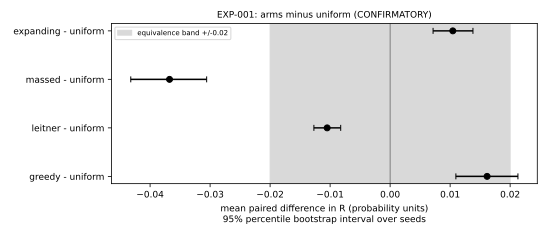
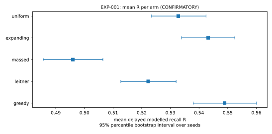
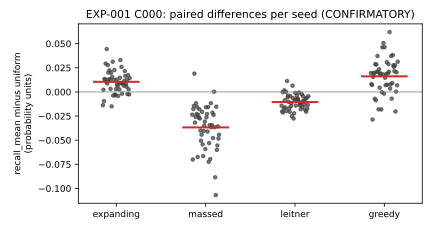

<!-- SPDX-License-Identifier: LicenseRef-MEMORY-NC-Research-1.0 -->
# EXP-001 report: schedule comparison under exponential forgetting

## 1. Identification

- **Experiment:** EXP-001. **Status:** CONFIRMATORY, complete: 250 of 250 planned runs, 0 excluded, 0 failed. **Report version:** M4 final, 2026-11-25. Written from the committed results, tables and figures only (owner, 2026-11-25, "approve all recommendations, RIGGED A", item 4; D-017); M4 evidence audit and exploratory addendum added (D-018, `research/publication/evidence_audit.md`).
- **Author:** Mohamed Bechir Kefi, independent researcher (approved authorship, C3). An AI system was used as a research and development assistant; it is not an author.
- **Protocol:** `research/experiments/EXP-001/protocol.md`, FROZEN v1.1, SHA-256 `91a79174986aa519bb1f9c1bc294c474ca441ce172076a6779826535689c496d`. Study protocol `research/protocol.md`, SHA-256 `fb9258a46b4b03fa1ffb171744ab951577bdf316c6147c93a00a3854603dff0d`. Freeze record `research/freeze.json`.
- **Configuration:** `research/experiments/EXP-001/config.json`, canonical SHA-256 `841629fa27db8c9652746f7dde5887afc8f8a6c8b538bb0234cddba3ca1818ce`, equal to the freeze record.
- **Provenance revision (the run):** `d4a793df271ec2dc1963d00715e3a6525a07863f`, clean tree. Analysis revision `3811bb93bca8798c57b80c55d97a8713732a13b8`. It differs from the run revision only in figure layout (D-016).

## 2. Executive summary

**Question.** Under exponential forgetting with multiplicative retrieval updates, at the calibrated central setting (`h0` 54 days, `σ` 0.759, `RI` 281 days, `k` 4), does a model-based greedy schedule give a different mean delayed modelled recall than equal-interval (uniform) review with the same budget?

**Method.** 50 simulated learners (seeds 1000 to 1049) and five arms, with common random numbers. Each arm is compared with `uniform` by paired differences, using a 95% percentile bootstrap interval and the frozen decision rule (study protocol section 4).

**Outcome.** Greedy minus uniform is **+0.0162** in recall probability. The 95% bootstrap CI is **[0.0110, 0.0213]**, the paired t CI is [0.0109, 0.0215], the relative change is 0.0303 and `d_z` is 0.8674. The interval lies entirely above 0. Under the frozen rule, the difference is **above zero and the directional prediction is supported**. The effect is small: the upper end of the interval only just exceeds the practical-equivalence margin of 0.02.

**Principal caveats.**

1. The greedy scheduler knows the true model (it is an oracle). EXP-002's frozen interpretation rule declares this advantage dependent on model knowledge.
2. On mastery share the sign reverses (greedy 0.0000, uniform 0.0200), so the conclusion is restricted to mean recall.
3. Neither forgetting model predicts real first-review recall better than a constant (CAL-002). Every result is a property of the assumed memory model, not of human learners.

## 3. Rationale and literature

- Tabibian et al. (2019; read in arXiv:1712.01856) derive review intensities that grow as predicted recall falls.
- Settles and Meeder (2016) describe the Pimsleur and Leitner schedules and fit the half-life model whose form the simulation uses.
- Cepeda et al. (2006) report that the optimal spacing depends on the retention interval.

The gap addressed is a controlled, budget-matched comparison of a recall-targeting scheduler against simple spacing rules. The scheduler's model advantage is made explicit and tested separately in EXP-002. The verification status of each source is in `research/literature_review.md`.

## 4. Hypotheses and operational definitions

- **Primary metric.** `R = (1/N) Σ_i m_i(T_test)`, with `m_i(t) = exp(-n_i Δ)` and `T_test = 27 + 281 = 308` days. Probability units; higher is better.
- **Hypotheses.** H0: `E[R_greedy - R_uniform] = 0`. H1 is two-sided. The directional prediction is positive.
- **Decision rule (frozen).** Applied to the 95% bootstrap interval:
  - entirely below 0: the prediction is contradicted;
  - inside `[-0.02, +0.02]`: practical equivalence;
  - containing 0 but extending beyond `±0.02`: inconclusive;
  - entirely above 0: the prediction is supported.
- **Secondary contrasts.** `expanding`, `leitner` and `massed` against `uniform`. Holm adjustment over the four contrasts applies to any statement of difference, read as a Holm-adjusted paired t p-value below 0.05 (D-015).
- **Controls.** The budget is exactly `B = 200` for every arm. Common random numbers are shared across arms. `massed` is the negative control.

## 5. Methodology

- **Model.** Study protocol section 2: `N` 50 items, `D` 28 days, `k` 4, `α` 0.4, `β` 0.6. Initial half-lives are `lognormal` with median 54.0 days and `σ` 0.759, calibrated from DS01 (CAL-001). `RI` is 281 days (rule 16.2).
- **Arms.** `uniform` (baseline), `expanding`, `massed`, `leitner` and `greedy` (oracle model). The adaptive arms use the coverage-first capacity and tie rules of amendment A2.
- **Data provenance.** No real data enters the simulation. DS01 (Duolingo traces, CC BY-NC 4.0) sets `h0` and `σ` only. The SHA-256 of the data manifest, `6d828809a1b2597fac61cd2e08d936383a7c86877242168421d7496c2602eb36`, is recorded in every run's environment.
- **Seeds:** 1000 to 1049.
- **Hardware and software:** Apple M1 Pro, macOS 15.3.1, Python 3.12.1, NumPy 2.5.4.
- **Compute budget:** cap 10 minutes; the matrix used 0.603 s.
- **Statistical plan.** Study protocol section 7, implemented in `src/memory_research/frozen_analysis.py` and committed at `6bde8ef` before any confirmatory output existed.

## 6. Implementation verification

- **Test suite.** 234 passed at `6bde8ef` (222 before the M3 additions). The M2 golden, invariant and differential tests cover probability bounds, exact budget, event ordering, monotone decay and a reference simulator.
- **METRICVAL-001 (exploratory).** 38 hand-computed checks of every section 5 metric and of the section 7 statistics; 0 failed. The oracle greedy scheduler's calibration error is exactly 0, as it must be.
- **Smoke runs and rehearsal.** SMOKE-001-M3, SMOKE-002 (v1.1 setting, N 10, seeds 1 to 5) and the rehearsal PROBE-007 (this configuration, seeds 1 to 5) completed with 0 excluded and 0 failed runs. The analysis code ran end to end on PROBE-007 before the confirmatory run.
- **Validation checks.** The section 8 checks ran on every confirmatory run; none failed.
- **Determinism.** A second execution of this configuration, to a scratch directory that was not kept, reproduced every per-run metric exactly (`progress.md`, session 5).
- **Faithfulness.** The scheduler is an oracle, so its predictions equal the true recall: calibration MAE is 0.0000.

## 7. Execution record

- **Commands.** `nice -n 10 .venv/bin/python -m memory_research run --config research/experiments/EXP-001/config.json --report --pdf`, then `.venv/bin/python scripts/analyse_confirmatory.py --exp EXP-001 --results results/confirmatory/EXP-001/results.json`.
- **Runs.** Run ids have the form `EXP-001/C000/<arm>/s<seed>`. The first run started at 2026-11-24T23:36:11.717Z and the last ended at 23:36:12.314Z (UTC). Exit status 0; all 250 runs `ok`.
- **Per-run provenance.** Id, seed, arm, config hash, status, runtime, and start and end times are in `results/confirmatory/EXP-001/run_manifest.json`.
- **Deviations from the frozen protocol.** None. The implementation readings of the analysis (D-015) were fixed before the run. After the output existed, only figure layout changed, and all analysis values are identical (D-016).

## 8. Results

Full tables are in `research/experiments/EXP-001/results_tables.md` (generated). Machine-readable results are in `results/confirmatory/EXP-001/analysis/frozen_analysis.json` and in `metrics.csv` in this folder.

| contrast vs uniform | mean diff | 95% bootstrap CI | paired t 95% CI | Holm p | rule |
|---|---|---|---|---|---|
| greedy (primary) | 0.0162 | [0.0110, 0.0213] | [0.0109, 0.0215] | 2.70e-07 | above zero |
| expanding | 0.0104 | [0.0072, 0.0138] | [0.0070, 0.0139] | 2.70e-07 | above zero |
| leitner | -0.0105 | [-0.0127, -0.0082] | [-0.0128, -0.0082] | 1.05e-11 | below zero |
| massed | -0.0368 | [-0.0432, -0.0306] | [-0.0433, -0.0302] | 1.33e-14 | below zero |

| arm | mean R | 95% bootstrap CI | mastery share | min item recall | peak daily load | sessions used |
|---|---|---|---|---|---|---|
| greedy | 0.5489 | [0.5380, 0.5601] | 0.0000 | 0.2584 | 8 | 27 |
| expanding | 0.5432 | [0.5339, 0.5525] | 0.0208 | 0.0061 | 50 | 4 |
| uniform | 0.5327 | [0.5234, 0.5424] | 0.0200 | 0.0024 | 8 | 27 |
| leitner | 0.5222 | [0.5127, 0.5320] | 0.0136 | 0.0135 | 8 | 27 |
| massed | 0.4960 | [0.4856, 0.5065] | 0.0196 | 0.0032 | 50 | 4 |

**Metric-choice sensitivity of greedy minus uniform (EXP-001 protocol section 16):**

| metric | mean diff | 95% bootstrap CI | same sign as the primary contrast |
|---|---|---|---|
| observed recall | 0.0072 | [-0.0044, 0.0184] | yes, but the interval contains 0 |
| minimum item recall | 0.2560 | [0.2291, 0.2817] | yes |
| 10th-percentile item recall | 0.2806 | [0.2625, 0.2984] | yes |
| mastery share | -0.0200 | [-0.0248, -0.0152] | no |

The conclusion is restricted to the mean.

**Achieved precision.** The SD of the paired differences, `s`, is 0.0186, below the 0.07 adequacy threshold of protocol section 6. The baseline mean (0.5327) lies inside the [0.4, 0.7] band targeted by rule 16.2.

*Figure 1.* Mean paired difference in `R` (arm minus uniform), in probability units, with 95% percentile bootstrap intervals over 50 seeds. The grey band is the practical-equivalence margin of ±0.02. Confirmatory.

*Figure 2.* Mean delayed modelled recall per arm, with 95% percentile bootstrap intervals over 50 seeds. Confirmatory.

*Figure 3.* Per-seed paired differences (dots; n = 50 per arm) and their means (red bars). Confirmatory.

## 9. Expected versus observed, and interpretation

- **Expected (stated before the run):** greedy above uniform. **Observed:** greedy is above uniform, with a small effect. The prediction is supported under the frozen rule.
- **Not predicted:** Leitner falls below uniform, and greedy lowers mastery share. Both are reported with the same weight as the primary result.
- **Pattern in the data.** Greedy lifts the weakest items (minimum item recall +0.2560) while no item reaches 0.9 (mastery share 0.0000). It equalizes recall across items rather than raising all of it.
- **Alternative explanations.**
  - `expanding` places reviews late without feedback and also beats uniform, so late placement is a competing explanation for part of the gain.
  - Oracle advantage: in EXP-002, the misspecified greedy scheduler is classified as practically equivalent to uniform under the frozen rule (a fragile classification; EXP-002 report, M4 addendum).
  - Load differences: `expanding` and `massed` use 4 sessions with a peak load of 50 reviews per session, while the other arms use 27 sessions with a peak load of 8.

### M4 addendum: competing explanations checked (SENS-001, exploratory)

Exploratory and post hoc (`results/exploratory/SENS-001/sensitivity.json`, journal SENS-001); the frozen verdict is unchanged.

- **Replication.** On independent seeds the primary contrast is 0.0167 [0.0113, 0.0218] (EXP-003 cell C044, seeds 3300 to 3349, confirmatory run) and 0.0193 [0.0147, 0.0236] (SENS-001, seeds 5000 to 5049).
- **Other retention intervals.** On the confirmatory learners, greedy minus uniform is 0.0076 [0.0060, 0.0093] at `RI` 1, 0.0189 [0.0159, 0.0221] at 7 and 0.0392 [0.0353, 0.0431] at 30 days.
- **Recency versus targeting.** Greedy, uniform and Leitner share the daily capacity, so their mean review day is the same (14.065). Greedy gives the hardest third of items 5.326 reviews and the easiest third 2.714 (uniform 4 and 4), and its mean last-review day (23.978) is slightly earlier than uniform's (24.180). The gain comes from moving reviews to hard items, not from reviewing closer to the test. This addresses the first competing explanation of protocol section 3.
- **Load.** Greedy and uniform have identical daily load (peak 8, 27 sessions), so load does not explain the primary contrast. It does confound the comparisons of expanding and massed with uniform.

## 10. Threats to validity

- **Construct.** The memory model is not supported by the real traces' first-review recall (CAL-002). `R` is a model probability, not human recall.
- **Internal.** The scheduler has oracle knowledge of the model family and the initial half-lives. Daily load differs between arm types. The order of reviews within a session is fixed.
- **External.** The result comes from one parameter setting. EXP-003 shows that the ranking changes across settings: 70 of 72 cells have at least one rank reversal.
- **Statistical.** 50 independent, paired simulated learners and a single primary test. The analysis readings of D-015 were fixed before any output.

## 11. Conclusion and next step

At the central setting, under exponential forgetting, an oracle greedy schedule yields slightly higher mean delayed modelled recall than uniform review (+0.0162, 95% CI [0.0110, 0.0213]), at the cost of mastery share. This is not evidence about human learners. M4 sets this result against EXP-002 (model dependence) and EXP-003 (setting dependence).

## 12. Reproduction appendix

See `reproduction.md` in this folder. Checksums of every output are in `results/confirmatory/EXP-001/SHA256SUMS`. The SHA-256 of the raw results is `8662acfb1b6af627c22f58cf65b1463b11f73805b59ca3c95172e79a42694f88` (schema `memory-result/1.0.0`). The generated report and PDF are in `results/confirmatory/EXP-001/report/`. References are as in `research/protocol.md`, with their verification status in `research/literature_review.md`.
