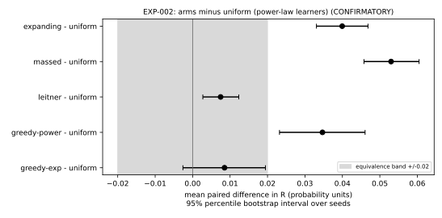
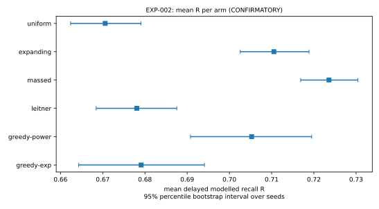
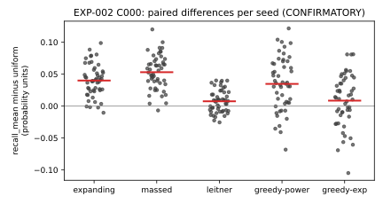

<!-- SPDX-License-Identifier: LicenseRef-MEMORY-NC-Research-1.0 -->
# EXP-002 report: oracle advantage and model misspecification under power-law forgetting

## 1. Identification

- **Experiment:** EXP-002. **Status:** CONFIRMATORY, complete: 300 of 300 planned runs, 0 excluded, 0 failed. **Report version:** M4 final, 2026-11-25 (M3 close text, with the M4 corrections and addendum marked below). Written from the committed results, tables and figures only (owner, 2026-11-25, "approve all recommendations, RIGGED A", item 4; D-017).
- **Author:** Mohamed Bechir Kefi (C3). An AI system was used as a research and development assistant; it is not an author.
- **Protocol:** `research/experiments/EXP-002/protocol.md`, FROZEN v1.1, SHA-256 `9f1e4e7c1b0275fb1d052015e13b5a88500fc3eaf5f82bebc7057e79621fbfa0`. Study protocol SHA-256 `fb9258a46b4b03fa1ffb171744ab951577bdf316c6147c93a00a3854603dff0d`.
- **Configuration:** `research/experiments/EXP-002/config.json`, canonical SHA-256 `930b73f2b673f44b4b066c3c9990c26a671dced9b8287a91bd892983d5c3c44d`, equal to the freeze record.
- **Provenance revision (the run):** `d4a793df271ec2dc1963d00715e3a6525a07863f`, clean tree. Analysis revision `3811bb93bca8798c57b80c55d97a8713732a13b8` (figure layout only, D-016).

## 2. Executive summary

**Question.** When simulated learners forget by a power law, does greedy scheduling still differ from uniform review: (a) with the true power-law model (`greedy-power`), and (b) with a misspecified exponential model (`greedy-exp`)? This is the principal invalidation test of EXP-001.

**Method.** The central setting with power-law learners (`ω` 1 per day), seeds 1000 to 1049, and six arms with common random numbers. Paired differences against `uniform`, with Holm adjustment over the two primary contrasts.

**Outcome.**
- `greedy-power` minus uniform is **+0.0347**, 95% bootstrap CI **[0.0232, 0.0461]**; H0a is rejected (Holm p 7.87e-07).
- `greedy-exp` minus uniform is **+0.0085**, 95% bootstrap CI **[-0.0026, 0.0195]**; H0b is not rejected (Holm p 0.1457), and the interval lies within ±0.02.
- **Under the frozen interpretation rule, the EXP-001 greedy advantage is declared dependent on model knowledge.**

**Principal caveats.**
- On power-law learners, the non-adaptive `massed` (+0.0530) and `expanding` (+0.0399) arms beat uniform by more than either greedy arm.
- Both greedy schedulers receive each item's true initial half-life.
- Results are conditional on the assumed memory model (CAL-002).

## 3. Rationale and literature

In EXP-001 the greedy scheduler knows the true model and its parameters, which no real scheduler does. Tabibian et al. (2019; arXiv:1712.01856) state both exponential and power-law forgetting. The power law has a heavier tail, so an exponential scheduler misjudges long-delay recall for power-law learners. This experiment removes the model advantage while keeping the budget, seeds and arms.

## 4. Hypotheses and operational definitions

- **Hypotheses.**
  - H0a: `E[R_greedy-power - R_uniform] = 0`.
  - H0b: `E[R_greedy-exp - R_uniform] = 0`.
  - Both are tested two-sided, with Holm adjustment over the two.
- **Metric.** `R` as in EXP-001, with `m_i(t) = (1 + ω Δ)^(-n_i)` and `ω` 1 per day. The initial half-life is matched to the exponential model (study protocol 2.4).
- **Interpretation rule (frozen, EXP-002 section 4).** If EXP-001 shows a positive difference, and either (H0b is not rejected and its interval lies inside ±0.02) or its interval lies entirely below 0, the EXP-001 advantage is declared dependent on model knowledge.
- **Readings fixed before data (D-015).**
  - "EXP-001 shows a positive difference" means that its primary bootstrap interval lies entirely above 0.
  - "Not rejected" means a Holm-adjusted (over the two contrasts) paired t p-value of at least 0.05.
  - The interval in the rule is the 95% bootstrap interval.
- **Secondary contrasts.** `expanding`, `massed` and `leitner` against uniform. They are descriptive; the generated table applies Holm over all five non-baseline arms.

## 5. Methodology

- **Setting.** `N` 50, `D` 28, `k` 4 (`B` 200), `RI` 281 days (test at day 308), `h0` 54.0 days, `σ` 0.759, `α` 0.4, `β` 0.6, `ω` 1.0, `lognormal` items.
- **Arms.** `uniform`, `expanding`, `massed`, `leitner`, `greedy-power` and `greedy-exp`.
  - `greedy-exp` converts each item's true initial half-life into the exponential rate `ln 2 / h_i(0)`.
  - The adaptive arms use the A2 coverage-first rules.
- **Seeds:** 1000 to 1049, the same list as EXP-001.
- **Hardware and software:** Apple M1 Pro, macOS 15.3.1, Python 3.12.1, NumPy 2.5.4.
- **Data manifest SHA-256:** `6d828809a1b2597fac61cd2e08d936383a7c86877242168421d7496c2602eb36`.
- **Compute budget:** cap 10 minutes; the matrix used 0.907 s.

## 6. Implementation verification

- **Shared checks.** The same suite (234 passed) and the same METRICVAL-001 checks (38 checks, 0 failed) as EXP-001.
- **Power-law evaluation.** Covered by the M2 golden tests and by a hand-computed power-law case in METRICVAL-001.
- **Rehearsal.** PROBE-008 (this configuration, exploratory seeds 1 to 5): 30 runs ok. The frozen analysis, including the interpretation rule, ran end to end before the confirmatory run.
- **Faithfulness.** `greedy-power` is an oracle (calibration MAE 0.0000). `greedy-exp` is misspecified, with calibration MAE 0.1804, so the misspecification is effective.

## 7. Execution record

- **Commands.** `nice -n 10 .venv/bin/python -m memory_research run --config research/experiments/EXP-002/config.json --report --pdf`, then `.venv/bin/python scripts/analyse_confirmatory.py --exp EXP-002 --results results/confirmatory/EXP-002/results.json --exp001 results/confirmatory/EXP-001/analysis/frozen_analysis.json`.
- **Runs.** The first run started at 2026-11-24T23:36:14.554Z and the last ended at 23:36:15.454Z (UTC). Exit status 0; all 300 runs `ok`. Per-run provenance is in `results/confirmatory/EXP-002/run_manifest.json`.
- **Deviations.** None from the frozen matrix. Analysis readings: D-015. Figure-layout change after output, with all values identical: D-016.
- **Owner decision (D-017).** The optional descriptive check with `ω ∈ {0.3, 3}` (EXP-002 protocol section 16) has no frozen configuration and was not run. The owner decided on 2026-11-25 ("approve all recommendations, RIGGED A", item 6): "EXP-002's optional ω check is not run, because it has no frozen config." It is recorded as not run in `research/freeze.json` (`post_freeze_record.not_run`).

## 8. Results

Full tables are in `research/experiments/EXP-002/results_tables.md` (generated). Machine-readable results are in `results/confirmatory/EXP-002/analysis/frozen_analysis.json` and `metrics.csv` in this folder.

**Primary contrasts (Holm over two):**

| contrast | mean diff | relative | 95% bootstrap CI | paired t 95% CI | s | d_z | p | Holm p | rule |
|---|---|---|---|---|---|---|---|---|---|
| greedy-power - uniform | 0.0347 | 0.0517 | [0.0232, 0.0461] | [0.0228, 0.0466] | 0.0419 | 0.8278 | 3.93e-07 | 7.87e-07 | above zero |
| greedy-exp - uniform | 0.0085 | 0.0127 | [-0.0026, 0.0195] | [-0.0031, 0.0201] | 0.0407 | 0.2091 | 0.1457 | 0.1457 | equivalent within delta |

**Interpretation rule:**

| condition | value |
|---|---|
| applicable (EXP-001 primary above zero) | yes |
| H0b rejected (Holm over two) | no |
| greedy-exp interval within ±0.02 | yes |
| greedy-exp interval entirely below 0 | no |
| **EXP-001 advantage dependent on model knowledge** | **yes** |

**All contrasts versus uniform (descriptive; Holm over five):**

| contrast | mean diff | 95% bootstrap CI | Holm p | rule |
|---|---|---|---|---|
| massed - uniform | 0.0530 | [0.0458, 0.0605] | 0 (underflow; M4 note) | above zero |
| expanding - uniform | 0.0399 | [0.0331, 0.0468] | 1.42e-14 | above zero |
| greedy-power - uniform | 0.0347 | [0.0232, 0.0461] | 1.18e-06 | above zero |
| greedy-exp - uniform | 0.0085 | [-0.0026, 0.0195] | 0.1457 | equivalent within delta |
| leitner - uniform | 0.0075 | [0.0027, 0.0123] | 0.0090 | above zero |

**Per-arm summary (50 seeds):**

| arm | mean R | 95% bootstrap CI | mastery share | min item recall | calibration MAE | peak daily load |
|---|---|---|---|---|---|---|
| massed | 0.7236 | [0.7169, 0.7304] | 0.0780 | 0.0518 | n/a | 50 |
| expanding | 0.7105 | [0.7026, 0.7189] | 0.0860 | 0.0127 | n/a | 50 |
| greedy-power | 0.7053 | [0.6908, 0.7195] | 0.0000 | 0.2490 | 0.0000 | 8 |
| greedy-exp | 0.6791 | [0.6643, 0.6941] | 0.0120 | 0.0629 | 0.1804 | 8 |
| leitner | 0.6781 | [0.6684, 0.6875] | 0.0216 | 0.0051 | n/a | 8 |
| uniform | 0.6706 | [0.6624, 0.6790] | 0.0792 | 0.0026 | n/a | 8 |

*Figure 1.* Mean paired difference in `R` (arm minus uniform) for power-law learners, in probability units, with 95% percentile bootstrap intervals over 50 seeds. The grey band is ±0.02. Confirmatory.

*Figure 2.* Mean delayed modelled recall per arm, with 95% bootstrap intervals over 50 seeds. Confirmatory.

*Figure 3.* Per-seed paired differences (n = 50 per arm) and their means (red bars). Confirmatory.

## 9. Expected versus observed, and interpretation

- **Protocol framing.** The protocol predicted no direction for H0a or H0b. It framed EXP-002 as the test that could invalidate EXP-001.
- **Observed.** With the true model, greedy beats uniform on power-law learners. With the wrong model, its advantage shrinks to a difference that the frozen rule classifies as practically equivalent to zero. The invalidation condition of the frozen rule is met: the EXP-001 greedy advantage is declared dependent on model knowledge. (M4 qualification: this is a statement about this model and setting; a misspecified scheduler keeps a small positive difference, 0.0085, and the classification is fragile, see the addendum below.)
- **Null result, stated as such.** "Equivalent within delta" is a finding of practical equivalence under the frozen rule, because the whole bootstrap interval lies inside ±0.02. It is not a reading of non-significance as equivalence. (M4 qualification: the upper bound, 0.0195, is within 0.0005 of the margin.)
- **Negative result for adaptive scheduling.** On power-law learners, the best arms are the non-adaptive late-placement schedules, `massed` and `expanding`. Even the oracle `greedy-power` does not beat them on mean `R`. In EXP-001 (exponential learners), `massed` was the worst arm. Which arm is best therefore depends on the forgetting model.
- **Alternative explanations.**
  - Daily load: `massed` and `expanding` place all reviews on 4 sessions.
  - The heavy power-law tail rewards recency.
  - Both greedy arms receive the true initial half-lives, which is a remaining information advantage.

### M4 addendum: fragility of the equivalence classification (second review pass; SENS-001, exploratory)

The frozen verdict stands. Three observations, the first from the committed confirmatory output and the others exploratory and post hoc (`results/exploratory/SENS-001/sensitivity.json`), show that its categorical label is fragile:

- **Interval method.** The paired t interval, the protocol's cross-check, is [-0.0031, 0.0201]; its upper end lies outside ±0.02, so under that interval the contrast would be "inconclusive". The bootstrap interval was the decision interval fixed before the data (D-015).
- **Independent seeds.** Re-simulated on new seeds 5000 to 5049, greedy-exp minus uniform is 0.0098 [0.0007, 0.0187], entirely above 0.
- **Other retention intervals.** On the confirmatory learners, greedy-exp minus uniform is 0.0113 [0.0008, 0.0213] at `RI` 1, 0.0213 [0.0110, 0.0313] at 7 and 0.0213 [0.0109, 0.0314] at 30 days: above 0 in every case.

The robust reading is quantitative: misspecification reduced the greedy advantage on power-law learners from 0.0347 to 0.0085 (about three quarters), leaving a small positive difference whose classification depends on the seed block and the retention interval.

## 10. Threats to validity

- **Construct.** Neither forgetting model fits real first-review recall better than a constant (CAL-002).
- **Internal.** The true initial half-lives are given to both schedulers, and daily load differs by arm type.
- **External.** `ω` is fixed at 1 per day. The `ω` robustness check was not run (owner decision, D-017), so sensitivity to `ω` is untested.
- **Statistical.** 50 paired learners, Holm over two contrasts. The achieved `s` (0.0419 and 0.0407) is below the 0.07 threshold.

## 11. Conclusion and next step

On power-law learners, an oracle greedy scheduler beats uniform review (+0.0347, CI [0.0232, 0.0461]). A greedy scheduler with a misspecified exponential model is practically equivalent to uniform (+0.0085, CI [-0.0026, 0.0195]). Under the frozen rule, the EXP-001 advantage depends on model knowledge. M4 integrates this with EXP-003 and states the conclusion conditional on the model.

## 12. Reproduction appendix

See `reproduction.md` in this folder. The SHA-256 of the raw results is `9d58dd0aabc4ba620d41574c856134b6909213d47671f0884c1dceb2cc22c78c`. Output checksums are in `results/confirmatory/EXP-002/SHA256SUMS`. The generated report and PDF are in `results/confirmatory/EXP-002/report/`.
