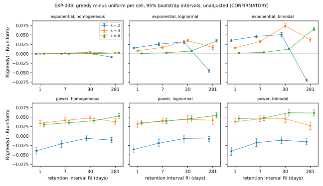
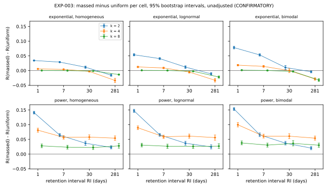
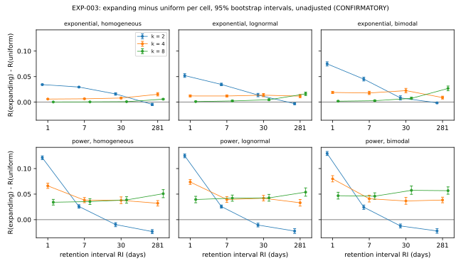
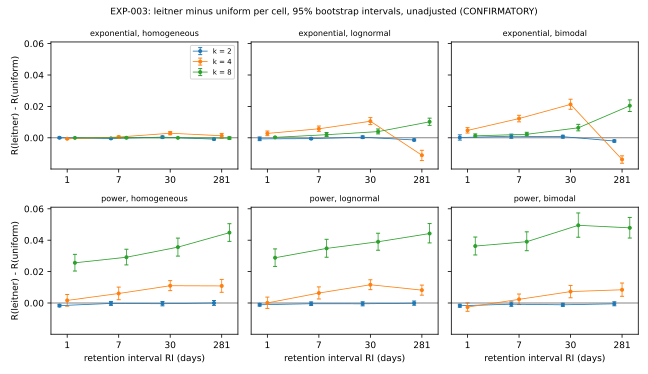
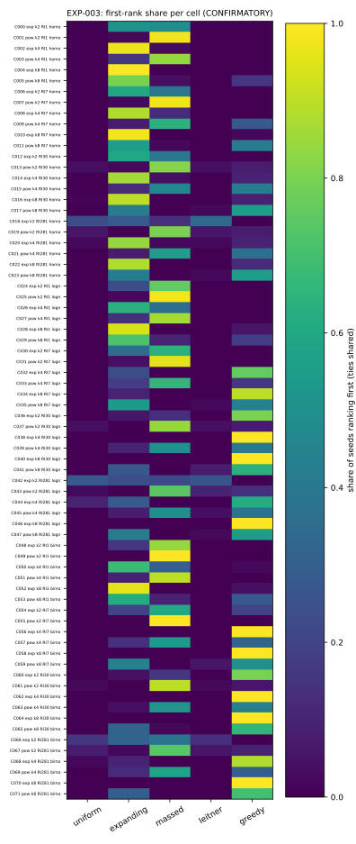
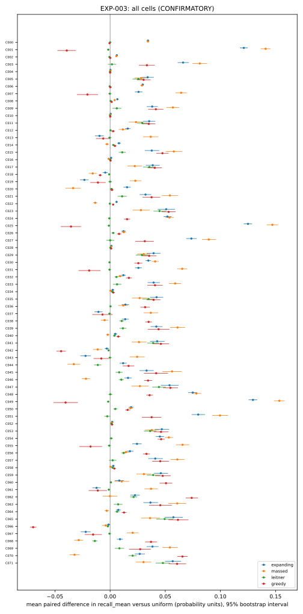

<!-- SPDX-License-Identifier: LicenseRef-MEMORY-NC-Research-1.0 -->
# EXP-003 report: robustness sweep over models, budgets, retention intervals and item distributions

## 1. Identification

- **Experiment:** EXP-003. **Status:** CONFIRMATORY run of a DESCRIPTIVE experiment (no hypothesis tests), complete: 18,000 of 18,000 planned runs, 0 excluded, 0 failed. **Report version:** M4 final, 2026-11-25 (M3 close text, with the M4 corrections and addendum marked below). Written from the committed results, tables and figures only (owner, 2026-11-25, "approve all recommendations, RIGGED A", item 4; D-017).
- **Author:** Mohamed Bechir Kefi (C3). An AI system was used as a research and development assistant; it is not an author.
- **Protocol:** `research/experiments/EXP-003/protocol.md`, FROZEN v1.1, SHA-256 `f4767c1998268d9a74272d32ec6916038acd1df92c2605e94c09bdfa771cf9a4`.
- **Configuration:** canonical SHA-256 `7c886211f6f949112a8ff1193b6d1b073f776c391df94f4d0e542e89b264b2c8`, equal to the freeze record.
- **Provenance revision (the run):** `d4a793df271ec2dc1963d00715e3a6525a07863f`, clean tree. Analysis revision `3811bb93bca8798c57b80c55d97a8713732a13b8` (figure layout only, D-016).

## 2. Executive summary

**Question.** Across forgetting models, study budgets, retention intervals and item-difficulty distributions, does the ranking of schedules by mean delayed modelled recall stay as it was at the central setting (EXP-001)?

**Method.** A full factorial design: model {exponential, power} × `k` {2, 4, 8} × `RI` {1, 7, 30, 281} × items {homogeneous, lognormal, bimodal}, giving 72 cells. Each cell has 5 arms and 50 seeds, with a disjoint seed block per `RI` level. Results are per-cell means with unadjusted 95% bootstrap intervals, first-rank shares and rank comparison with EXP-001.

**Outcome.** **The EXP-001 ranking is not stable.**

- 70 of 72 cells show at least one pairwise rank reversal against EXP-001 (greedy > expanding > uniform > leitner > massed).
- In 51 cells the top arm is not greedy. Top arm by mean `R`: massed 29 cells, greedy 21, expanding 19, uniform 3, leitner 0.
- Greedy minus uniform has the opposite sign to EXP-001 in 17 cells. Its interval lies entirely below 0 in 13 cells, all at `k = 2`, and entirely above 0 in 53.
- The pre-stated expectations hold only partly: E1 in 13 of 18 groups, E2 in 16 of 24.

**Principal caveats.** The experiment is descriptive and the intervals are unadjusted. Many exponential cells at `RI` 1 to 30 sit at the recall ceiling. Results are conditional on the assumed memory model (CAL-002).

## 3. Rationale and literature

Cepeda et al. (2006) report that the spacing that maximizes retention grows with the retention interval, so a schedule that wins at one `RI` may lose at another. Item heterogeneity limits what difficulty targeting can gain. This experiment is the protocol's sensitivity analysis for parameter range and item distribution (study protocol section 10, items 2 and 4).

## 4. Hypotheses and operational definitions

- **No hypothesis test.** Pre-stated expectations, not confirmatory:
  - E1: `massed` improves relative to `uniform` as `RI` decreases.
  - E2: the `greedy` advantage over `uniform` is smallest for `homogeneous` items.
- **Readings fixed before data (D-015).**
  - E1 holds in a (model, k, distribution) group if massed minus uniform is non-increasing in `RI`.
  - E2 holds in a (model, k, RI) group if greedy minus uniform is smallest for `homogeneous`.
  - First-rank share: exact ties share the credit equally.
  - A rank reversal is any pair of arms whose order of cell means differs from their order of EXP-001 means.
- **Metric.** `R` as in EXP-001. `greedy` is matched to the true model in every cell.

## 5. Methodology

- **Fixed parameters.** As at the central setting: `N` 50, `D` 28, `h0` 54.0 days, `σ` 0.759, `α` 0.4, `β` 0.6, `ω` 1.0. Arms: `uniform`, `expanding`, `massed`, `leitner`, `greedy`.
- **Seed blocks per `RI` level (A5 and B2).**
  - `RI` 1: seeds 3000 to 3049.
  - `RI` 7: seeds 3100 to 3149.
  - `RI` 30: seeds 3200 to 3249.
  - `RI` 281: seeds 3300 to 3349.
  - All blocks are disjoint from EXP-001 and EXP-002.
- **Hardware and software:** Apple M1 Pro, macOS 15.3.1, Python 3.12.1, NumPy 2.5.4.
- **Data manifest SHA-256:** `6d828809a1b2597fac61cd2e08d936383a7c86877242168421d7496c2602eb36`.
- **Compute budget:** cap 90 minutes; the matrix used 36.063 s.

## 6. Implementation verification

- **Shared checks.** Suite and METRICVAL-001 as for EXP-001.
- **Rehearsal.** PROBE-009 (this configuration, exploratory seed blocks 1 to 5, 101 to 105, 201 to 205 and 301 to 305): 1,800 runs ok. The frozen analysis and figures ran end to end before the confirmatory run.
- **Validation checks.** The section 8 checks ran on all 18,000 runs; none failed.

## 7. Execution record

- **Commands.** `nice -n 10 .venv/bin/python -m memory_research run --config research/experiments/EXP-003/config.json --report --pdf`, then `.venv/bin/python scripts/analyse_confirmatory.py --exp EXP-003 --results results/confirmatory/EXP-003/results.json --exp001 results/confirmatory/EXP-001/analysis/frozen_analysis.json`.
- **Runs.** The first run started at 2026-11-24T23:36:18.016Z and the last ended at 23:36:54.072Z (UTC). Exit status 0; all 18,000 runs `ok`. Per-run provenance is in `results/confirmatory/EXP-003/run_manifest.json`.
- **Storage.** The outputs total about 24 MB, above the 20 MB limit. `results.json` (15.5 MB, SHA-256 `22c56bdb9bdb06b6e438e37f2cc8c41e04bce1b613fcc66325febcb71bd78038`) is git-ignored and regenerable. The run manifest, SHA-256 manifest, generated report, analysis and tables are committed (D-016).
- **Deviations.** None from the frozen matrix. Analysis readings: D-015. Figure layout: D-016.

## 8. Results

Full per-cell tables are in `research/experiments/EXP-003/results_tables.md` (generated; per-cell means for every arm, greedy minus uniform with interval, rank order and first-rank share). Machine-readable results are in `results/confirmatory/EXP-003/analysis/frozen_analysis.json` and `metrics.csv` in this folder.

**Summary counts:**

| quantity | value |
|---|---|
| cells | 72 |
| EXP-001 rank order (reference) | greedy > expanding > uniform > leitner > massed |
| cells with at least one pairwise rank reversal vs EXP-001 | 70 |
| cells whose top arm differs from EXP-001 (greedy) | 51 |
| cells where greedy minus uniform has the opposite sign to EXP-001 | 17 |
| E1: groups where it holds | 13 of 18 |
| E2: groups where it holds | 16 of 24 |

**Cells where the arm-minus-uniform interval lies entirely above 0 or entirely below 0:**

| arm | above 0 | below 0 |
|---|---|---|
| expanding | 63 | 8 |
| greedy | 53 | 13 |
| leitner | 35 | 11 |
| massed | 54 | 14 |

**Top arm by mean R:** massed 29, greedy 21, expanding 19, uniform 3, leitner 0.

**Central cells inside the sweep (`k` 4, `RI` 281, lognormal; independent seeds 3300 to 3349):**

| cell | model | rank order | greedy - uniform | 95% bootstrap CI |
|---|---|---|---|---|
| C044 | exponential | greedy > expanding > uniform > leitner > massed | 0.0167 | [0.0113, 0.0218] |
| C045 | power | massed > greedy > expanding > leitner > uniform | 0.0417 | [0.0307, 0.0524] |

C044 reproduces the EXP-001 ordering on an independent seed block. C045 has the same ordering pattern as EXP-002, with massed first.

**Where greedy falls below uniform.** The interval lies entirely below 0 in 13 cells, all with `k = 2`:

- 10 power-law cells (M4 correction: the M3 text said 9; the frozen analysis lists C001, C007, C019, C025, C031, C043, C049, C055, C061 and C067);
- the exponential cells at `RI` 281 for all three distributions: homogeneous -0.0090 [-0.0107, -0.0074], lognormal -0.0444 [-0.0487, -0.0402] and bimodal -0.0698 [-0.0725, -0.0668].

**E1 failures.** E1 fails in 5 groups, all under the power law: `k` 4 with homogeneous and with lognormal items, and `k` 8 with homogeneous, lognormal and bimodal items. In these groups massed still beats uniform at every `RI`, but not monotonically in `RI`.

*Figure 1.* Greedy minus uniform per cell. Panels show model × item distribution; the x axis is `RI` in days; lines show budget `k`. The bars are unadjusted 95% percentile bootstrap intervals over 50 seeds. Confirmatory, descriptive.

*Figure 2.* Massed minus uniform per cell; layout as in Figure 1.

*Figure 3.* Expanding minus uniform per cell; layout as in Figure 1.

*Figure 4.* Leitner minus uniform per cell; layout as in Figure 1.

{height=20cm}

*Figure 5.* Share of the 50 seeds in which each arm has the highest `R`, per cell, with exact ties shared (ties occur in 3 cells).

{height=20cm}

*Figure 6.* Overview of all 72 cells × 4 contrasts with 95% bootstrap intervals (generated report figure).

## 9. Expected versus observed, and interpretation

- **E1.** Expected: massed improves relative to uniform as `RI` shrinks. Observed in 13 of 18 groups. The exceptions are all power-law groups.
- **E2.** Expected: the greedy advantage is smallest for homogeneous items. Observed in 16 of 24 groups.
- **Generality of EXP-001.** The protocol states that a rank reversal relative to EXP-001 in any cell limits the generality of the EXP-001 conclusion. Reversals occur in 70 of 72 cells, so **the EXP-001 conclusion does not generalize across the sweep**. The question "which schedule maximizes recall" has no single answer in this model: the answer depends on the forgetting model, the budget and the retention interval.
- **Negative result.** At the smallest budget (`k = 2`), greedy is below uniform in 13 cells. Leitner never ranks first.
- **Alternative explanations.**
  - Ceiling compression at short `RI` under exponential forgetting (flagged automatically in the generated report).
  - Daily load differences between arm types.
  - The capacity rule of the adaptive arms at small budgets.

### M4 addendum: exploratory robustness of the instability (SENS-001)

Exploratory and post hoc (`results/exploratory/SENS-001/sensitivity.json`, journal SENS-001); no frozen count changes.

- **Resolved reversals.** Counting a reversal only when the reversed pairwise difference has a 95% bootstrap interval excluding 0 still gives 70 of 72 cells.
- **Ceiling cells removed.** 16 cells (15 exponential, 1 power-law) have a uniform mean above 0.95 (a post hoc threshold). Without them, 54 of 56 cells have a resolved reversal.
- **Resolved top arm.** The top arm is separated from every other arm by such an interval in 59 of 72 cells: massed 28, greedy 15, expanding 14, uniform 2.
- **By model.** Under the power law the top arm is massed in 24 of 36 cells; under exponential forgetting greedy and expanding are top in 14 cells each.
- **E2 reading.** E2 compares signed differences. In the four groups where greedy is below uniform for every distribution (all at `k = 2`), "smallest advantage" is read as the smallest signed value; under a magnitude reading these groups could be classified differently. Disclosed, not changed (D-015 reading).
- **Mechanism at `k = 2`.** The explanation that greedy leaves easy items with a single review at the smallest budget is plausible but was measured only at the central cell (`k = 4`).

## 10. Threats to validity

- **Statistical.** 72 cells × 4 contrasts with unadjusted intervals; individual cells support no confirmatory statement. The `RI` levels are independent samples.
- **Construct and external.** The memory model is unsupported by real first-review recall (CAL-002). All parameters other than `h0` and `σ` are planning values, and `ω` is fixed (its check was not run, D-017).
- **Internal.** The ceiling regime at short `RI`, load differences, and oracle model knowledge in the greedy arm.

## 11. Conclusion and next step

The arm ranking found at the central cell is specific to that cell. Across the 72 cells, the best arm varies (massed 29, greedy 21, expanding 19, uniform 3), and greedy falls below uniform at the smallest budget. M4 states the study's answer conditional on model, budget and retention interval, and examines the ceiling cells and the load confound.

## 12. Reproduction appendix

See `reproduction.md` in this folder. The raw `results.json` is regenerated by the run command, bit-identical in metrics on the same platform. Committed checksums are in `results/confirmatory/EXP-003/SHA256SUMS`. The generated report and PDF are in `results/confirmatory/EXP-003/report/`.
