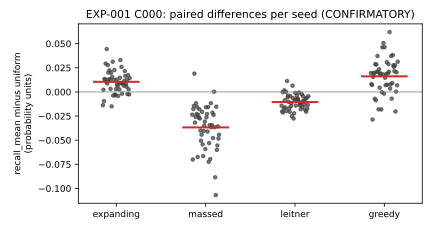

<!-- SPDX-License-Identifier: LicenseRef-MEMORY-NC-Research-1.0 -->
# EXP-001 report (generated)

**CONFIRMATORY run against a frozen protocol.**

Generated by `memory_research.report` from `results.json` (SHA-256 `8662acfb1b6af627c22f58cf65b1463b11f73805b59ca3c95172e79a42694f88`). Every number below is computed from that file; none is typed by hand. Simulated learners only; no claim about human learning.

## Provenance

- experiment: EXP-001
- kind: confirmatory
- created (UTC): 2026-11-24T23:36:12Z
- matrix config SHA-256: `841629fa27db8c9652746f7dde5887afc8f8a6c8b538bb0234cddba3ca1818ce`
- protocol: research/experiments/EXP-001/protocol.md (frozen: True)
- code revision of the run: `d4a793df271ec2dc1963d00715e3a6525a07863f` (dirty: False)
- report generator: memory_research.report 0.2.0 at `d4a793df271ec2dc1963d00715e3a6525a07863f` (dirty: False)
- python / numpy: 3.12.1 / 2.5.4
- OS: Darwin 24.3.0 (macOS-15.3.1-arm64-arm-64bit)
- CPU: Apple M1 Pro

## Runs

| runs | ok | excluded | failed |
|---|---|---|---|
| 250 | 250 | 0 | 0 |

## Runtime

| quantity | value |
|---|---|
| mean runtime per run (s) | 0.0023 |
| median runtime per run (s) | 0.0008 |
| max runtime per run (s) | 0.1861 |
| wall clock, whole matrix (s) | 0.6028 |
| process peak RSS (MiB) | 38.6875 |
| mean runtime per run, uniform (s) | 0.0017 |
| mean runtime per run, expanding (s) | 0.0015 |
| mean runtime per run, massed (s) | 0.0007 |
| mean runtime per run, leitner (s) | 0.0015 |
| mean runtime per run, greedy (s) | 0.0064 |

## Cells

| cell | factors | config SHA-256 (first 12) |
|---|---|---|
| C000 | {} | 166d257a2d5e |

## Primary metric `recall_mean` per arm

| cell | arm | n | mean | SD | median | min | max |
|---|---|---|---|---|---|---|---|
| C000 | uniform | 50 | 0.5327 | 0.0339 | 0.5313 | 0.4711 | 0.5909 |
| C000 | expanding | 50 | 0.5432 | 0.0334 | 0.5468 | 0.4682 | 0.6030 |
| C000 | massed | 50 | 0.4960 | 0.0376 | 0.4888 | 0.4029 | 0.5634 |
| C000 | leitner | 50 | 0.5222 | 0.0346 | 0.5226 | 0.4608 | 0.5816 |
| C000 | greedy | 50 | 0.5489 | 0.0399 | 0.5526 | 0.4883 | 0.6290 |

## Paired differences versus `uniform`

Mean difference over seeds, SD of the paired differences (`s`), 95% percentile bootstrap interval (10,000 resamples, seed 20261124), paired t interval, Holm-adjusted p within the cell, standardized effect `d_z`, and the projected 95% half-width with 50 seeds (`t(0.975, 49) s / sqrt(50)`). The protocol (section 6) treats 50 seeds as adequate when `s < 0.07`.

| cell | arm | pairs | mean diff | s | d_z | p (Holm) | half-width, 50 seeds |
|---|---|---|---|---|---|---|---|
| C000 | expanding | 50 | 0.0104 | 0.0120 | 0.8705 | 0.0000 | 0.0034 |
| C000 | massed | 50 | -0.0368 | 0.0231 | -1.5942 | 0.0000 | 0.0066 |
| C000 | leitner | 50 | -0.0105 | 0.0081 | -1.2945 | 0.0000 | 0.0023 |
| C000 | greedy | 50 | 0.0162 | 0.0186 | 0.8674 | 0.0000 | 0.0053 |

| cell | arm | bootstrap 95% CI | paired t 95% CI | section 4 rule |
|---|---|---|---|---|
| C000 | expanding | [0.0072, 0.0138] | [0.0070, 0.0139] | above zero |
| C000 | massed | [-0.0432, -0.0306] | [-0.0433, -0.0302] | below zero |
| C000 | leitner | [-0.0127, -0.0082] | [-0.0128, -0.0082] | below zero |
| C000 | greedy | [0.0110, 0.0213] | [0.0109, 0.0215] | above zero |

## Degenerate-case flags

None detected by the automatic checks.

## Figures

*Figure 1.* Paired difference in recall_mean (arm minus uniform) for each seed, cell C000; dots are seeds (n = 50 baseline runs), red bars are means. Confirmatory run against the frozen protocol.

## Tables

`summary.csv` (per cell and arm) and `contrasts.csv` (paired contrasts) are written next to this report.
