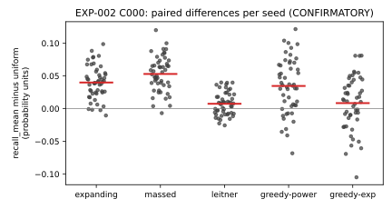

<!-- SPDX-License-Identifier: LicenseRef-MEMORY-NC-Research-1.0 -->
# EXP-002 report (generated)

**CONFIRMATORY run against a frozen protocol.**

Generated by `memory_research.report` from `results.json` (SHA-256 `9d58dd0aabc4ba620d41574c856134b6909213d47671f0884c1dceb2cc22c78c`). Every number below is computed from that file; none is typed by hand. Simulated learners only; no claim about human learning.

## Provenance

- experiment: EXP-002
- kind: confirmatory
- created (UTC): 2026-11-24T23:36:15Z
- matrix config SHA-256: `930b73f2b673f44b4b066c3c9990c26a671dced9b8287a91bd892983d5c3c44d`
- protocol: research/experiments/EXP-002/protocol.md (frozen: True)
- code revision of the run: `d4a793df271ec2dc1963d00715e3a6525a07863f` (dirty: False)
- report generator: memory_research.report 0.2.0 at `d4a793df271ec2dc1963d00715e3a6525a07863f` (dirty: False)
- python / numpy: 3.12.1 / 2.5.4
- OS: Darwin 24.3.0 (macOS-15.3.1-arm64-arm-64bit)
- CPU: Apple M1 Pro

## Runs

| runs | ok | excluded | failed |
|---|---|---|---|
| 300 | 300 | 0 | 0 |

## Runtime

| quantity | value |
|---|---|
| mean runtime per run (s) | 0.0029 |
| median runtime per run (s) | 0.0009 |
| max runtime per run (s) | 0.0613 |
| wall clock, whole matrix (s) | 0.9070 |
| process peak RSS (MiB) | 39.8750 |
| mean runtime per run, uniform (s) | 0.0032 |
| mean runtime per run, expanding (s) | 0.0005 |
| mean runtime per run, massed (s) | 0.0011 |
| mean runtime per run, leitner (s) | 0.0036 |
| mean runtime per run, greedy-power (s) | 0.0036 |
| mean runtime per run, greedy-exp (s) | 0.0051 |

## Cells

| cell | factors | config SHA-256 (first 12) |
|---|---|---|
| C000 | {} | 194f6e37f3a6 |

## Primary metric `recall_mean` per arm

| cell | arm | n | mean | SD | median | min | max |
|---|---|---|---|---|---|---|---|
| C000 | uniform | 50 | 0.6706 | 0.0306 | 0.6703 | 0.6047 | 0.7582 |
| C000 | expanding | 50 | 0.7105 | 0.0298 | 0.7119 | 0.6530 | 0.7777 |
| C000 | massed | 50 | 0.7236 | 0.0251 | 0.7244 | 0.6702 | 0.7723 |
| C000 | leitner | 50 | 0.6781 | 0.0351 | 0.6753 | 0.5982 | 0.7556 |
| C000 | greedy-power | 50 | 0.7053 | 0.0524 | 0.7156 | 0.5745 | 0.7976 |
| C000 | greedy-exp | 50 | 0.6791 | 0.0544 | 0.6841 | 0.5378 | 0.7818 |

## Paired differences versus `uniform`

Mean difference over seeds, SD of the paired differences (`s`), 95% percentile bootstrap interval (10,000 resamples, seed 20261124), paired t interval, Holm-adjusted p within the cell, standardized effect `d_z`, and the projected 95% half-width with 50 seeds (`t(0.975, 49) s / sqrt(50)`). The protocol (section 6) treats 50 seeds as adequate when `s < 0.07`.

| cell | arm | pairs | mean diff | s | d_z | p (Holm) | half-width, 50 seeds |
|---|---|---|---|---|---|---|---|
| C000 | expanding | 50 | 0.0399 | 0.0251 | 1.5909 | 0.0000 | 0.0071 |
| C000 | massed | 50 | 0.0530 | 0.0269 | 1.9689 | 0.0000 | 0.0076 |
| C000 | leitner | 50 | 0.0075 | 0.0177 | 0.4212 | 0.0090 | 0.0050 |
| C000 | greedy-power | 50 | 0.0347 | 0.0419 | 0.8278 | 0.0000 | 0.0119 |
| C000 | greedy-exp | 50 | 0.0085 | 0.0407 | 0.2091 | 0.1457 | 0.0116 |

| cell | arm | bootstrap 95% CI | paired t 95% CI | section 4 rule |
|---|---|---|---|---|
| C000 | expanding | [0.0331, 0.0468] | [0.0328, 0.0471] | above zero |
| C000 | massed | [0.0458, 0.0605] | [0.0453, 0.0606] | above zero |
| C000 | leitner | [0.0027, 0.0123] | [0.0024, 0.0125] | above zero |
| C000 | greedy-power | [0.0232, 0.0461] | [0.0228, 0.0466] | above zero |
| C000 | greedy-exp | [-0.0026, 0.0195] | [-0.0031, 0.0201] | equivalent within delta |

## Degenerate-case flags

None detected by the automatic checks.

## Figures

*Figure 1.* Paired difference in recall_mean (arm minus uniform) for each seed, cell C000; dots are seeds (n = 50 baseline runs), red bars are means. Confirmatory run against the frozen protocol.

## Tables

`summary.csv` (per cell and arm) and `contrasts.csv` (paired contrasts) are written next to this report.
