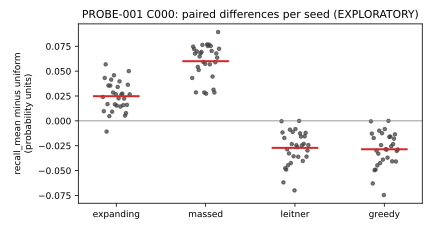

<!-- SPDX-License-Identifier: LicenseRef-MEMORY-NC-Research-1.0 -->
# PROBE-001 exploratory report (generated)

**EXPLORATORY: not a confirmatory result; protocol not frozen; never to be presented as a finding.**

Generated by `memory_research.report` from `results.json` (SHA-256 `d056641861a7e151306d3c8a97f4b0eeff9b2668c91429d8a089d0c76d566723`). Every number below is computed from that file; none is typed by hand. Simulated learners only; no claim about human learning.

## Provenance

- experiment: PROBE-001
- kind: exploratory
- created (UTC): 2026-11-24T16:05:42Z
- matrix config SHA-256: `55f58826ff0fec0ebe8d43fdade1994baadc9e5ff942c0909ae1b13e202abdeb`
- protocol: None (frozen: False)
- code revision of the run: `bad36ee04f8598005a7070f99d0ee26eda6b6d33` (dirty: False)
- report generator: memory_research.report 0.1.0 at `13bb3d9fab7a312eb6edbb7678298f038aefe05d` (dirty: False)
- python / numpy: 3.12.1 / 2.5.4
- OS: Darwin 24.3.0 (macOS-15.3.1-arm64-arm-64bit)
- CPU: Apple M1 Pro

## Runs

| runs | ok | excluded | failed |
|---|---|---|---|
| 150 | 150 | 0 | 0 |

## Runtime

| quantity | value |
|---|---|
| mean runtime per run (s) | 0.0008 |
| median runtime per run (s) | 0.0008 |
| max runtime per run (s) | 0.0049 |
| wall clock, whole matrix (s) | 0.1334 |
| process peak RSS (MiB) | 38.8906 |
| mean runtime per run, uniform (s) | 0.0010 |
| mean runtime per run, expanding (s) | 0.0003 |
| mean runtime per run, massed (s) | 0.0003 |
| mean runtime per run, leitner (s) | 0.0010 |
| mean runtime per run, greedy (s) | 0.0013 |

## Cells

| cell | factors | config SHA-256 (first 12) |
|---|---|---|
| C000 | {} | b4b5f8fe1b2d |

## Primary metric `recall_mean` per arm

| cell | arm | n | mean | SD | median | min | max |
|---|---|---|---|---|---|---|---|
| C000 | uniform | 30 | 0.0295 | 0.0180 | 0.0296 | 0.0000 | 0.0765 |
| C000 | expanding | 30 | 0.0544 | 0.0231 | 0.0538 | 0.0144 | 0.1091 |
| C000 | massed | 30 | 0.0896 | 0.0251 | 0.0869 | 0.0358 | 0.1382 |
| C000 | leitner | 30 | 0.0024 | 0.0022 | 0.0016 | 0.0000 | 0.0083 |
| C000 | greedy | 30 | 0.0010 | 0.0011 | 0.0005 | 0.0000 | 0.0038 |

## Paired differences versus `uniform`

Mean difference over seeds, SD of the paired differences (`s`), 95% percentile bootstrap interval (10,000 resamples, seed 20261124), paired t interval, Holm-adjusted p within the cell, standardized effect `d_z`, and the projected 95% half-width with 50 seeds (`t(0.975, 49) s / sqrt(50)`). The protocol (section 6) treats 50 seeds as adequate when `s < 0.07`.

| cell | arm | pairs | mean diff | s | d_z | p (Holm) | half-width, 50 seeds |
|---|---|---|---|---|---|---|---|
| C000 | expanding | 30 | 0.0248 | 0.0152 | 1.6317 | 0.0000 | 0.0043 |
| C000 | massed | 30 | 0.0600 | 0.0173 | 3.4687 | 0.0000 | 0.0049 |
| C000 | leitner | 30 | -0.0271 | 0.0170 | -1.5932 | 0.0000 | 0.0048 |
| C000 | greedy | 30 | -0.0286 | 0.0174 | -1.6371 | 0.0000 | 0.0050 |

| cell | arm | bootstrap 95% CI | paired t 95% CI | section 4 rule |
|---|---|---|---|---|
| C000 | expanding | [0.0195, 0.0302] | [0.0192, 0.0305] | above zero |
| C000 | massed | [0.0538, 0.0659] | [0.0536, 0.0665] | above zero |
| C000 | leitner | [-0.0333, -0.0213] | [-0.0335, -0.0208] | below zero |
| C000 | greedy | [-0.0349, -0.0226] | [-0.0351, -0.0220] | below zero |

The `rule` column applies the protocol's section 4 decision rule mechanically. In an exploratory run it is a planning diagnostic only and is not a test of any hypothesis.

## Degenerate-case flags

- C000 uniform: near floor (mean recall 0.0295 < 0.10)
- C000 expanding: near floor (mean recall 0.0544 < 0.10)
- C000 massed: near floor (mean recall 0.0896 < 0.10)
- C000 leitner: floor (every seed has mean recall < 0.05)
- C000 greedy: floor (every seed has mean recall < 0.05)
- C000 leitner: items never reviewed in 30/30 runs (mean 31.0 of 50 items)
- C000 greedy: items never reviewed in 30/30 runs (mean 35.7 of 50 items)

## Figures

*Figure 1.* Paired difference in recall_mean (arm minus uniform) for each seed, cell C000; dots are seeds (n = 30 baseline runs), red bars are means. Exploratory; not a finding.

## Tables

`summary.csv` (per cell and arm) and `contrasts.csv` (paired contrasts) are written next to this report.
