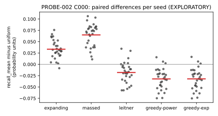

<!-- SPDX-License-Identifier: LicenseRef-MEMORY-NC-Research-1.0 -->
# PROBE-002 exploratory report (generated)

**EXPLORATORY: not a confirmatory result; protocol not frozen; never to be presented as a finding.**

Generated by `memory_research.report` from `results.json` (SHA-256 `b807448c3ab642adf39616538b39966b21fe6d086d928afaccc2879d0e6badcd`). Every number below is computed from that file; none is typed by hand. Simulated learners only; no claim about human learning.

## Provenance

- experiment: PROBE-002
- kind: exploratory
- created (UTC): 2026-11-24T16:05:44Z
- matrix config SHA-256: `2426cf8fb6373570ed61ad6e87b8d3362712902092bf33e8b95739443254ee9c`
- protocol: None (frozen: False)
- code revision of the run: `bad36ee04f8598005a7070f99d0ee26eda6b6d33` (dirty: False)
- report generator: memory_research.report 0.1.0 at `13bb3d9fab7a312eb6edbb7678298f038aefe05d` (dirty: False)
- python / numpy: 3.12.1 / 2.5.4
- OS: Darwin 24.3.0 (macOS-15.3.1-arm64-arm-64bit)
- CPU: Apple M1 Pro

## Runs

| runs | ok | excluded | failed |
|---|---|---|---|
| 180 | 180 | 0 | 0 |

## Runtime

| quantity | value |
|---|---|
| mean runtime per run (s) | 0.0032 |
| median runtime per run (s) | 0.0009 |
| max runtime per run (s) | 0.0448 |
| wall clock, whole matrix (s) | 0.6410 |
| process peak RSS (MiB) | 38.3438 |
| mean runtime per run, uniform (s) | 0.0039 |
| mean runtime per run, expanding (s) | 0.0015 |
| mean runtime per run, massed (s) | 0.0007 |
| mean runtime per run, leitner (s) | 0.0031 |
| mean runtime per run, greedy-power (s) | 0.0037 |
| mean runtime per run, greedy-exp (s) | 0.0062 |

## Cells

| cell | factors | config SHA-256 (first 12) |
|---|---|---|
| C000 | {} | 1a1dc2f49678 |

## Primary metric `recall_mean` per arm

| cell | arm | n | mean | SD | median | min | max |
|---|---|---|---|---|---|---|---|
| C000 | uniform | 30 | 0.0879 | 0.0255 | 0.0871 | 0.0254 | 0.1466 |
| C000 | expanding | 30 | 0.1213 | 0.0316 | 0.1231 | 0.0595 | 0.2064 |
| C000 | massed | 30 | 0.1528 | 0.0323 | 0.1585 | 0.0925 | 0.2161 |
| C000 | leitner | 30 | 0.0699 | 0.0148 | 0.0696 | 0.0280 | 0.0970 |
| C000 | greedy-power | 30 | 0.0558 | 0.0091 | 0.0559 | 0.0315 | 0.0725 |
| C000 | greedy-exp | 30 | 0.0559 | 0.0095 | 0.0569 | 0.0317 | 0.0779 |

## Paired differences versus `uniform`

Mean difference over seeds, SD of the paired differences (`s`), 95% percentile bootstrap interval (10,000 resamples, seed 20261124), paired t interval, Holm-adjusted p within the cell, standardized effect `d_z`, and the projected 95% half-width with 50 seeds (`t(0.975, 49) s / sqrt(50)`). The protocol (section 6) treats 50 seeds as adequate when `s < 0.07`.

| cell | arm | pairs | mean diff | s | d_z | p (Holm) | half-width, 50 seeds |
|---|---|---|---|---|---|---|---|
| C000 | expanding | 30 | 0.0334 | 0.0205 | 1.6264 | 0.0000 | 0.0058 |
| C000 | massed | 30 | 0.0649 | 0.0249 | 2.6041 | 0.0000 | 0.0071 |
| C000 | leitner | 30 | -0.0180 | 0.0232 | -0.7761 | 0.0002 | 0.0066 |
| C000 | greedy-power | 30 | -0.0321 | 0.0229 | -1.4021 | 0.0000 | 0.0065 |
| C000 | greedy-exp | 30 | -0.0321 | 0.0232 | -1.3839 | 0.0000 | 0.0066 |

| cell | arm | bootstrap 95% CI | paired t 95% CI | section 4 rule |
|---|---|---|---|---|
| C000 | expanding | [0.0263, 0.0406] | [0.0257, 0.0410] | above zero |
| C000 | massed | [0.0559, 0.0734] | [0.0556, 0.0742] | above zero |
| C000 | leitner | [-0.0260, -0.0098] | [-0.0267, -0.0094] | below zero |
| C000 | greedy-power | [-0.0402, -0.0241] | [-0.0407, -0.0236] | below zero |
| C000 | greedy-exp | [-0.0402, -0.0239] | [-0.0407, -0.0234] | below zero |

The `rule` column applies the protocol's section 4 decision rule mechanically. In an exploratory run it is a planning diagnostic only and is not a test of any hypothesis.

## Degenerate-case flags

- C000 uniform: near floor (mean recall 0.0879 < 0.10)
- C000 leitner: near floor (mean recall 0.0699 < 0.10)
- C000 greedy-power: near floor (mean recall 0.0558 < 0.10)
- C000 greedy-exp: near floor (mean recall 0.0559 < 0.10)
- C000 leitner: items never reviewed in 30/30 runs (mean 29.7 of 50 items)
- C000 greedy-power: items never reviewed in 30/30 runs (mean 38.5 of 50 items)
- C000 greedy-exp: items never reviewed in 30/30 runs (mean 34.0 of 50 items)

## Figures

*Figure 1.* Paired difference in recall_mean (arm minus uniform) for each seed, cell C000; dots are seeds (n = 30 baseline runs), red bars are means. Exploratory; not a finding.

## Tables

`summary.csv` (per cell and arm) and `contrasts.csv` (paired contrasts) are written next to this report.
