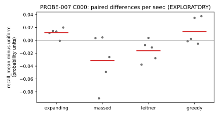

<!-- SPDX-License-Identifier: LicenseRef-MEMORY-NC-Research-1.0 -->
# PROBE-007 exploratory report (generated)

**EXPLORATORY: not a confirmatory result; protocol not frozen; never to be presented as a finding.**

Generated by `memory_research.report` from `results.json` (SHA-256 `5fb261b6c53745c148d08660ab286b638f4361eac89125641f9890107f2be09f`). Every number below is computed from that file; none is typed by hand. Simulated learners only; no claim about human learning.

## Provenance

- experiment: PROBE-007
- kind: exploratory
- created (UTC): 2026-11-24T23:35:37Z
- matrix config SHA-256: `f748632c9516e3bc913ac4c77a1f80788ac2db8a634e4237894a7c0fe845fd8a`
- protocol: None (frozen: False)
- code revision of the run: `d4a793df271ec2dc1963d00715e3a6525a07863f` (dirty: False)
- report generator: memory_research.report 0.2.0 at `d4a793df271ec2dc1963d00715e3a6525a07863f` (dirty: False)
- python / numpy: 3.12.1 / 2.5.4
- OS: Darwin 24.3.0 (macOS-15.3.1-arm64-arm-64bit)
- CPU: Apple M1 Pro

## Runs

| runs | ok | excluded | failed |
|---|---|---|---|
| 25 | 25 | 0 | 0 |

## Runtime

| quantity | value |
|---|---|
| mean runtime per run (s) | 0.0010 |
| median runtime per run (s) | 0.0008 |
| max runtime per run (s) | 0.0057 |
| wall clock, whole matrix (s) | 0.0322 |
| process peak RSS (MiB) | 38.6250 |
| mean runtime per run, uniform (s) | 0.0018 |
| mean runtime per run, expanding (s) | 0.0003 |
| mean runtime per run, massed (s) | 0.0003 |
| mean runtime per run, leitner (s) | 0.0009 |
| mean runtime per run, greedy (s) | 0.0016 |

## Cells

| cell | factors | config SHA-256 (first 12) |
|---|---|---|
| C000 | {} | 166d257a2d5e |

## Primary metric `recall_mean` per arm

| cell | arm | n | mean | SD | median | min | max |
|---|---|---|---|---|---|---|---|
| C000 | uniform | 5 | 0.5477 | 0.0400 | 0.5411 | 0.4945 | 0.6052 |
| C000 | expanding | 5 | 0.5595 | 0.0417 | 0.5588 | 0.5059 | 0.6189 |
| C000 | massed | 5 | 0.5162 | 0.0546 | 0.4980 | 0.4687 | 0.6096 |
| C000 | leitner | 5 | 0.5317 | 0.0557 | 0.5299 | 0.4568 | 0.6089 |
| C000 | greedy | 5 | 0.5613 | 0.0542 | 0.5612 | 0.4930 | 0.6401 |

## Paired differences versus `uniform`

Mean difference over seeds, SD of the paired differences (`s`), 95% percentile bootstrap interval (10,000 resamples, seed 20261124), paired t interval, Holm-adjusted p within the cell, standardized effect `d_z`, and the projected 95% half-width with 50 seeds (`t(0.975, 49) s / sqrt(50)`). The protocol (section 6) treats 50 seeds as adequate when `s < 0.07`.

| cell | arm | pairs | mean diff | s | d_z | p (Holm) | half-width, 50 seeds |
|---|---|---|---|---|---|---|---|
| C000 | expanding | 5 | 0.0118 | 0.0077 | 1.5424 | 0.1043 | 0.0022 |
| C000 | massed | 5 | -0.0315 | 0.0397 | -0.7928 | 0.3019 | 0.0113 |
| C000 | leitner | 5 | -0.0160 | 0.0166 | -0.9667 | 0.2901 | 0.0047 |
| C000 | greedy | 5 | 0.0136 | 0.0208 | 0.6535 | 0.3019 | 0.0059 |

| cell | arm | bootstrap 95% CI | paired t 95% CI | section 4 rule |
|---|---|---|---|---|
| C000 | expanding | [0.0053, 0.0172] | [0.0023, 0.0214] | above zero |
| C000 | massed | [-0.0632, -0.0020] | [-0.0808, 0.0178] | below zero |
| C000 | leitner | [-0.0296, -0.0036] | [-0.0366, 0.0046] | below zero |
| C000 | greedy | [-0.0022, 0.0295] | [-0.0123, 0.0395] | inconclusive |

The `rule` column applies the protocol's section 4 decision rule mechanically. In an exploratory run it is a planning diagnostic only and is not a test of any hypothesis.

## Degenerate-case flags

None detected by the automatic checks.

## Figures

*Figure 1.* Paired difference in recall_mean (arm minus uniform) for each seed, cell C000; dots are seeds (n = 5 baseline runs), red bars are means. Exploratory; not a finding.

## Tables

`summary.csv` (per cell and arm) and `contrasts.csv` (paired contrasts) are written next to this report.
