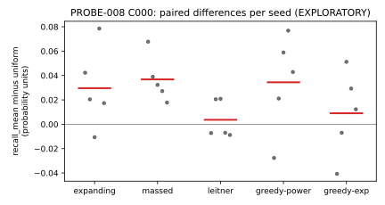

<!-- SPDX-License-Identifier: LicenseRef-MEMORY-NC-Research-1.0 -->
# PROBE-008 exploratory report (generated)

**EXPLORATORY: not a confirmatory result; protocol not frozen; never to be presented as a finding.**

Generated by `memory_research.report` from `results.json` (SHA-256 `6f73c2be86c8f4ee1d33158c623050b07b238325316dd0a124e1f60ea6861835`). Every number below is computed from that file; none is typed by hand. Simulated learners only; no claim about human learning.

## Provenance

- experiment: PROBE-008
- kind: exploratory
- created (UTC): 2026-11-24T23:35:38Z
- matrix config SHA-256: `a0dcfc0b9336ab9016ef1fe913d22493103b5e883376be4c94d53eaee2d54d8f`
- protocol: None (frozen: False)
- code revision of the run: `d4a793df271ec2dc1963d00715e3a6525a07863f` (dirty: False)
- report generator: memory_research.report 0.2.0 at `d4a793df271ec2dc1963d00715e3a6525a07863f` (dirty: False)
- python / numpy: 3.12.1 / 2.5.4
- OS: Darwin 24.3.0 (macOS-15.3.1-arm64-arm-64bit)
- CPU: Apple M1 Pro

## Runs

| runs | ok | excluded | failed |
|---|---|---|---|
| 30 | 30 | 0 | 0 |

## Runtime

| quantity | value |
|---|---|
| mean runtime per run (s) | 0.0028 |
| median runtime per run (s) | 0.0010 |
| max runtime per run (s) | 0.0417 |
| wall clock, whole matrix (s) | 0.0932 |
| process peak RSS (MiB) | 37.6406 |
| mean runtime per run, uniform (s) | 0.0093 |
| mean runtime per run, expanding (s) | 0.0014 |
| mean runtime per run, massed (s) | 0.0003 |
| mean runtime per run, leitner (s) | 0.0010 |
| mean runtime per run, greedy-power (s) | 0.0030 |
| mean runtime per run, greedy-exp (s) | 0.0019 |

## Cells

| cell | factors | config SHA-256 (first 12) |
|---|---|---|
| C000 | {} | 194f6e37f3a6 |

## Primary metric `recall_mean` per arm

| cell | arm | n | mean | SD | median | min | max |
|---|---|---|---|---|---|---|---|
| C000 | uniform | 5 | 0.6798 | 0.0342 | 0.6699 | 0.6437 | 0.7315 |
| C000 | expanding | 5 | 0.7094 | 0.0225 | 0.7146 | 0.6860 | 0.7381 |
| C000 | massed | 5 | 0.7166 | 0.0326 | 0.7115 | 0.6868 | 0.7638 |
| C000 | leitner | 5 | 0.6834 | 0.0484 | 0.6611 | 0.6365 | 0.7523 |
| C000 | greedy-power | 5 | 0.7142 | 0.0631 | 0.7153 | 0.6160 | 0.7904 |
| C000 | greedy-exp | 5 | 0.6888 | 0.0637 | 0.6872 | 0.6030 | 0.7827 |

## Paired differences versus `uniform`

Mean difference over seeds, SD of the paired differences (`s`), 95% percentile bootstrap interval (10,000 resamples, seed 20261124), paired t interval, Holm-adjusted p within the cell, standardized effect `d_z`, and the projected 95% half-width with 50 seeds (`t(0.975, 49) s / sqrt(50)`). The protocol (section 6) treats 50 seeds as adequate when `s < 0.07`.

| cell | arm | pairs | mean diff | s | d_z | p (Holm) | half-width, 50 seeds |
|---|---|---|---|---|---|---|---|
| C000 | expanding | 5 | 0.0296 | 0.0332 | 0.8908 | 0.4687 | 0.0094 |
| C000 | massed | 5 | 0.0368 | 0.0190 | 1.9424 | 0.0611 | 0.0054 |
| C000 | leitner | 5 | 0.0037 | 0.0156 | 0.2350 | 1.0000 | 0.0044 |
| C000 | greedy-power | 5 | 0.0344 | 0.0403 | 0.8535 | 0.4687 | 0.0115 |
| C000 | greedy-exp | 5 | 0.0090 | 0.0351 | 0.2565 | 1.0000 | 0.0100 |

| cell | arm | bootstrap 95% CI | paired t 95% CI | section 4 rule |
|---|---|---|---|---|
| C000 | expanding | [0.0055, 0.0553] | [-0.0116, 0.0708] | above zero |
| C000 | massed | [0.0239, 0.0536] | [0.0133, 0.0603] | above zero |
| C000 | leitner | [-0.0078, 0.0152] | [-0.0157, 0.0230] | equivalent within delta |
| C000 | greedy-power | [0.0005, 0.0629] | [-0.0156, 0.0845] | above zero |
| C000 | greedy-exp | [-0.0200, 0.0352] | [-0.0346, 0.0526] | inconclusive |

The `rule` column applies the protocol's section 4 decision rule mechanically. In an exploratory run it is a planning diagnostic only and is not a test of any hypothesis.

## Degenerate-case flags

None detected by the automatic checks.

## Figures

*Figure 1.* Paired difference in recall_mean (arm minus uniform) for each seed, cell C000; dots are seeds (n = 5 baseline runs), red bars are means. Exploratory; not a finding.

## Tables

`summary.csv` (per cell and arm) and `contrasts.csv` (paired contrasts) are written next to this report.
