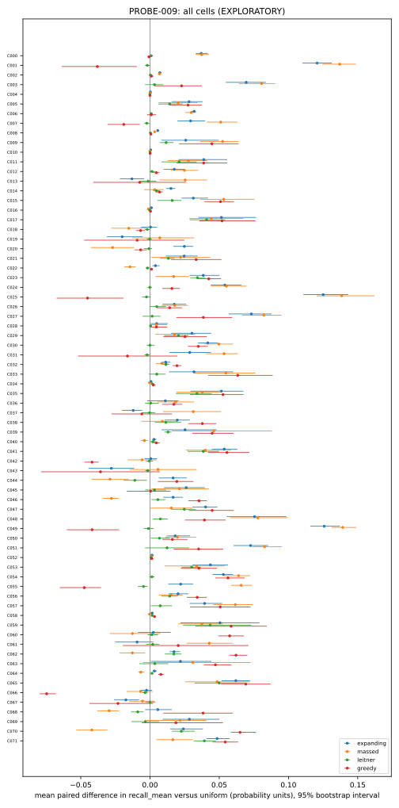

<!-- SPDX-License-Identifier: LicenseRef-MEMORY-NC-Research-1.0 -->
# PROBE-009 exploratory report (generated)

**EXPLORATORY: not a confirmatory result; protocol not frozen; never to be presented as a finding.**

Generated by `memory_research.report` from `results.json` (SHA-256 `e69309b313c3157a3cb98f04f686730e360bdbb29f14728d9b57cf02f04c47ad`). Every number below is computed from that file; none is typed by hand. Simulated learners only; no claim about human learning.

## Provenance

- experiment: PROBE-009
- kind: exploratory
- created (UTC): 2026-11-24T23:35:45Z
- matrix config SHA-256: `6696ffae8e79f15acf0f6bcbd4839693efbce1e86220b2f88337d26d59fc102d`
- protocol: None (frozen: False)
- code revision of the run: `d4a793df271ec2dc1963d00715e3a6525a07863f` (dirty: False)
- report generator: memory_research.report 0.2.0 at `d4a793df271ec2dc1963d00715e3a6525a07863f` (dirty: False)
- python / numpy: 3.12.1 / 2.5.4
- OS: Darwin 24.3.0 (macOS-15.3.1-arm64-arm-64bit)
- CPU: Apple M1 Pro

## Runs

| runs | ok | excluded | failed |
|---|---|---|---|
| 1800 | 1800 | 0 | 0 |

## Runtime

| quantity | value |
|---|---|
| mean runtime per run (s) | 0.0026 |
| median runtime per run (s) | 0.0009 |
| max runtime per run (s) | 0.1256 |
| wall clock, whole matrix (s) | 4.8342 |
| process peak RSS (MiB) | 42.2969 |
| mean runtime per run, uniform (s) | 0.0035 |
| mean runtime per run, expanding (s) | 0.0009 |
| mean runtime per run, massed (s) | 0.0010 |
| mean runtime per run, leitner (s) | 0.0027 |
| mean runtime per run, greedy (s) | 0.0048 |

## Cells

| cell | factors | config SHA-256 (first 12) |
|---|---|---|
| C000 | {"item_distribution": "homogeneous", "retention_interval_days": 1, "reviews_per_item": 2, "true_model": "exponential"} | 7d457e8cca0b |
| C001 | {"item_distribution": "homogeneous", "retention_interval_days": 1, "reviews_per_item": 2, "true_model": "power"} | ae0ce655d0c8 |
| C002 | {"item_distribution": "homogeneous", "retention_interval_days": 1, "reviews_per_item": 4, "true_model": "exponential"} | 760d9d9f1bdb |
| C003 | {"item_distribution": "homogeneous", "retention_interval_days": 1, "reviews_per_item": 4, "true_model": "power"} | 058f0ec1378d |
| C004 | {"item_distribution": "homogeneous", "retention_interval_days": 1, "reviews_per_item": 8, "true_model": "exponential"} | f0a807d97317 |
| C005 | {"item_distribution": "homogeneous", "retention_interval_days": 1, "reviews_per_item": 8, "true_model": "power"} | 0ae20659a7d0 |
| C006 | {"item_distribution": "homogeneous", "retention_interval_days": 7, "reviews_per_item": 2, "true_model": "exponential"} | 35057524cba1 |
| C007 | {"item_distribution": "homogeneous", "retention_interval_days": 7, "reviews_per_item": 2, "true_model": "power"} | 9bbaf373f0f5 |
| C008 | {"item_distribution": "homogeneous", "retention_interval_days": 7, "reviews_per_item": 4, "true_model": "exponential"} | 0728c3c6809d |
| C009 | {"item_distribution": "homogeneous", "retention_interval_days": 7, "reviews_per_item": 4, "true_model": "power"} | 1bb0b127552d |
| C010 | {"item_distribution": "homogeneous", "retention_interval_days": 7, "reviews_per_item": 8, "true_model": "exponential"} | 2932f4e13207 |
| C011 | {"item_distribution": "homogeneous", "retention_interval_days": 7, "reviews_per_item": 8, "true_model": "power"} | d69af194845f |
| C012 | {"item_distribution": "homogeneous", "retention_interval_days": 30, "reviews_per_item": 2, "true_model": "exponential"} | 581f4935c4d3 |
| C013 | {"item_distribution": "homogeneous", "retention_interval_days": 30, "reviews_per_item": 2, "true_model": "power"} | f20102875c70 |
| C014 | {"item_distribution": "homogeneous", "retention_interval_days": 30, "reviews_per_item": 4, "true_model": "exponential"} | 44a5da2d6c24 |
| C015 | {"item_distribution": "homogeneous", "retention_interval_days": 30, "reviews_per_item": 4, "true_model": "power"} | 903a8a34d587 |
| C016 | {"item_distribution": "homogeneous", "retention_interval_days": 30, "reviews_per_item": 8, "true_model": "exponential"} | 24400e3a529b |
| C017 | {"item_distribution": "homogeneous", "retention_interval_days": 30, "reviews_per_item": 8, "true_model": "power"} | 417a62816427 |
| C018 | {"item_distribution": "homogeneous", "retention_interval_days": 281, "reviews_per_item": 2, "true_model": "exponential"} | 603a283ebd55 |
| C019 | {"item_distribution": "homogeneous", "retention_interval_days": 281, "reviews_per_item": 2, "true_model": "power"} | cd8fca44bfff |
| C020 | {"item_distribution": "homogeneous", "retention_interval_days": 281, "reviews_per_item": 4, "true_model": "exponential"} | dc848d3cacb5 |
| C021 | {"item_distribution": "homogeneous", "retention_interval_days": 281, "reviews_per_item": 4, "true_model": "power"} | 3616beef3dd0 |
| C022 | {"item_distribution": "homogeneous", "retention_interval_days": 281, "reviews_per_item": 8, "true_model": "exponential"} | 09ac8fb9d4ad |
| C023 | {"item_distribution": "homogeneous", "retention_interval_days": 281, "reviews_per_item": 8, "true_model": "power"} | 658932de5fe4 |
| C024 | {"item_distribution": "lognormal", "retention_interval_days": 1, "reviews_per_item": 2, "true_model": "exponential"} | f5fe83a2fab6 |
| C025 | {"item_distribution": "lognormal", "retention_interval_days": 1, "reviews_per_item": 2, "true_model": "power"} | 6542bab40394 |
| C026 | {"item_distribution": "lognormal", "retention_interval_days": 1, "reviews_per_item": 4, "true_model": "exponential"} | d1d6c9900f2f |
| C027 | {"item_distribution": "lognormal", "retention_interval_days": 1, "reviews_per_item": 4, "true_model": "power"} | 6d3df0b31972 |
| C028 | {"item_distribution": "lognormal", "retention_interval_days": 1, "reviews_per_item": 8, "true_model": "exponential"} | 6cd8cb69df09 |
| C029 | {"item_distribution": "lognormal", "retention_interval_days": 1, "reviews_per_item": 8, "true_model": "power"} | 0148fa3bef4a |
| C030 | {"item_distribution": "lognormal", "retention_interval_days": 7, "reviews_per_item": 2, "true_model": "exponential"} | 33e4f42b9f56 |
| C031 | {"item_distribution": "lognormal", "retention_interval_days": 7, "reviews_per_item": 2, "true_model": "power"} | 59b11eb8a58c |
| C032 | {"item_distribution": "lognormal", "retention_interval_days": 7, "reviews_per_item": 4, "true_model": "exponential"} | f72d50d56e9c |
| C033 | {"item_distribution": "lognormal", "retention_interval_days": 7, "reviews_per_item": 4, "true_model": "power"} | f759b6c195e4 |
| C034 | {"item_distribution": "lognormal", "retention_interval_days": 7, "reviews_per_item": 8, "true_model": "exponential"} | 0985473ad649 |
| C035 | {"item_distribution": "lognormal", "retention_interval_days": 7, "reviews_per_item": 8, "true_model": "power"} | b7b4b978f1fb |
| C036 | {"item_distribution": "lognormal", "retention_interval_days": 30, "reviews_per_item": 2, "true_model": "exponential"} | 63d5f7ee8af8 |
| C037 | {"item_distribution": "lognormal", "retention_interval_days": 30, "reviews_per_item": 2, "true_model": "power"} | f7f2276697ab |
| C038 | {"item_distribution": "lognormal", "retention_interval_days": 30, "reviews_per_item": 4, "true_model": "exponential"} | 266b7ef2dfe8 |
| C039 | {"item_distribution": "lognormal", "retention_interval_days": 30, "reviews_per_item": 4, "true_model": "power"} | d615a146e00f |
| C040 | {"item_distribution": "lognormal", "retention_interval_days": 30, "reviews_per_item": 8, "true_model": "exponential"} | d02c8f3bcc0d |
| C041 | {"item_distribution": "lognormal", "retention_interval_days": 30, "reviews_per_item": 8, "true_model": "power"} | 4d663fa68cbf |
| C042 | {"item_distribution": "lognormal", "retention_interval_days": 281, "reviews_per_item": 2, "true_model": "exponential"} | c24a7ef3f22d |
| C043 | {"item_distribution": "lognormal", "retention_interval_days": 281, "reviews_per_item": 2, "true_model": "power"} | a196c47c2d38 |
| C044 | {"item_distribution": "lognormal", "retention_interval_days": 281, "reviews_per_item": 4, "true_model": "exponential"} | 166d257a2d5e |
| C045 | {"item_distribution": "lognormal", "retention_interval_days": 281, "reviews_per_item": 4, "true_model": "power"} | 194f6e37f3a6 |
| C046 | {"item_distribution": "lognormal", "retention_interval_days": 281, "reviews_per_item": 8, "true_model": "exponential"} | dc15a5fb9d35 |
| C047 | {"item_distribution": "lognormal", "retention_interval_days": 281, "reviews_per_item": 8, "true_model": "power"} | ddeb697d797d |
| C048 | {"item_distribution": "bimodal", "retention_interval_days": 1, "reviews_per_item": 2, "true_model": "exponential"} | 99e5d3023c0c |
| C049 | {"item_distribution": "bimodal", "retention_interval_days": 1, "reviews_per_item": 2, "true_model": "power"} | 5846412a4280 |
| C050 | {"item_distribution": "bimodal", "retention_interval_days": 1, "reviews_per_item": 4, "true_model": "exponential"} | 194cbab13941 |
| C051 | {"item_distribution": "bimodal", "retention_interval_days": 1, "reviews_per_item": 4, "true_model": "power"} | f2dc35add9d3 |
| C052 | {"item_distribution": "bimodal", "retention_interval_days": 1, "reviews_per_item": 8, "true_model": "exponential"} | a401a46a976f |
| C053 | {"item_distribution": "bimodal", "retention_interval_days": 1, "reviews_per_item": 8, "true_model": "power"} | c73011b9f040 |
| C054 | {"item_distribution": "bimodal", "retention_interval_days": 7, "reviews_per_item": 2, "true_model": "exponential"} | 9daa000f8a2a |
| C055 | {"item_distribution": "bimodal", "retention_interval_days": 7, "reviews_per_item": 2, "true_model": "power"} | 90d0be3adf60 |
| C056 | {"item_distribution": "bimodal", "retention_interval_days": 7, "reviews_per_item": 4, "true_model": "exponential"} | 84e3cd2fa78b |
| C057 | {"item_distribution": "bimodal", "retention_interval_days": 7, "reviews_per_item": 4, "true_model": "power"} | 22d20bcdd11c |
| C058 | {"item_distribution": "bimodal", "retention_interval_days": 7, "reviews_per_item": 8, "true_model": "exponential"} | 8259bf175856 |
| C059 | {"item_distribution": "bimodal", "retention_interval_days": 7, "reviews_per_item": 8, "true_model": "power"} | 15cd0aad5db9 |
| C060 | {"item_distribution": "bimodal", "retention_interval_days": 30, "reviews_per_item": 2, "true_model": "exponential"} | 8278c9590b6f |
| C061 | {"item_distribution": "bimodal", "retention_interval_days": 30, "reviews_per_item": 2, "true_model": "power"} | 226f46ec5d6a |
| C062 | {"item_distribution": "bimodal", "retention_interval_days": 30, "reviews_per_item": 4, "true_model": "exponential"} | 6c5385c55307 |
| C063 | {"item_distribution": "bimodal", "retention_interval_days": 30, "reviews_per_item": 4, "true_model": "power"} | f801da65f39e |
| C064 | {"item_distribution": "bimodal", "retention_interval_days": 30, "reviews_per_item": 8, "true_model": "exponential"} | 11180a0c786c |
| C065 | {"item_distribution": "bimodal", "retention_interval_days": 30, "reviews_per_item": 8, "true_model": "power"} | a166aca1ebf2 |
| C066 | {"item_distribution": "bimodal", "retention_interval_days": 281, "reviews_per_item": 2, "true_model": "exponential"} | fdd578abda2b |
| C067 | {"item_distribution": "bimodal", "retention_interval_days": 281, "reviews_per_item": 2, "true_model": "power"} | 4ff75dd8d4aa |
| C068 | {"item_distribution": "bimodal", "retention_interval_days": 281, "reviews_per_item": 4, "true_model": "exponential"} | cead468c371f |
| C069 | {"item_distribution": "bimodal", "retention_interval_days": 281, "reviews_per_item": 4, "true_model": "power"} | dc4191291559 |
| C070 | {"item_distribution": "bimodal", "retention_interval_days": 281, "reviews_per_item": 8, "true_model": "exponential"} | 4cf1396e04fb |
| C071 | {"item_distribution": "bimodal", "retention_interval_days": 281, "reviews_per_item": 8, "true_model": "power"} | 533727e07149 |

## Primary metric `recall_mean` per arm

| cell | arm | n | mean | SD | median | min | max |
|---|---|---|---|---|---|---|---|
| C000 | uniform | 5 | 0.9560 | 0.0058 | 0.9592 | 0.9472 | 0.9611 |
| C000 | expanding | 5 | 0.9930 | 0.0004 | 0.9929 | 0.9924 | 0.9936 |
| C000 | massed | 5 | 0.9933 | 0.0006 | 0.9933 | 0.9926 | 0.9942 |
| C000 | leitner | 5 | 0.9569 | 0.0053 | 0.9593 | 0.9479 | 0.9607 |
| C000 | greedy | 5 | 0.9553 | 0.0048 | 0.9570 | 0.9489 | 0.9595 |
| C001 | uniform | 5 | 0.7779 | 0.0198 | 0.7797 | 0.7601 | 0.8088 |
| C001 | expanding | 5 | 0.8986 | 0.0106 | 0.8952 | 0.8881 | 0.9161 |
| C001 | massed | 5 | 0.9148 | 0.0073 | 0.9161 | 0.9050 | 0.9245 |
| C001 | leitner | 5 | 0.7759 | 0.0191 | 0.7752 | 0.7576 | 0.8065 |
| C001 | greedy | 5 | 0.7399 | 0.0438 | 0.7308 | 0.6809 | 0.7952 |
| C002 | uniform | 5 | 0.9907 | 0.0016 | 0.9918 | 0.9882 | 0.9919 |
| C002 | expanding | 5 | 0.9978 | 0.0004 | 0.9978 | 0.9975 | 0.9983 |
| C002 | massed | 5 | 0.9976 | 0.0003 | 0.9976 | 0.9974 | 0.9980 |
| C002 | leitner | 5 | 0.9910 | 0.0009 | 0.9911 | 0.9896 | 0.9920 |
| C002 | greedy | 5 | 0.9918 | 0.0005 | 0.9918 | 0.9909 | 0.9923 |
| C003 | uniform | 5 | 0.8707 | 0.0246 | 0.8610 | 0.8453 | 0.9098 |
| C003 | expanding | 5 | 0.9402 | 0.0094 | 0.9380 | 0.9314 | 0.9522 |
| C003 | massed | 5 | 0.9513 | 0.0094 | 0.9508 | 0.9379 | 0.9616 |
| C003 | leitner | 5 | 0.8740 | 0.0303 | 0.8675 | 0.8445 | 0.9176 |
| C003 | greedy | 5 | 0.8936 | 0.0403 | 0.9027 | 0.8300 | 0.9351 |
| C004 | uniform | 5 | 0.9995 | 0.0000 | 0.9995 | 0.9994 | 0.9995 |
| C004 | expanding | 5 | 0.9998 | 0.0000 | 0.9998 | 0.9998 | 0.9998 |
| C004 | massed | 5 | 0.9997 | 0.0000 | 0.9997 | 0.9997 | 0.9997 |
| C004 | leitner | 5 | 0.9994 | 0.0000 | 0.9994 | 0.9994 | 0.9994 |
| C004 | greedy | 5 | 0.9995 | 0.0000 | 0.9995 | 0.9994 | 0.9995 |
| C005 | uniform | 5 | 0.9656 | 0.0152 | 0.9629 | 0.9510 | 0.9914 |
| C005 | expanding | 5 | 0.9938 | 0.0023 | 0.9940 | 0.9907 | 0.9969 |
| C005 | massed | 5 | 0.9859 | 0.0137 | 0.9925 | 0.9617 | 0.9937 |
| C005 | leitner | 5 | 0.9797 | 0.0121 | 0.9718 | 0.9704 | 0.9931 |
| C005 | greedy | 5 | 0.9930 | 0.0008 | 0.9931 | 0.9922 | 0.9941 |
| C006 | uniform | 5 | 0.9223 | 0.0025 | 0.9221 | 0.9187 | 0.9247 |
| C006 | expanding | 5 | 0.9541 | 0.0037 | 0.9531 | 0.9505 | 0.9580 |
| C006 | massed | 5 | 0.9522 | 0.0039 | 0.9529 | 0.9460 | 0.9560 |
| C006 | leitner | 5 | 0.9232 | 0.0022 | 0.9237 | 0.9206 | 0.9260 |
| C006 | greedy | 5 | 0.9232 | 0.0026 | 0.9244 | 0.9204 | 0.9256 |
| C007 | uniform | 5 | 0.7288 | 0.0222 | 0.7264 | 0.7060 | 0.7595 |
| C007 | expanding | 5 | 0.7581 | 0.0259 | 0.7561 | 0.7279 | 0.7992 |
| C007 | massed | 5 | 0.7798 | 0.0171 | 0.7809 | 0.7533 | 0.8007 |
| C007 | leitner | 5 | 0.7265 | 0.0203 | 0.7259 | 0.7061 | 0.7546 |
| C007 | greedy | 5 | 0.7099 | 0.0290 | 0.6977 | 0.6878 | 0.7588 |
| C008 | uniform | 5 | 0.9793 | 0.0012 | 0.9794 | 0.9776 | 0.9805 |
| C008 | expanding | 5 | 0.9849 | 0.0012 | 0.9854 | 0.9834 | 0.9861 |
| C008 | massed | 5 | 0.9826 | 0.0015 | 0.9831 | 0.9800 | 0.9839 |
| C008 | leitner | 5 | 0.9795 | 0.0011 | 0.9794 | 0.9783 | 0.9808 |
| C008 | greedy | 5 | 0.9800 | 0.0007 | 0.9803 | 0.9790 | 0.9806 |
| C009 | uniform | 5 | 0.8379 | 0.0280 | 0.8393 | 0.8025 | 0.8794 |
| C009 | expanding | 5 | 0.8637 | 0.0225 | 0.8694 | 0.8389 | 0.8934 |
| C009 | massed | 5 | 0.8903 | 0.0113 | 0.8942 | 0.8719 | 0.9018 |
| C009 | leitner | 5 | 0.8495 | 0.0336 | 0.8490 | 0.8083 | 0.9008 |
| C009 | greedy | 5 | 0.8826 | 0.0219 | 0.8811 | 0.8493 | 0.9082 |
| C010 | uniform | 5 | 0.9979 | 0.0002 | 0.9979 | 0.9976 | 0.9980 |
| C010 | expanding | 5 | 0.9984 | 0.0001 | 0.9983 | 0.9983 | 0.9985 |
| C010 | massed | 5 | 0.9979 | 0.0002 | 0.9979 | 0.9976 | 0.9980 |
| C010 | leitner | 5 | 0.9979 | 0.0000 | 0.9979 | 0.9978 | 0.9979 |
| C010 | greedy | 5 | 0.9980 | 0.0000 | 0.9980 | 0.9979 | 0.9980 |
| C011 | uniform | 5 | 0.9479 | 0.0233 | 0.9388 | 0.9285 | 0.9833 |
| C011 | expanding | 5 | 0.9867 | 0.0026 | 0.9864 | 0.9840 | 0.9901 |
| C011 | massed | 5 | 0.9756 | 0.0080 | 0.9732 | 0.9654 | 0.9859 |
| C011 | leitner | 5 | 0.9689 | 0.0101 | 0.9646 | 0.9636 | 0.9869 |
| C011 | greedy | 5 | 0.9866 | 0.0009 | 0.9871 | 0.9852 | 0.9873 |
| C012 | uniform | 5 | 0.7999 | 0.0115 | 0.7996 | 0.7868 | 0.8148 |
| C012 | expanding | 5 | 0.8174 | 0.0163 | 0.8147 | 0.7965 | 0.8355 |
| C012 | massed | 5 | 0.8247 | 0.0090 | 0.8274 | 0.8139 | 0.8346 |
| C012 | leitner | 5 | 0.8013 | 0.0133 | 0.7992 | 0.7872 | 0.8165 |
| C012 | greedy | 5 | 0.8045 | 0.0091 | 0.8068 | 0.7923 | 0.8148 |
| C013 | uniform | 5 | 0.6502 | 0.0238 | 0.6537 | 0.6111 | 0.6727 |
| C013 | expanding | 5 | 0.6372 | 0.0292 | 0.6385 | 0.5942 | 0.6760 |
| C013 | massed | 5 | 0.6756 | 0.0184 | 0.6871 | 0.6545 | 0.6919 |
| C013 | leitner | 5 | 0.6488 | 0.0211 | 0.6455 | 0.6181 | 0.6702 |
| C013 | greedy | 5 | 0.6427 | 0.0589 | 0.6578 | 0.5545 | 0.6981 |
| C014 | uniform | 5 | 0.9288 | 0.0077 | 0.9296 | 0.9195 | 0.9388 |
| C014 | expanding | 5 | 0.9439 | 0.0049 | 0.9452 | 0.9357 | 0.9483 |
| C014 | massed | 5 | 0.9322 | 0.0059 | 0.9346 | 0.9231 | 0.9377 |
| C014 | leitner | 5 | 0.9336 | 0.0059 | 0.9345 | 0.9270 | 0.9394 |
| C014 | greedy | 5 | 0.9357 | 0.0046 | 0.9361 | 0.9296 | 0.9401 |
| C015 | uniform | 5 | 0.7802 | 0.0312 | 0.7945 | 0.7245 | 0.7969 |
| C015 | expanding | 5 | 0.8115 | 0.0301 | 0.8165 | 0.7620 | 0.8439 |
| C015 | massed | 5 | 0.8334 | 0.0112 | 0.8367 | 0.8211 | 0.8486 |
| C015 | leitner | 5 | 0.7962 | 0.0430 | 0.8128 | 0.7195 | 0.8187 |
| C015 | greedy | 5 | 0.8311 | 0.0316 | 0.8437 | 0.7798 | 0.8584 |
| C016 | uniform | 5 | 0.9923 | 0.0010 | 0.9926 | 0.9908 | 0.9933 |
| C016 | expanding | 5 | 0.9933 | 0.0004 | 0.9936 | 0.9929 | 0.9936 |
| C016 | massed | 5 | 0.9912 | 0.0009 | 0.9914 | 0.9899 | 0.9923 |
| C016 | leitner | 5 | 0.9921 | 0.0006 | 0.9922 | 0.9915 | 0.9927 |
| C016 | greedy | 5 | 0.9927 | 0.0006 | 0.9928 | 0.9921 | 0.9933 |
| C017 | uniform | 5 | 0.9246 | 0.0266 | 0.9332 | 0.8780 | 0.9420 |
| C017 | expanding | 5 | 0.9762 | 0.0083 | 0.9769 | 0.9634 | 0.9854 |
| C017 | massed | 5 | 0.9688 | 0.0096 | 0.9728 | 0.9528 | 0.9772 |
| C017 | leitner | 5 | 0.9655 | 0.0163 | 0.9631 | 0.9434 | 0.9827 |
| C017 | greedy | 5 | 0.9766 | 0.0108 | 0.9808 | 0.9582 | 0.9857 |
| C018 | uniform | 5 | 0.2225 | 0.0102 | 0.2226 | 0.2126 | 0.2369 |
| C018 | expanding | 5 | 0.2229 | 0.0147 | 0.2282 | 0.1998 | 0.2385 |
| C018 | massed | 5 | 0.2072 | 0.0159 | 0.2101 | 0.1860 | 0.2295 |
| C018 | leitner | 5 | 0.2205 | 0.0114 | 0.2228 | 0.2081 | 0.2370 |
| C018 | greedy | 5 | 0.2157 | 0.0134 | 0.2163 | 0.2005 | 0.2315 |
| C019 | uniform | 5 | 0.5346 | 0.0207 | 0.5283 | 0.5096 | 0.5658 |
| C019 | expanding | 5 | 0.5145 | 0.0287 | 0.5170 | 0.4796 | 0.5482 |
| C019 | massed | 5 | 0.5417 | 0.0299 | 0.5479 | 0.5105 | 0.5852 |
| C019 | leitner | 5 | 0.5343 | 0.0191 | 0.5288 | 0.5103 | 0.5616 |
| C019 | greedy | 5 | 0.5253 | 0.0352 | 0.5335 | 0.4670 | 0.5616 |
| C020 | uniform | 5 | 0.5611 | 0.0194 | 0.5643 | 0.5304 | 0.5829 |
| C020 | expanding | 5 | 0.5859 | 0.0152 | 0.5859 | 0.5656 | 0.6062 |
| C020 | massed | 5 | 0.5341 | 0.0165 | 0.5266 | 0.5181 | 0.5605 |
| C020 | leitner | 5 | 0.5603 | 0.0202 | 0.5639 | 0.5313 | 0.5843 |
| C020 | greedy | 5 | 0.5544 | 0.0216 | 0.5580 | 0.5254 | 0.5845 |
| C021 | uniform | 5 | 0.7292 | 0.0241 | 0.7364 | 0.6927 | 0.7559 |
| C021 | expanding | 5 | 0.7539 | 0.0163 | 0.7544 | 0.7309 | 0.7715 |
| C021 | massed | 5 | 0.7513 | 0.0224 | 0.7482 | 0.7251 | 0.7869 |
| C021 | leitner | 5 | 0.7425 | 0.0208 | 0.7522 | 0.7084 | 0.7586 |
| C021 | greedy | 5 | 0.7625 | 0.0324 | 0.7589 | 0.7270 | 0.8152 |
| C022 | uniform | 5 | 0.9333 | 0.0048 | 0.9337 | 0.9261 | 0.9392 |
| C022 | expanding | 5 | 0.9372 | 0.0020 | 0.9358 | 0.9358 | 0.9394 |
| C022 | massed | 5 | 0.9188 | 0.0028 | 0.9187 | 0.9155 | 0.9231 |
| C022 | leitner | 5 | 0.9314 | 0.0031 | 0.9317 | 0.9273 | 0.9352 |
| C022 | greedy | 5 | 0.9343 | 0.0040 | 0.9338 | 0.9292 | 0.9395 |
| C023 | uniform | 5 | 0.9247 | 0.0103 | 0.9274 | 0.9087 | 0.9334 |
| C023 | expanding | 5 | 0.9631 | 0.0082 | 0.9671 | 0.9530 | 0.9702 |
| C023 | massed | 5 | 0.9417 | 0.0179 | 0.9402 | 0.9158 | 0.9630 |
| C023 | leitner | 5 | 0.9589 | 0.0107 | 0.9590 | 0.9422 | 0.9716 |
| C023 | greedy | 5 | 0.9671 | 0.0053 | 0.9662 | 0.9614 | 0.9744 |
| C024 | uniform | 5 | 0.9331 | 0.0171 | 0.9322 | 0.9074 | 0.9512 |
| C024 | expanding | 5 | 0.9872 | 0.0035 | 0.9882 | 0.9827 | 0.9905 |
| C024 | massed | 5 | 0.9883 | 0.0042 | 0.9889 | 0.9818 | 0.9931 |
| C024 | leitner | 5 | 0.9330 | 0.0167 | 0.9344 | 0.9066 | 0.9508 |
| C024 | greedy | 5 | 0.9489 | 0.0124 | 0.9530 | 0.9293 | 0.9622 |
| C025 | uniform | 5 | 0.7670 | 0.0322 | 0.7687 | 0.7274 | 0.8150 |
| C025 | expanding | 5 | 0.8921 | 0.0141 | 0.8868 | 0.8819 | 0.9168 |
| C025 | massed | 5 | 0.9055 | 0.0122 | 0.9025 | 0.8941 | 0.9255 |
| C025 | leitner | 5 | 0.7645 | 0.0313 | 0.7642 | 0.7248 | 0.8117 |
| C025 | greedy | 5 | 0.7220 | 0.0597 | 0.7038 | 0.6613 | 0.8166 |
| C026 | uniform | 5 | 0.9773 | 0.0123 | 0.9763 | 0.9629 | 0.9902 |
| C026 | expanding | 5 | 0.9949 | 0.0024 | 0.9961 | 0.9913 | 0.9970 |
| C026 | massed | 5 | 0.9952 | 0.0022 | 0.9961 | 0.9916 | 0.9970 |
| C026 | leitner | 5 | 0.9822 | 0.0118 | 0.9849 | 0.9619 | 0.9919 |
| C026 | greedy | 5 | 0.9915 | 0.0014 | 0.9918 | 0.9896 | 0.9934 |
| C027 | uniform | 5 | 0.8622 | 0.0312 | 0.8480 | 0.8307 | 0.9066 |
| C027 | expanding | 5 | 0.9353 | 0.0167 | 0.9445 | 0.9162 | 0.9514 |
| C027 | massed | 5 | 0.9443 | 0.0174 | 0.9469 | 0.9198 | 0.9622 |
| C027 | leitner | 5 | 0.8637 | 0.0365 | 0.8388 | 0.8370 | 0.9162 |
| C027 | greedy | 5 | 0.9007 | 0.0397 | 0.9112 | 0.8333 | 0.9378 |
| C028 | uniform | 5 | 0.9948 | 0.0087 | 0.9991 | 0.9795 | 0.9994 |
| C028 | expanding | 5 | 0.9997 | 0.0000 | 0.9997 | 0.9997 | 0.9997 |
| C028 | massed | 5 | 0.9993 | 0.0005 | 0.9995 | 0.9985 | 0.9996 |
| C028 | leitner | 5 | 0.9952 | 0.0090 | 0.9992 | 0.9790 | 0.9994 |
| C028 | greedy | 5 | 0.9994 | 0.0001 | 0.9994 | 0.9994 | 0.9996 |
| C029 | uniform | 5 | 0.9593 | 0.0215 | 0.9497 | 0.9405 | 0.9926 |
| C029 | expanding | 5 | 0.9895 | 0.0068 | 0.9912 | 0.9786 | 0.9971 |
| C029 | massed | 5 | 0.9770 | 0.0225 | 0.9864 | 0.9393 | 0.9946 |
| C029 | leitner | 5 | 0.9798 | 0.0119 | 0.9717 | 0.9707 | 0.9936 |
| C029 | greedy | 5 | 0.9846 | 0.0190 | 0.9924 | 0.9505 | 0.9945 |
| C030 | uniform | 5 | 0.8755 | 0.0189 | 0.8714 | 0.8560 | 0.9049 |
| C030 | expanding | 5 | 0.9173 | 0.0142 | 0.9174 | 0.8976 | 0.9374 |
| C030 | massed | 5 | 0.9253 | 0.0117 | 0.9319 | 0.9105 | 0.9370 |
| C030 | leitner | 5 | 0.8755 | 0.0183 | 0.8708 | 0.8549 | 0.9045 |
| C030 | greedy | 5 | 0.9104 | 0.0117 | 0.9095 | 0.8949 | 0.9271 |
| C031 | uniform | 5 | 0.7118 | 0.0158 | 0.7051 | 0.6945 | 0.7342 |
| C031 | expanding | 5 | 0.7405 | 0.0275 | 0.7276 | 0.7192 | 0.7840 |
| C031 | massed | 5 | 0.7653 | 0.0197 | 0.7626 | 0.7474 | 0.7959 |
| C031 | leitner | 5 | 0.7098 | 0.0135 | 0.7037 | 0.6951 | 0.7294 |
| C031 | greedy | 5 | 0.6955 | 0.0556 | 0.6963 | 0.6397 | 0.7843 |
| C032 | uniform | 5 | 0.9586 | 0.0062 | 0.9613 | 0.9487 | 0.9638 |
| C032 | expanding | 5 | 0.9700 | 0.0090 | 0.9720 | 0.9564 | 0.9791 |
| C032 | massed | 5 | 0.9672 | 0.0077 | 0.9668 | 0.9583 | 0.9755 |
| C032 | leitner | 5 | 0.9701 | 0.0039 | 0.9704 | 0.9638 | 0.9745 |
| C032 | greedy | 5 | 0.9781 | 0.0037 | 0.9787 | 0.9717 | 0.9815 |
| C033 | uniform | 5 | 0.8212 | 0.0388 | 0.8152 | 0.7721 | 0.8803 |
| C033 | expanding | 5 | 0.8529 | 0.0238 | 0.8434 | 0.8290 | 0.8915 |
| C033 | massed | 5 | 0.8759 | 0.0142 | 0.8722 | 0.8607 | 0.8966 |
| C033 | leitner | 5 | 0.8261 | 0.0433 | 0.8201 | 0.7762 | 0.8956 |
| C033 | greedy | 5 | 0.8845 | 0.0144 | 0.8801 | 0.8737 | 0.9096 |
| C034 | uniform | 5 | 0.9954 | 0.0017 | 0.9959 | 0.9925 | 0.9967 |
| C034 | expanding | 5 | 0.9962 | 0.0027 | 0.9975 | 0.9915 | 0.9979 |
| C034 | massed | 5 | 0.9950 | 0.0019 | 0.9955 | 0.9920 | 0.9968 |
| C034 | leitner | 5 | 0.9971 | 0.0004 | 0.9973 | 0.9963 | 0.9973 |
| C034 | greedy | 5 | 0.9979 | 0.0003 | 0.9980 | 0.9974 | 0.9981 |
| C035 | uniform | 5 | 0.9338 | 0.0273 | 0.9246 | 0.9170 | 0.9820 |
| C035 | expanding | 5 | 0.9853 | 0.0045 | 0.9869 | 0.9787 | 0.9905 |
| C035 | massed | 5 | 0.9715 | 0.0099 | 0.9701 | 0.9574 | 0.9833 |
| C035 | leitner | 5 | 0.9677 | 0.0104 | 0.9636 | 0.9622 | 0.9864 |
| C035 | greedy | 5 | 0.9865 | 0.0007 | 0.9865 | 0.9854 | 0.9874 |
| C036 | uniform | 5 | 0.7512 | 0.0243 | 0.7464 | 0.7263 | 0.7865 |
| C036 | expanding | 5 | 0.7623 | 0.0235 | 0.7518 | 0.7509 | 0.8043 |
| C036 | massed | 5 | 0.7697 | 0.0344 | 0.7666 | 0.7359 | 0.8201 |
| C036 | leitner | 5 | 0.7517 | 0.0205 | 0.7458 | 0.7304 | 0.7810 |
| C036 | greedy | 5 | 0.7684 | 0.0242 | 0.7639 | 0.7430 | 0.8081 |
| C037 | uniform | 5 | 0.6350 | 0.0288 | 0.6319 | 0.6021 | 0.6784 |
| C037 | expanding | 5 | 0.6229 | 0.0328 | 0.6178 | 0.5917 | 0.6770 |
| C037 | massed | 5 | 0.6663 | 0.0209 | 0.6638 | 0.6389 | 0.6927 |
| C037 | leitner | 5 | 0.6347 | 0.0297 | 0.6222 | 0.6029 | 0.6786 |
| C037 | greedy | 5 | 0.6291 | 0.0438 | 0.6256 | 0.5707 | 0.6787 |
| C038 | uniform | 5 | 0.8925 | 0.0171 | 0.8966 | 0.8708 | 0.9116 |
| C038 | expanding | 5 | 0.9122 | 0.0068 | 0.9126 | 0.9022 | 0.9187 |
| C038 | massed | 5 | 0.9015 | 0.0178 | 0.9039 | 0.8832 | 0.9280 |
| C038 | leitner | 5 | 0.9040 | 0.0111 | 0.9042 | 0.8885 | 0.9199 |
| C038 | greedy | 5 | 0.9303 | 0.0060 | 0.9316 | 0.9228 | 0.9369 |
| C039 | uniform | 5 | 0.7823 | 0.0423 | 0.7972 | 0.7072 | 0.8075 |
| C039 | expanding | 5 | 0.8076 | 0.0200 | 0.8150 | 0.7758 | 0.8259 |
| C039 | massed | 5 | 0.8284 | 0.0102 | 0.8301 | 0.8113 | 0.8387 |
| C039 | leitner | 5 | 0.7953 | 0.0421 | 0.8131 | 0.7203 | 0.8191 |
| C039 | greedy | 5 | 0.8272 | 0.0284 | 0.8328 | 0.7803 | 0.8537 |
| C040 | uniform | 5 | 0.9875 | 0.0028 | 0.9892 | 0.9833 | 0.9898 |
| C040 | expanding | 5 | 0.9905 | 0.0012 | 0.9902 | 0.9890 | 0.9921 |
| C040 | massed | 5 | 0.9834 | 0.0059 | 0.9833 | 0.9741 | 0.9900 |
| C040 | leitner | 5 | 0.9896 | 0.0009 | 0.9899 | 0.9884 | 0.9904 |
| C040 | greedy | 5 | 0.9921 | 0.0002 | 0.9922 | 0.9918 | 0.9922 |
| C041 | uniform | 5 | 0.9207 | 0.0174 | 0.9216 | 0.8929 | 0.9384 |
| C041 | expanding | 5 | 0.9743 | 0.0102 | 0.9798 | 0.9632 | 0.9834 |
| C041 | massed | 5 | 0.9606 | 0.0108 | 0.9573 | 0.9504 | 0.9738 |
| C041 | leitner | 5 | 0.9591 | 0.0248 | 0.9614 | 0.9184 | 0.9793 |
| C041 | greedy | 5 | 0.9762 | 0.0103 | 0.9795 | 0.9581 | 0.9839 |
| C042 | uniform | 5 | 0.2630 | 0.0198 | 0.2697 | 0.2391 | 0.2830 |
| C042 | expanding | 5 | 0.2636 | 0.0239 | 0.2749 | 0.2331 | 0.2896 |
| C042 | massed | 5 | 0.2573 | 0.0135 | 0.2593 | 0.2344 | 0.2697 |
| C042 | leitner | 5 | 0.2626 | 0.0181 | 0.2660 | 0.2392 | 0.2832 |
| C042 | greedy | 5 | 0.2212 | 0.0248 | 0.2348 | 0.1928 | 0.2414 |
| C043 | uniform | 5 | 0.5199 | 0.0271 | 0.5365 | 0.4844 | 0.5418 |
| C043 | expanding | 5 | 0.4920 | 0.0170 | 0.4912 | 0.4735 | 0.5185 |
| C043 | massed | 5 | 0.5257 | 0.0196 | 0.5264 | 0.4989 | 0.5532 |
| C043 | leitner | 5 | 0.5182 | 0.0252 | 0.5356 | 0.4855 | 0.5373 |
| C043 | greedy | 5 | 0.4842 | 0.0338 | 0.4980 | 0.4311 | 0.5186 |
| C044 | uniform | 5 | 0.5294 | 0.0222 | 0.5405 | 0.5010 | 0.5522 |
| C044 | expanding | 5 | 0.5461 | 0.0265 | 0.5487 | 0.5024 | 0.5716 |
| C044 | massed | 5 | 0.5005 | 0.0170 | 0.4958 | 0.4874 | 0.5287 |
| C044 | leitner | 5 | 0.5184 | 0.0253 | 0.5237 | 0.4774 | 0.5398 |
| C044 | greedy | 5 | 0.5487 | 0.0341 | 0.5537 | 0.4952 | 0.5873 |
| C045 | uniform | 5 | 0.7165 | 0.0205 | 0.7100 | 0.6993 | 0.7510 |
| C045 | expanding | 5 | 0.7427 | 0.0183 | 0.7454 | 0.7168 | 0.7662 |
| C045 | massed | 5 | 0.7377 | 0.0157 | 0.7314 | 0.7223 | 0.7631 |
| C045 | leitner | 5 | 0.7198 | 0.0205 | 0.7194 | 0.7013 | 0.7522 |
| C045 | greedy | 5 | 0.7169 | 0.0374 | 0.7153 | 0.6683 | 0.7695 |
| C046 | uniform | 5 | 0.8960 | 0.0089 | 0.8954 | 0.8828 | 0.9061 |
| C046 | expanding | 5 | 0.9127 | 0.0132 | 0.9138 | 0.8908 | 0.9243 |
| C046 | massed | 5 | 0.8681 | 0.0134 | 0.8708 | 0.8526 | 0.8813 |
| C046 | leitner | 5 | 0.9017 | 0.0102 | 0.9045 | 0.8857 | 0.9105 |
| C046 | greedy | 5 | 0.9314 | 0.0063 | 0.9340 | 0.9220 | 0.9380 |
| C047 | uniform | 5 | 0.9192 | 0.0142 | 0.9224 | 0.8965 | 0.9342 |
| C047 | expanding | 5 | 0.9593 | 0.0093 | 0.9573 | 0.9461 | 0.9694 |
| C047 | massed | 5 | 0.9346 | 0.0192 | 0.9290 | 0.9165 | 0.9616 |
| C047 | leitner | 5 | 0.9439 | 0.0133 | 0.9461 | 0.9221 | 0.9563 |
| C047 | greedy | 5 | 0.9641 | 0.0094 | 0.9669 | 0.9489 | 0.9741 |
| C048 | uniform | 5 | 0.9074 | 0.0312 | 0.9081 | 0.8611 | 0.9475 |
| C048 | expanding | 5 | 0.9829 | 0.0044 | 0.9835 | 0.9774 | 0.9881 |
| C048 | massed | 5 | 0.9853 | 0.0052 | 0.9865 | 0.9768 | 0.9896 |
| C048 | leitner | 5 | 0.9150 | 0.0250 | 0.9209 | 0.8765 | 0.9446 |
| C048 | greedy | 5 | 0.9467 | 0.0128 | 0.9489 | 0.9271 | 0.9621 |
| C049 | uniform | 5 | 0.7636 | 0.0218 | 0.7648 | 0.7301 | 0.7878 |
| C049 | expanding | 5 | 0.8893 | 0.0110 | 0.8909 | 0.8765 | 0.9005 |
| C049 | massed | 5 | 0.9027 | 0.0121 | 0.9042 | 0.8861 | 0.9173 |
| C049 | leitner | 5 | 0.7624 | 0.0186 | 0.7611 | 0.7349 | 0.7846 |
| C049 | greedy | 5 | 0.7217 | 0.0389 | 0.7258 | 0.6629 | 0.7720 |
| C050 | uniform | 5 | 0.9745 | 0.0163 | 0.9813 | 0.9462 | 0.9864 |
| C050 | expanding | 5 | 0.9927 | 0.0048 | 0.9947 | 0.9855 | 0.9977 |
| C050 | massed | 5 | 0.9943 | 0.0019 | 0.9943 | 0.9916 | 0.9962 |
| C050 | leitner | 5 | 0.9813 | 0.0081 | 0.9848 | 0.9672 | 0.9874 |
| C050 | greedy | 5 | 0.9906 | 0.0042 | 0.9919 | 0.9834 | 0.9942 |
| C051 | uniform | 5 | 0.8608 | 0.0260 | 0.8674 | 0.8209 | 0.8891 |
| C051 | expanding | 5 | 0.9335 | 0.0116 | 0.9335 | 0.9152 | 0.9443 |
| C051 | massed | 5 | 0.9436 | 0.0128 | 0.9435 | 0.9268 | 0.9578 |
| C051 | leitner | 5 | 0.8731 | 0.0113 | 0.8775 | 0.8544 | 0.8840 |
| C051 | greedy | 5 | 0.8959 | 0.0320 | 0.8948 | 0.8461 | 0.9328 |
| C052 | uniform | 5 | 0.9982 | 0.0016 | 0.9988 | 0.9954 | 0.9995 |
| C052 | expanding | 5 | 0.9996 | 0.0001 | 0.9996 | 0.9995 | 0.9997 |
| C052 | massed | 5 | 0.9993 | 0.0003 | 0.9993 | 0.9989 | 0.9995 |
| C052 | leitner | 5 | 0.9990 | 0.0003 | 0.9991 | 0.9985 | 0.9992 |
| C052 | greedy | 5 | 0.9995 | 0.0002 | 0.9995 | 0.9992 | 0.9996 |
| C053 | uniform | 5 | 0.9450 | 0.0242 | 0.9427 | 0.9097 | 0.9768 |
| C053 | expanding | 5 | 0.9886 | 0.0107 | 0.9953 | 0.9724 | 0.9964 |
| C053 | massed | 5 | 0.9787 | 0.0123 | 0.9742 | 0.9646 | 0.9916 |
| C053 | leitner | 5 | 0.9751 | 0.0183 | 0.9716 | 0.9487 | 0.9930 |
| C053 | greedy | 5 | 0.9803 | 0.0197 | 0.9927 | 0.9487 | 0.9937 |
| C054 | uniform | 5 | 0.8177 | 0.0186 | 0.8116 | 0.8013 | 0.8495 |
| C054 | expanding | 5 | 0.8706 | 0.0106 | 0.8688 | 0.8604 | 0.8878 |
| C054 | massed | 5 | 0.8816 | 0.0096 | 0.8837 | 0.8718 | 0.8932 |
| C054 | leitner | 5 | 0.8190 | 0.0167 | 0.8133 | 0.8063 | 0.8482 |
| C054 | greedy | 5 | 0.8740 | 0.0155 | 0.8669 | 0.8585 | 0.8979 |
| C055 | uniform | 5 | 0.6777 | 0.0186 | 0.6752 | 0.6526 | 0.7015 |
| C055 | expanding | 5 | 0.6998 | 0.0186 | 0.6914 | 0.6803 | 0.7228 |
| C055 | massed | 5 | 0.7435 | 0.0183 | 0.7334 | 0.7273 | 0.7653 |
| C055 | leitner | 5 | 0.6730 | 0.0167 | 0.6710 | 0.6476 | 0.6892 |
| C055 | greedy | 5 | 0.6303 | 0.0261 | 0.6391 | 0.5923 | 0.6554 |
| C056 | uniform | 5 | 0.9367 | 0.0082 | 0.9345 | 0.9266 | 0.9480 |
| C056 | expanding | 5 | 0.9569 | 0.0035 | 0.9577 | 0.9532 | 0.9613 |
| C056 | massed | 5 | 0.9520 | 0.0053 | 0.9526 | 0.9464 | 0.9600 |
| C056 | leitner | 5 | 0.9509 | 0.0067 | 0.9520 | 0.9400 | 0.9581 |
| C056 | greedy | 5 | 0.9707 | 0.0032 | 0.9695 | 0.9688 | 0.9764 |
| C057 | uniform | 5 | 0.7954 | 0.0232 | 0.7964 | 0.7660 | 0.8258 |
| C057 | expanding | 5 | 0.8348 | 0.0123 | 0.8314 | 0.8242 | 0.8549 |
| C057 | massed | 5 | 0.8570 | 0.0147 | 0.8517 | 0.8429 | 0.8788 |
| C057 | leitner | 5 | 0.8028 | 0.0244 | 0.8028 | 0.7652 | 0.8279 |
| C057 | greedy | 5 | 0.8462 | 0.0213 | 0.8372 | 0.8321 | 0.8829 |
| C058 | uniform | 5 | 0.9941 | 0.0008 | 0.9940 | 0.9929 | 0.9950 |
| C058 | expanding | 5 | 0.9957 | 0.0018 | 0.9964 | 0.9926 | 0.9973 |
| C058 | massed | 5 | 0.9938 | 0.0007 | 0.9936 | 0.9931 | 0.9949 |
| C058 | leitner | 5 | 0.9957 | 0.0003 | 0.9956 | 0.9953 | 0.9961 |
| C058 | greedy | 5 | 0.9974 | 0.0002 | 0.9973 | 0.9972 | 0.9978 |
| C059 | uniform | 5 | 0.9229 | 0.0309 | 0.9230 | 0.8827 | 0.9671 |
| C059 | expanding | 5 | 0.9734 | 0.0163 | 0.9825 | 0.9461 | 0.9845 |
| C059 | massed | 5 | 0.9603 | 0.0133 | 0.9560 | 0.9447 | 0.9770 |
| C059 | leitner | 5 | 0.9663 | 0.0173 | 0.9622 | 0.9420 | 0.9831 |
| C059 | greedy | 5 | 0.9815 | 0.0097 | 0.9857 | 0.9641 | 0.9865 |
| C060 | uniform | 5 | 0.7145 | 0.0332 | 0.7196 | 0.6722 | 0.7573 |
| C060 | expanding | 5 | 0.7169 | 0.0343 | 0.7324 | 0.6792 | 0.7481 |
| C060 | massed | 5 | 0.7018 | 0.0187 | 0.6933 | 0.6901 | 0.7346 |
| C060 | leitner | 5 | 0.7158 | 0.0359 | 0.7194 | 0.6697 | 0.7579 |
| C060 | greedy | 5 | 0.7720 | 0.0366 | 0.7855 | 0.7294 | 0.8116 |
| C061 | uniform | 5 | 0.6121 | 0.0301 | 0.6055 | 0.5746 | 0.6576 |
| C061 | expanding | 5 | 0.6027 | 0.0421 | 0.6062 | 0.5343 | 0.6465 |
| C061 | massed | 5 | 0.6549 | 0.0130 | 0.6568 | 0.6382 | 0.6713 |
| C061 | leitner | 5 | 0.6140 | 0.0295 | 0.6118 | 0.5823 | 0.6614 |
| C061 | greedy | 5 | 0.6324 | 0.0632 | 0.6390 | 0.5558 | 0.7117 |
| C062 | uniform | 5 | 0.8729 | 0.0154 | 0.8797 | 0.8471 | 0.8856 |
| C062 | expanding | 5 | 0.8903 | 0.0167 | 0.8940 | 0.8648 | 0.9067 |
| C062 | massed | 5 | 0.8602 | 0.0171 | 0.8560 | 0.8432 | 0.8883 |
| C062 | leitner | 5 | 0.8902 | 0.0158 | 0.8987 | 0.8696 | 0.9051 |
| C062 | greedy | 5 | 0.9350 | 0.0076 | 0.9376 | 0.9253 | 0.9432 |
| C063 | uniform | 5 | 0.7795 | 0.0534 | 0.7970 | 0.6964 | 0.8334 |
| C063 | expanding | 5 | 0.8014 | 0.0246 | 0.8090 | 0.7609 | 0.8242 |
| C063 | massed | 5 | 0.8104 | 0.0116 | 0.8076 | 0.7954 | 0.8271 |
| C063 | leitner | 5 | 0.7830 | 0.0502 | 0.7914 | 0.7016 | 0.8347 |
| C063 | greedy | 5 | 0.8267 | 0.0516 | 0.8323 | 0.7408 | 0.8746 |
| C064 | uniform | 5 | 0.9851 | 0.0029 | 0.9863 | 0.9801 | 0.9873 |
| C064 | expanding | 5 | 0.9883 | 0.0013 | 0.9880 | 0.9867 | 0.9900 |
| C064 | massed | 5 | 0.9785 | 0.0041 | 0.9794 | 0.9719 | 0.9831 |
| C064 | leitner | 5 | 0.9865 | 0.0020 | 0.9865 | 0.9834 | 0.9883 |
| C064 | greedy | 5 | 0.9929 | 0.0009 | 0.9933 | 0.9919 | 0.9939 |
| C065 | uniform | 5 | 0.9109 | 0.0254 | 0.9230 | 0.8766 | 0.9355 |
| C065 | expanding | 5 | 0.9729 | 0.0145 | 0.9783 | 0.9490 | 0.9841 |
| C065 | massed | 5 | 0.9594 | 0.0088 | 0.9611 | 0.9500 | 0.9713 |
| C065 | leitner | 5 | 0.9609 | 0.0272 | 0.9752 | 0.9150 | 0.9809 |
| C065 | greedy | 5 | 0.9801 | 0.0039 | 0.9812 | 0.9741 | 0.9845 |
| C066 | uniform | 5 | 0.3265 | 0.0481 | 0.3259 | 0.2755 | 0.3775 |
| C066 | expanding | 5 | 0.3240 | 0.0501 | 0.3230 | 0.2711 | 0.3803 |
| C066 | massed | 5 | 0.3197 | 0.0402 | 0.3209 | 0.2766 | 0.3657 |
| C066 | leitner | 5 | 0.3229 | 0.0473 | 0.3189 | 0.2753 | 0.3740 |
| C066 | greedy | 5 | 0.2518 | 0.0435 | 0.2534 | 0.2030 | 0.2974 |
| C067 | uniform | 5 | 0.5124 | 0.0281 | 0.5182 | 0.4771 | 0.5520 |
| C067 | expanding | 5 | 0.4950 | 0.0315 | 0.5023 | 0.4609 | 0.5308 |
| C067 | massed | 5 | 0.5070 | 0.0273 | 0.4951 | 0.4756 | 0.5422 |
| C067 | leitner | 5 | 0.5124 | 0.0264 | 0.5122 | 0.4839 | 0.5538 |
| C067 | greedy | 5 | 0.4893 | 0.0187 | 0.4957 | 0.4598 | 0.5099 |
| C068 | uniform | 5 | 0.5061 | 0.0562 | 0.4947 | 0.4479 | 0.5710 |
| C068 | expanding | 5 | 0.5117 | 0.0490 | 0.5059 | 0.4566 | 0.5636 |
| C068 | massed | 5 | 0.4766 | 0.0504 | 0.4655 | 0.4289 | 0.5331 |
| C068 | leitner | 5 | 0.4973 | 0.0598 | 0.4858 | 0.4297 | 0.5687 |
| C068 | greedy | 5 | 0.5445 | 0.0808 | 0.5245 | 0.4329 | 0.6257 |
| C069 | uniform | 5 | 0.6978 | 0.0253 | 0.6956 | 0.6681 | 0.7285 |
| C069 | expanding | 5 | 0.7262 | 0.0343 | 0.7345 | 0.6797 | 0.7694 |
| C069 | massed | 5 | 0.7195 | 0.0178 | 0.7185 | 0.6961 | 0.7456 |
| C069 | leitner | 5 | 0.6944 | 0.0226 | 0.7012 | 0.6654 | 0.7217 |
| C069 | greedy | 5 | 0.7165 | 0.0551 | 0.6879 | 0.6783 | 0.8090 |
| C070 | uniform | 5 | 0.8643 | 0.0249 | 0.8691 | 0.8243 | 0.8865 |
| C070 | expanding | 5 | 0.8884 | 0.0127 | 0.8808 | 0.8763 | 0.9031 |
| C070 | massed | 5 | 0.8223 | 0.0234 | 0.8117 | 0.8018 | 0.8483 |
| C070 | leitner | 5 | 0.8869 | 0.0177 | 0.8842 | 0.8654 | 0.9103 |
| C070 | greedy | 5 | 0.9293 | 0.0140 | 0.9292 | 0.9117 | 0.9435 |
| C071 | uniform | 5 | 0.9053 | 0.0250 | 0.9154 | 0.8668 | 0.9280 |
| C071 | expanding | 5 | 0.9538 | 0.0178 | 0.9648 | 0.9318 | 0.9677 |
| C071 | massed | 5 | 0.9218 | 0.0202 | 0.9215 | 0.8951 | 0.9447 |
| C071 | leitner | 5 | 0.9445 | 0.0275 | 0.9480 | 0.9001 | 0.9722 |
| C071 | greedy | 5 | 0.9596 | 0.0152 | 0.9646 | 0.9335 | 0.9730 |

## Paired differences versus `uniform`

Mean difference over seeds, SD of the paired differences (`s`), 95% percentile bootstrap interval (10,000 resamples, seed 20261124), paired t interval, Holm-adjusted p within the cell, standardized effect `d_z`, and the projected 95% half-width with 50 seeds (`t(0.975, 49) s / sqrt(50)`). The protocol (section 6) treats 50 seeds as adequate when `s < 0.07`.

| cell | arm | pairs | mean diff | s | d_z | p (Holm) | half-width, 50 seeds |
|---|---|---|---|---|---|---|---|
| C000 | expanding | 5 | 0.0370 | 0.0055 | 6.7016 | 0.0005 | 0.0016 |
| C000 | massed | 5 | 0.0374 | 0.0059 | 6.2862 | 0.0005 | 0.0017 |
| C000 | leitner | 5 | 0.0009 | 0.0014 | 0.6368 | 0.4552 | 0.0004 |
| C000 | greedy | 5 | -0.0007 | 0.0016 | -0.4300 | 0.4552 | 0.0005 |
| C001 | expanding | 5 | 0.1207 | 0.0133 | 9.1044 | 0.0001 | 0.0038 |
| C001 | massed | 5 | 0.1370 | 0.0150 | 9.1583 | 0.0001 | 0.0042 |
| C001 | leitner | 5 | -0.0020 | 0.0023 | -0.8733 | 0.1392 | 0.0006 |
| C001 | greedy | 5 | -0.0380 | 0.0345 | -1.1007 | 0.1392 | 0.0098 |
| C002 | expanding | 5 | 0.0071 | 0.0014 | 4.8986 | 0.0016 | 0.0004 |
| C002 | massed | 5 | 0.0069 | 0.0017 | 3.9545 | 0.0027 | 0.0005 |
| C002 | leitner | 5 | 0.0003 | 0.0016 | 0.1713 | 0.7212 | 0.0004 |
| C002 | greedy | 5 | 0.0010 | 0.0015 | 0.6901 | 0.3954 | 0.0004 |
| C003 | expanding | 5 | 0.0695 | 0.0189 | 3.6857 | 0.0035 | 0.0054 |
| C003 | massed | 5 | 0.0806 | 0.0180 | 4.4867 | 0.0022 | 0.0051 |
| C003 | leitner | 5 | 0.0033 | 0.0089 | 0.3642 | 0.4611 | 0.0025 |
| C003 | greedy | 5 | 0.0228 | 0.0228 | 1.0011 | 0.1776 | 0.0065 |
| C004 | expanding | 5 | 0.0003 | 0.0000 | 17.3490 | 0.0000 | 0.0000 |
| C004 | massed | 5 | 0.0002 | 0.0000 | 6.9395 | 0.0003 | 0.0000 |
| C004 | leitner | 5 | -0.0001 | 0.0000 | -4.0747 | 0.0016 | 0.0000 |
| C004 | greedy | 5 | -0.0000 | 0.0000 | -2.3305 | 0.0065 | 0.0000 |
| C005 | expanding | 5 | 0.0282 | 0.0138 | 2.0515 | 0.0405 | 0.0039 |
| C005 | massed | 5 | 0.0203 | 0.0182 | 1.1132 | 0.0949 | 0.0052 |
| C005 | leitner | 5 | 0.0142 | 0.0112 | 1.2647 | 0.0949 | 0.0032 |
| C005 | greedy | 5 | 0.0275 | 0.0148 | 1.8515 | 0.0431 | 0.0042 |
| C006 | expanding | 5 | 0.0318 | 0.0021 | 15.2017 | 0.0000 | 0.0006 |
| C006 | massed | 5 | 0.0299 | 0.0052 | 5.7404 | 0.0006 | 0.0015 |
| C006 | leitner | 5 | 0.0009 | 0.0016 | 0.5744 | 0.5368 | 0.0004 |
| C006 | greedy | 5 | 0.0009 | 0.0042 | 0.2233 | 0.6438 | 0.0012 |
| C007 | expanding | 5 | 0.0293 | 0.0127 | 2.3102 | 0.0200 | 0.0036 |
| C007 | massed | 5 | 0.0510 | 0.0146 | 3.4970 | 0.0058 | 0.0041 |
| C007 | leitner | 5 | -0.0023 | 0.0023 | -1.0204 | 0.0995 | 0.0006 |
| C007 | greedy | 5 | -0.0189 | 0.0152 | -1.2439 | 0.0995 | 0.0043 |
| C008 | expanding | 5 | 0.0056 | 0.0006 | 8.6224 | 0.0002 | 0.0002 |
| C008 | massed | 5 | 0.0034 | 0.0007 | 5.1519 | 0.0010 | 0.0002 |
| C008 | leitner | 5 | 0.0003 | 0.0006 | 0.4486 | 0.3725 | 0.0002 |
| C008 | greedy | 5 | 0.0007 | 0.0006 | 1.2466 | 0.0989 | 0.0002 |
| C009 | expanding | 5 | 0.0258 | 0.0270 | 0.9557 | 0.0994 | 0.0077 |
| C009 | massed | 5 | 0.0524 | 0.0181 | 2.9002 | 0.0117 | 0.0051 |
| C009 | leitner | 5 | 0.0116 | 0.0063 | 1.8444 | 0.0437 | 0.0018 |
| C009 | greedy | 5 | 0.0447 | 0.0272 | 1.6437 | 0.0437 | 0.0077 |
| C010 | expanding | 5 | 0.0005 | 0.0002 | 2.8911 | 0.0118 | 0.0001 |
| C010 | massed | 5 | -0.0000 | 0.0002 | -0.0027 | 1.0000 | 0.0001 |
| C010 | leitner | 5 | -0.0000 | 0.0002 | -0.0007 | 1.0000 | 0.0000 |
| C010 | greedy | 5 | 0.0001 | 0.0002 | 0.8187 | 0.4234 | 0.0000 |
| C011 | expanding | 5 | 0.0388 | 0.0224 | 1.7300 | 0.0721 | 0.0064 |
| C011 | massed | 5 | 0.0277 | 0.0182 | 1.5209 | 0.0721 | 0.0052 |
| C011 | leitner | 5 | 0.0210 | 0.0160 | 1.3144 | 0.0721 | 0.0045 |
| C011 | greedy | 5 | 0.0388 | 0.0233 | 1.6607 | 0.0721 | 0.0066 |
| C012 | expanding | 5 | 0.0175 | 0.0099 | 1.7683 | 0.0503 | 0.0028 |
| C012 | massed | 5 | 0.0249 | 0.0129 | 1.9296 | 0.0500 | 0.0037 |
| C012 | leitner | 5 | 0.0014 | 0.0029 | 0.4925 | 0.3326 | 0.0008 |
| C012 | greedy | 5 | 0.0046 | 0.0030 | 1.5119 | 0.0555 | 0.0009 |
| C013 | expanding | 5 | -0.0130 | 0.0118 | -1.1020 | 0.2436 | 0.0034 |
| C013 | massed | 5 | 0.0254 | 0.0220 | 1.1568 | 0.2436 | 0.0062 |
| C013 | leitner | 5 | -0.0014 | 0.0075 | -0.1807 | 1.0000 | 0.0021 |
| C013 | greedy | 5 | -0.0074 | 0.0427 | -0.1737 | 1.0000 | 0.0121 |
| C014 | expanding | 5 | 0.0151 | 0.0043 | 3.4839 | 0.0059 | 0.0012 |
| C014 | massed | 5 | 0.0034 | 0.0089 | 0.3788 | 0.4447 | 0.0025 |
| C014 | leitner | 5 | 0.0047 | 0.0027 | 1.7312 | 0.0360 | 0.0008 |
| C014 | greedy | 5 | 0.0068 | 0.0035 | 1.9711 | 0.0349 | 0.0010 |
| C015 | expanding | 5 | 0.0313 | 0.0120 | 2.5977 | 0.0131 | 0.0034 |
| C015 | massed | 5 | 0.0532 | 0.0263 | 2.0240 | 0.0212 | 0.0075 |
| C015 | leitner | 5 | 0.0160 | 0.0120 | 1.3331 | 0.0407 | 0.0034 |
| C015 | greedy | 5 | 0.0509 | 0.0140 | 3.6419 | 0.0049 | 0.0040 |
| C016 | expanding | 5 | 0.0010 | 0.0007 | 1.3822 | 0.1462 | 0.0002 |
| C016 | massed | 5 | -0.0011 | 0.0010 | -1.0974 | 0.2104 | 0.0003 |
| C016 | leitner | 5 | -0.0002 | 0.0005 | -0.4041 | 0.4173 | 0.0001 |
| C016 | greedy | 5 | 0.0004 | 0.0005 | 0.7065 | 0.3786 | 0.0001 |
| C017 | expanding | 5 | 0.0516 | 0.0275 | 1.8774 | 0.0385 | 0.0078 |
| C017 | massed | 5 | 0.0442 | 0.0265 | 1.6649 | 0.0385 | 0.0075 |
| C017 | leitner | 5 | 0.0409 | 0.0167 | 2.4426 | 0.0219 | 0.0048 |
| C017 | greedy | 5 | 0.0520 | 0.0272 | 1.9153 | 0.0385 | 0.0077 |
| C018 | expanding | 5 | 0.0004 | 0.0080 | 0.0481 | 0.9195 | 0.0023 |
| C018 | massed | 5 | -0.0153 | 0.0163 | -0.9398 | 0.3105 | 0.0046 |
| C018 | leitner | 5 | -0.0020 | 0.0024 | -0.8347 | 0.3105 | 0.0007 |
| C018 | greedy | 5 | -0.0068 | 0.0041 | -1.6441 | 0.0851 | 0.0012 |
| C019 | expanding | 5 | -0.0201 | 0.0168 | -1.1980 | 0.2212 | 0.0048 |
| C019 | massed | 5 | 0.0071 | 0.0305 | 0.2331 | 1.0000 | 0.0087 |
| C019 | leitner | 5 | -0.0003 | 0.0023 | -0.1080 | 1.0000 | 0.0007 |
| C019 | greedy | 5 | -0.0093 | 0.0458 | -0.2027 | 1.0000 | 0.0130 |
| C020 | expanding | 5 | 0.0248 | 0.0094 | 2.6397 | 0.0165 | 0.0027 |
| C020 | massed | 5 | -0.0270 | 0.0198 | -1.3646 | 0.1139 | 0.0056 |
| C020 | leitner | 5 | -0.0008 | 0.0039 | -0.2057 | 0.6695 | 0.0011 |
| C020 | greedy | 5 | -0.0067 | 0.0057 | -1.1744 | 0.1169 | 0.0016 |
| C021 | expanding | 5 | 0.0247 | 0.0156 | 1.5776 | 0.0729 | 0.0044 |
| C021 | massed | 5 | 0.0221 | 0.0284 | 0.7781 | 0.1568 | 0.0081 |
| C021 | leitner | 5 | 0.0133 | 0.0067 | 1.9762 | 0.0461 | 0.0019 |
| C021 | greedy | 5 | 0.0333 | 0.0236 | 1.4101 | 0.0729 | 0.0067 |
| C022 | expanding | 5 | 0.0040 | 0.0036 | 1.1150 | 0.2017 | 0.0010 |
| C022 | massed | 5 | -0.0144 | 0.0055 | -2.6280 | 0.0168 | 0.0016 |
| C022 | leitner | 5 | -0.0018 | 0.0019 | -0.9660 | 0.2017 | 0.0005 |
| C022 | greedy | 5 | 0.0011 | 0.0012 | 0.8617 | 0.2017 | 0.0004 |
| C023 | expanding | 5 | 0.0385 | 0.0146 | 2.6442 | 0.0082 | 0.0041 |
| C023 | massed | 5 | 0.0171 | 0.0153 | 1.1196 | 0.0665 | 0.0043 |
| C023 | leitner | 5 | 0.0342 | 0.0071 | 4.8117 | 0.0017 | 0.0020 |
| C023 | greedy | 5 | 0.0424 | 0.0109 | 3.8908 | 0.0029 | 0.0031 |
| C024 | expanding | 5 | 0.0541 | 0.0141 | 3.8411 | 0.0040 | 0.0040 |
| C024 | massed | 5 | 0.0551 | 0.0162 | 3.3989 | 0.0048 | 0.0046 |
| C024 | leitner | 5 | -0.0001 | 0.0020 | -0.0642 | 0.8929 | 0.0006 |
| C024 | greedy | 5 | 0.0158 | 0.0083 | 1.8982 | 0.0264 | 0.0024 |
| C025 | expanding | 5 | 0.1251 | 0.0203 | 6.1521 | 0.0006 | 0.0058 |
| C025 | massed | 5 | 0.1384 | 0.0264 | 5.2499 | 0.0009 | 0.0075 |
| C025 | leitner | 5 | -0.0025 | 0.0040 | -0.6266 | 0.2338 | 0.0011 |
| C025 | greedy | 5 | -0.0451 | 0.0310 | -1.4511 | 0.0631 | 0.0088 |
| C026 | expanding | 5 | 0.0176 | 0.0107 | 1.6422 | 0.0854 | 0.0030 |
| C026 | massed | 5 | 0.0179 | 0.0120 | 1.4949 | 0.0863 | 0.0034 |
| C026 | leitner | 5 | 0.0049 | 0.0075 | 0.6507 | 0.2194 | 0.0021 |
| C026 | greedy | 5 | 0.0142 | 0.0113 | 1.2557 | 0.0968 | 0.0032 |
| C027 | expanding | 5 | 0.0732 | 0.0199 | 3.6860 | 0.0035 | 0.0056 |
| C027 | massed | 5 | 0.0822 | 0.0177 | 4.6477 | 0.0019 | 0.0050 |
| C027 | leitner | 5 | 0.0015 | 0.0083 | 0.1858 | 0.6991 | 0.0023 |
| C027 | greedy | 5 | 0.0386 | 0.0267 | 1.4447 | 0.0639 | 0.0076 |
| C028 | expanding | 5 | 0.0048 | 0.0086 | 0.5621 | 1.0000 | 0.0025 |
| C028 | massed | 5 | 0.0045 | 0.0087 | 0.5157 | 1.0000 | 0.0025 |
| C028 | leitner | 5 | 0.0004 | 0.0011 | 0.3314 | 1.0000 | 0.0003 |
| C028 | greedy | 5 | 0.0046 | 0.0086 | 0.5347 | 1.0000 | 0.0024 |
| C029 | expanding | 5 | 0.0303 | 0.0185 | 1.6391 | 0.0645 | 0.0053 |
| C029 | massed | 5 | 0.0177 | 0.0191 | 0.9299 | 0.1061 | 0.0054 |
| C029 | leitner | 5 | 0.0205 | 0.0113 | 1.8110 | 0.0619 | 0.0032 |
| C029 | greedy | 5 | 0.0253 | 0.0200 | 1.2672 | 0.0943 | 0.0057 |
| C030 | expanding | 5 | 0.0417 | 0.0095 | 4.4160 | 0.0024 | 0.0027 |
| C030 | massed | 5 | 0.0498 | 0.0133 | 3.7519 | 0.0032 | 0.0038 |
| C030 | leitner | 5 | -0.0001 | 0.0039 | -0.0179 | 0.9699 | 0.0011 |
| C030 | greedy | 5 | 0.0349 | 0.0092 | 3.7768 | 0.0032 | 0.0026 |
| C031 | expanding | 5 | 0.0287 | 0.0195 | 1.4688 | 0.0911 | 0.0055 |
| C031 | massed | 5 | 0.0535 | 0.0154 | 3.4723 | 0.0059 | 0.0044 |
| C031 | leitner | 5 | -0.0021 | 0.0024 | -0.8508 | 0.2597 | 0.0007 |
| C031 | greedy | 5 | -0.0163 | 0.0486 | -0.3348 | 0.4957 | 0.0138 |
| C032 | expanding | 5 | 0.0114 | 0.0040 | 2.8580 | 0.0062 | 0.0011 |
| C032 | massed | 5 | 0.0087 | 0.0058 | 1.5011 | 0.0284 | 0.0016 |
| C032 | leitner | 5 | 0.0115 | 0.0036 | 3.2278 | 0.0059 | 0.0010 |
| C032 | greedy | 5 | 0.0195 | 0.0040 | 4.9003 | 0.0016 | 0.0011 |
| C033 | expanding | 5 | 0.0318 | 0.0310 | 1.0264 | 0.1668 | 0.0088 |
| C033 | massed | 5 | 0.0548 | 0.0273 | 2.0070 | 0.0328 | 0.0078 |
| C033 | leitner | 5 | 0.0049 | 0.0078 | 0.6270 | 0.2335 | 0.0022 |
| C033 | greedy | 5 | 0.0634 | 0.0283 | 2.2398 | 0.0298 | 0.0080 |
| C034 | expanding | 5 | 0.0008 | 0.0010 | 0.7276 | 0.3582 | 0.0003 |
| C034 | massed | 5 | -0.0004 | 0.0007 | -0.5391 | 0.3582 | 0.0002 |
| C034 | leitner | 5 | 0.0016 | 0.0017 | 0.9235 | 0.3235 | 0.0005 |
| C034 | greedy | 5 | 0.0024 | 0.0018 | 1.3562 | 0.1547 | 0.0005 |
| C035 | expanding | 5 | 0.0515 | 0.0253 | 2.0391 | 0.0414 | 0.0072 |
| C035 | massed | 5 | 0.0377 | 0.0212 | 1.7811 | 0.0414 | 0.0060 |
| C035 | leitner | 5 | 0.0340 | 0.0174 | 1.9546 | 0.0414 | 0.0049 |
| C035 | greedy | 5 | 0.0528 | 0.0269 | 1.9607 | 0.0414 | 0.0076 |
| C036 | expanding | 5 | 0.0111 | 0.0142 | 0.7798 | 0.3123 | 0.0040 |
| C036 | massed | 5 | 0.0185 | 0.0168 | 1.1032 | 0.2075 | 0.0048 |
| C036 | leitner | 5 | 0.0005 | 0.0065 | 0.0777 | 0.8706 | 0.0019 |
| C036 | greedy | 5 | 0.0172 | 0.0099 | 1.7393 | 0.0708 | 0.0028 |
| C037 | expanding | 5 | -0.0121 | 0.0093 | -1.3036 | 0.1739 | 0.0026 |
| C037 | massed | 5 | 0.0313 | 0.0267 | 1.1718 | 0.1764 | 0.0076 |
| C037 | leitner | 5 | -0.0003 | 0.0056 | -0.0509 | 1.0000 | 0.0016 |
| C037 | greedy | 5 | -0.0059 | 0.0291 | -0.2039 | 1.0000 | 0.0083 |
| C038 | expanding | 5 | 0.0197 | 0.0116 | 1.6918 | 0.0582 | 0.0033 |
| C038 | massed | 5 | 0.0090 | 0.0178 | 0.5031 | 0.3235 | 0.0051 |
| C038 | leitner | 5 | 0.0115 | 0.0122 | 0.9428 | 0.2054 | 0.0035 |
| C038 | greedy | 5 | 0.0378 | 0.0133 | 2.8314 | 0.0127 | 0.0038 |
| C039 | expanding | 5 | 0.0253 | 0.0262 | 0.9664 | 0.1758 | 0.0074 |
| C039 | massed | 5 | 0.0461 | 0.0458 | 1.0052 | 0.1758 | 0.0130 |
| C039 | leitner | 5 | 0.0130 | 0.0033 | 3.9500 | 0.0036 | 0.0009 |
| C039 | greedy | 5 | 0.0449 | 0.0195 | 2.2959 | 0.0205 | 0.0056 |
| C040 | expanding | 5 | 0.0030 | 0.0020 | 1.4702 | 0.0909 | 0.0006 |
| C040 | massed | 5 | -0.0041 | 0.0036 | -1.1415 | 0.1263 | 0.0010 |
| C040 | leitner | 5 | 0.0020 | 0.0028 | 0.7409 | 0.1729 | 0.0008 |
| C040 | greedy | 5 | 0.0046 | 0.0028 | 1.6491 | 0.0843 | 0.0008 |
| C041 | expanding | 5 | 0.0536 | 0.0119 | 4.5093 | 0.0022 | 0.0034 |
| C041 | massed | 5 | 0.0400 | 0.0225 | 1.7785 | 0.0164 | 0.0064 |
| C041 | leitner | 5 | 0.0385 | 0.0147 | 2.6266 | 0.0089 | 0.0042 |
| C041 | greedy | 5 | 0.0556 | 0.0192 | 2.8894 | 0.0089 | 0.0055 |
| C042 | expanding | 5 | 0.0006 | 0.0058 | 0.0982 | 1.0000 | 0.0016 |
| C042 | massed | 5 | -0.0057 | 0.0140 | -0.4062 | 1.0000 | 0.0040 |
| C042 | leitner | 5 | -0.0004 | 0.0034 | -0.1318 | 1.0000 | 0.0010 |
| C042 | greedy | 5 | -0.0419 | 0.0067 | -6.2105 | 0.0006 | 0.0019 |
| C043 | expanding | 5 | -0.0279 | 0.0212 | -1.3162 | 0.1690 | 0.0060 |
| C043 | massed | 5 | 0.0058 | 0.0309 | 0.1869 | 0.6975 | 0.0088 |
| C043 | leitner | 5 | -0.0017 | 0.0025 | -0.6653 | 0.6331 | 0.0007 |
| C043 | greedy | 5 | -0.0357 | 0.0556 | -0.6427 | 0.6331 | 0.0158 |
| C044 | expanding | 5 | 0.0167 | 0.0132 | 1.2632 | 0.1428 | 0.0038 |
| C044 | massed | 5 | -0.0289 | 0.0172 | -1.6828 | 0.0789 | 0.0049 |
| C044 | leitner | 5 | -0.0110 | 0.0108 | -1.0194 | 0.1428 | 0.0031 |
| C044 | greedy | 5 | 0.0194 | 0.0166 | 1.1695 | 0.1428 | 0.0047 |
| C045 | expanding | 5 | 0.0262 | 0.0187 | 1.3992 | 0.1409 | 0.0053 |
| C045 | massed | 5 | 0.0212 | 0.0264 | 0.8030 | 0.4410 | 0.0075 |
| C045 | leitner | 5 | 0.0032 | 0.0093 | 0.3493 | 0.9568 | 0.0026 |
| C045 | greedy | 5 | 0.0004 | 0.0204 | 0.0208 | 0.9651 | 0.0058 |
| C046 | expanding | 5 | 0.0167 | 0.0092 | 1.8248 | 0.0302 | 0.0026 |
| C046 | massed | 5 | -0.0279 | 0.0074 | -3.7601 | 0.0033 | 0.0021 |
| C046 | leitner | 5 | 0.0057 | 0.0070 | 0.8138 | 0.1429 | 0.0020 |
| C046 | greedy | 5 | 0.0354 | 0.0084 | 4.2249 | 0.0028 | 0.0024 |
| C047 | expanding | 5 | 0.0401 | 0.0115 | 3.4851 | 0.0059 | 0.0033 |
| C047 | massed | 5 | 0.0154 | 0.0207 | 0.7442 | 0.1714 | 0.0059 |
| C047 | leitner | 5 | 0.0247 | 0.0111 | 2.2247 | 0.0229 | 0.0032 |
| C047 | greedy | 5 | 0.0449 | 0.0205 | 2.1959 | 0.0229 | 0.0058 |
| C048 | expanding | 5 | 0.0755 | 0.0273 | 2.7616 | 0.0112 | 0.0078 |
| C048 | massed | 5 | 0.0779 | 0.0266 | 2.9314 | 0.0112 | 0.0075 |
| C048 | leitner | 5 | 0.0075 | 0.0071 | 1.0610 | 0.0766 | 0.0020 |
| C048 | greedy | 5 | 0.0393 | 0.0184 | 2.1353 | 0.0176 | 0.0052 |
| C049 | expanding | 5 | 0.1258 | 0.0141 | 8.9297 | 0.0001 | 0.0040 |
| C049 | massed | 5 | 0.1392 | 0.0113 | 12.3112 | 0.0000 | 0.0032 |
| C049 | leitner | 5 | -0.0012 | 0.0046 | -0.2500 | 0.6060 | 0.0013 |
| C049 | greedy | 5 | -0.0418 | 0.0246 | -1.7031 | 0.0379 | 0.0070 |
| C050 | expanding | 5 | 0.0182 | 0.0119 | 1.5294 | 0.1071 | 0.0034 |
| C050 | massed | 5 | 0.0199 | 0.0149 | 1.3374 | 0.1209 | 0.0042 |
| C050 | leitner | 5 | 0.0068 | 0.0091 | 0.7516 | 0.1681 | 0.0026 |
| C050 | greedy | 5 | 0.0162 | 0.0122 | 1.3225 | 0.1209 | 0.0035 |
| C051 | expanding | 5 | 0.0727 | 0.0167 | 4.3594 | 0.0019 | 0.0047 |
| C051 | massed | 5 | 0.0828 | 0.0140 | 5.8982 | 0.0008 | 0.0040 |
| C051 | leitner | 5 | 0.0123 | 0.0211 | 0.5829 | 0.2624 | 0.0060 |
| C051 | greedy | 5 | 0.0351 | 0.0223 | 1.5771 | 0.0486 | 0.0063 |
| C052 | expanding | 5 | 0.0014 | 0.0016 | 0.8894 | 0.4704 | 0.0004 |
| C052 | massed | 5 | 0.0010 | 0.0015 | 0.7082 | 0.4704 | 0.0004 |
| C052 | leitner | 5 | 0.0007 | 0.0014 | 0.5187 | 0.4704 | 0.0004 |
| C052 | greedy | 5 | 0.0012 | 0.0015 | 0.8353 | 0.4704 | 0.0004 |
| C053 | expanding | 5 | 0.0436 | 0.0162 | 2.6848 | 0.0116 | 0.0046 |
| C053 | massed | 5 | 0.0337 | 0.0278 | 1.2108 | 0.0537 | 0.0079 |
| C053 | leitner | 5 | 0.0301 | 0.0094 | 3.2061 | 0.0080 | 0.0027 |
| C053 | greedy | 5 | 0.0353 | 0.0166 | 2.1255 | 0.0179 | 0.0047 |
| C054 | expanding | 5 | 0.0530 | 0.0094 | 5.6138 | 0.0009 | 0.0027 |
| C054 | massed | 5 | 0.0639 | 0.0125 | 5.1191 | 0.0010 | 0.0035 |
| C054 | leitner | 5 | 0.0014 | 0.0026 | 0.5198 | 0.3097 | 0.0007 |
| C054 | greedy | 5 | 0.0563 | 0.0139 | 4.0536 | 0.0016 | 0.0039 |
| C055 | expanding | 5 | 0.0221 | 0.0118 | 1.8724 | 0.0277 | 0.0034 |
| C055 | massed | 5 | 0.0658 | 0.0098 | 6.7207 | 0.0005 | 0.0028 |
| C055 | leitner | 5 | -0.0047 | 0.0046 | -1.0103 | 0.0868 | 0.0013 |
| C055 | greedy | 5 | -0.0474 | 0.0205 | -2.3112 | 0.0200 | 0.0058 |
| C056 | expanding | 5 | 0.0203 | 0.0096 | 2.1076 | 0.0277 | 0.0027 |
| C056 | massed | 5 | 0.0153 | 0.0113 | 1.3516 | 0.0391 | 0.0032 |
| C056 | leitner | 5 | 0.0142 | 0.0079 | 1.8034 | 0.0314 | 0.0022 |
| C056 | greedy | 5 | 0.0341 | 0.0093 | 3.6740 | 0.0048 | 0.0026 |
| C057 | expanding | 5 | 0.0394 | 0.0151 | 2.6084 | 0.0129 | 0.0043 |
| C057 | massed | 5 | 0.0616 | 0.0180 | 3.4272 | 0.0062 | 0.0051 |
| C057 | leitner | 5 | 0.0074 | 0.0096 | 0.7703 | 0.1601 | 0.0027 |
| C057 | greedy | 5 | 0.0507 | 0.0284 | 1.7888 | 0.0323 | 0.0081 |
| C058 | expanding | 5 | 0.0016 | 0.0017 | 0.9029 | 0.2273 | 0.0005 |
| C058 | massed | 5 | -0.0004 | 0.0006 | -0.5481 | 0.2876 | 0.0002 |
| C058 | leitner | 5 | 0.0015 | 0.0007 | 2.1497 | 0.0258 | 0.0002 |
| C058 | greedy | 5 | 0.0032 | 0.0007 | 4.3652 | 0.0025 | 0.0002 |
| C059 | expanding | 5 | 0.0505 | 0.0368 | 1.3741 | 0.0744 | 0.0105 |
| C059 | massed | 5 | 0.0374 | 0.0205 | 1.8212 | 0.0608 | 0.0058 |
| C059 | leitner | 5 | 0.0434 | 0.0329 | 1.3181 | 0.0744 | 0.0094 |
| C059 | greedy | 5 | 0.0586 | 0.0339 | 1.7279 | 0.0608 | 0.0096 |
| C060 | expanding | 5 | 0.0024 | 0.0151 | 0.1607 | 1.0000 | 0.0043 |
| C060 | massed | 5 | -0.0127 | 0.0231 | -0.5489 | 0.8608 | 0.0066 |
| C060 | leitner | 5 | 0.0013 | 0.0050 | 0.2520 | 1.0000 | 0.0014 |
| C060 | greedy | 5 | 0.0575 | 0.0117 | 4.9174 | 0.0016 | 0.0033 |
| C061 | expanding | 5 | -0.0093 | 0.0184 | -0.5066 | 0.9618 | 0.0052 |
| C061 | massed | 5 | 0.0428 | 0.0222 | 1.9309 | 0.0499 | 0.0063 |
| C061 | leitner | 5 | 0.0020 | 0.0062 | 0.3177 | 0.9618 | 0.0018 |
| C061 | greedy | 5 | 0.0204 | 0.0577 | 0.3526 | 0.9618 | 0.0164 |
| C062 | expanding | 5 | 0.0173 | 0.0050 | 3.4734 | 0.0044 | 0.0014 |
| C062 | massed | 5 | -0.0127 | 0.0125 | -1.0206 | 0.0846 | 0.0035 |
| C062 | leitner | 5 | 0.0173 | 0.0075 | 2.2957 | 0.0136 | 0.0021 |
| C062 | greedy | 5 | 0.0621 | 0.0091 | 6.8278 | 0.0004 | 0.0026 |
| C063 | expanding | 5 | 0.0220 | 0.0292 | 0.7514 | 0.5046 | 0.0083 |
| C063 | massed | 5 | 0.0309 | 0.0512 | 0.6038 | 0.5046 | 0.0145 |
| C063 | leitner | 5 | 0.0035 | 0.0139 | 0.2512 | 0.6043 | 0.0040 |
| C063 | greedy | 5 | 0.0473 | 0.0127 | 3.7239 | 0.0045 | 0.0036 |
| C064 | expanding | 5 | 0.0032 | 0.0020 | 1.5629 | 0.0500 | 0.0006 |
| C064 | massed | 5 | -0.0066 | 0.0029 | -2.3147 | 0.0199 | 0.0008 |
| C064 | leitner | 5 | 0.0015 | 0.0011 | 1.2897 | 0.0500 | 0.0003 |
| C064 | greedy | 5 | 0.0078 | 0.0026 | 3.0525 | 0.0096 | 0.0007 |
| C065 | expanding | 5 | 0.0620 | 0.0131 | 4.7435 | 0.0018 | 0.0037 |
| C065 | massed | 5 | 0.0484 | 0.0308 | 1.5738 | 0.0245 | 0.0087 |
| C065 | leitner | 5 | 0.0499 | 0.0234 | 2.1322 | 0.0177 | 0.0067 |
| C065 | greedy | 5 | 0.0692 | 0.0232 | 2.9797 | 0.0079 | 0.0066 |
| C066 | expanding | 5 | -0.0025 | 0.0054 | -0.4551 | 0.5053 | 0.0015 |
| C066 | massed | 5 | -0.0068 | 0.0113 | -0.5972 | 0.5053 | 0.0032 |
| C066 | leitner | 5 | -0.0035 | 0.0024 | -1.4936 | 0.0865 | 0.0007 |
| C066 | greedy | 5 | -0.0746 | 0.0076 | -9.8554 | 0.0001 | 0.0022 |
| C067 | expanding | 5 | -0.0174 | 0.0114 | -1.5296 | 0.1071 | 0.0032 |
| C067 | massed | 5 | -0.0054 | 0.0120 | -0.4478 | 0.7466 | 0.0034 |
| C067 | leitner | 5 | -0.0000 | 0.0049 | -0.0062 | 0.9897 | 0.0014 |
| C067 | greedy | 5 | -0.0231 | 0.0289 | -0.8011 | 0.4432 | 0.0082 |
| C068 | expanding | 5 | 0.0056 | 0.0128 | 0.4401 | 0.3807 | 0.0036 |
| C068 | massed | 5 | -0.0295 | 0.0101 | -2.9318 | 0.0112 | 0.0029 |
| C068 | leitner | 5 | -0.0088 | 0.0060 | -1.4780 | 0.0894 | 0.0017 |
| C068 | greedy | 5 | 0.0384 | 0.0326 | 1.1776 | 0.1160 | 0.0093 |
| C069 | expanding | 5 | 0.0284 | 0.0260 | 1.0911 | 0.2849 | 0.0074 |
| C069 | massed | 5 | 0.0218 | 0.0271 | 0.8046 | 0.4391 | 0.0077 |
| C069 | leitner | 5 | -0.0033 | 0.0127 | -0.2616 | 0.6328 | 0.0036 |
| C069 | greedy | 5 | 0.0187 | 0.0366 | 0.5116 | 0.6328 | 0.0104 |
| C070 | expanding | 5 | 0.0241 | 0.0160 | 1.5034 | 0.0283 | 0.0046 |
| C070 | massed | 5 | -0.0420 | 0.0148 | -2.8406 | 0.0094 | 0.0042 |
| C070 | leitner | 5 | 0.0226 | 0.0109 | 2.0765 | 0.0194 | 0.0031 |
| C070 | greedy | 5 | 0.0650 | 0.0126 | 5.1691 | 0.0013 | 0.0036 |
| C071 | expanding | 5 | 0.0485 | 0.0108 | 4.4792 | 0.0021 | 0.0031 |
| C071 | massed | 5 | 0.0165 | 0.0170 | 0.9702 | 0.0959 | 0.0048 |
| C071 | leitner | 5 | 0.0392 | 0.0104 | 3.7866 | 0.0021 | 0.0029 |
| C071 | greedy | 5 | 0.0543 | 0.0119 | 4.5672 | 0.0021 | 0.0034 |

| cell | arm | bootstrap 95% CI | paired t 95% CI | section 4 rule |
|---|---|---|---|---|
| C000 | expanding | [0.0330, 0.0418] | [0.0301, 0.0438] | above zero |
| C000 | massed | [0.0330, 0.0425] | [0.0300, 0.0447] | above zero |
| C000 | leitner | [-0.0001, 0.0021] | [-0.0008, 0.0026] | equivalent within delta |
| C000 | greedy | [-0.0018, 0.0007] | [-0.0027, 0.0013] | equivalent within delta |
| C001 | expanding | [0.1101, 0.1313] | [0.1042, 0.1372] | above zero |
| C001 | massed | [0.1245, 0.1487] | [0.1184, 0.1555] | above zero |
| C001 | leitner | [-0.0036, 0.0001] | [-0.0048, 0.0008] | equivalent within delta |
| C001 | greedy | [-0.0637, -0.0095] | [-0.0809, 0.0049] | below zero |
| C002 | expanding | [0.0061, 0.0084] | [0.0053, 0.0089] | above zero |
| C002 | massed | [0.0057, 0.0084] | [0.0047, 0.0090] | above zero |
| C002 | leitner | [-0.0007, 0.0017] | [-0.0017, 0.0022] | equivalent within delta |
| C002 | greedy | [0.0001, 0.0024] | [-0.0008, 0.0028] | above zero |
| C003 | expanding | [0.0547, 0.0836] | [0.0461, 0.0929] | above zero |
| C003 | massed | [0.0641, 0.0904] | [0.0583, 0.1029] | above zero |
| C003 | leitner | [-0.0037, 0.0096] | [-0.0079, 0.0144] | equivalent within delta |
| C003 | greedy | [0.0033, 0.0375] | [-0.0055, 0.0511] | above zero |
| C004 | expanding | [0.0003, 0.0003] | [0.0003, 0.0003] | above zero |
| C004 | massed | [0.0002, 0.0002] | [0.0002, 0.0003] | above zero |
| C004 | leitner | [-0.0001, -0.0001] | [-0.0001, -0.0001] | below zero |
| C004 | greedy | [-0.0000, -0.0000] | [-0.0000, -0.0000] | below zero |
| C005 | expanding | [0.0157, 0.0380] | [0.0111, 0.0453] | above zero |
| C005 | massed | [0.0064, 0.0342] | [-0.0023, 0.0429] | above zero |
| C005 | leitner | [0.0059, 0.0236] | [0.0003, 0.0281] | above zero |
| C005 | greedy | [0.0140, 0.0375] | [0.0090, 0.0459] | above zero |
| C006 | expanding | [0.0300, 0.0332] | [0.0292, 0.0344] | above zero |
| C006 | massed | [0.0255, 0.0333] | [0.0234, 0.0363] | above zero |
| C006 | leitner | [-0.0003, 0.0021] | [-0.0010, 0.0028] | equivalent within delta |
| C006 | greedy | [-0.0021, 0.0044] | [-0.0042, 0.0061] | equivalent within delta |
| C007 | expanding | [0.0198, 0.0397] | [0.0136, 0.0450] | above zero |
| C007 | massed | [0.0410, 0.0631] | [0.0329, 0.0692] | above zero |
| C007 | leitner | [-0.0041, -0.0005] | [-0.0052, 0.0005] | below zero |
| C007 | greedy | [-0.0306, -0.0073] | [-0.0378, -0.0000] | below zero |
| C008 | expanding | [0.0051, 0.0061] | [0.0048, 0.0064] | above zero |
| C008 | massed | [0.0028, 0.0038] | [0.0025, 0.0042] | above zero |
| C008 | leitner | [-0.0002, 0.0008] | [-0.0005, 0.0010] | equivalent within delta |
| C008 | greedy | [0.0003, 0.0011] | [0.0000, 0.0014] | above zero |
| C009 | expanding | [0.0082, 0.0496] | [-0.0077, 0.0594] | above zero |
| C009 | massed | [0.0363, 0.0640] | [0.0300, 0.0749] | above zero |
| C009 | leitner | [0.0071, 0.0169] | [0.0038, 0.0195] | above zero |
| C009 | greedy | [0.0210, 0.0640] | [0.0109, 0.0784] | above zero |
| C010 | expanding | [0.0004, 0.0007] | [0.0003, 0.0007] | above zero |
| C010 | massed | [-0.0002, 0.0002] | [-0.0003, 0.0003] | equivalent within delta |
| C010 | leitner | [-0.0001, 0.0001] | [-0.0002, 0.0002] | equivalent within delta |
| C010 | greedy | [0.0000, 0.0002] | [-0.0001, 0.0003] | above zero |
| C011 | expanding | [0.0207, 0.0557] | [0.0110, 0.0667] | above zero |
| C011 | massed | [0.0128, 0.0413] | [0.0051, 0.0503] | above zero |
| C011 | leitner | [0.0083, 0.0336] | [0.0012, 0.0409] | above zero |
| C011 | greedy | [0.0191, 0.0557] | [0.0098, 0.0678] | above zero |
| C012 | expanding | [0.0098, 0.0252] | [0.0052, 0.0298] | above zero |
| C012 | massed | [0.0149, 0.0349] | [0.0089, 0.0409] | above zero |
| C012 | leitner | [-0.0005, 0.0040] | [-0.0022, 0.0051] | equivalent within delta |
| C012 | greedy | [0.0021, 0.0069] | [0.0008, 0.0084] | above zero |
| C013 | expanding | [-0.0218, -0.0042] | [-0.0277, 0.0016] | below zero |
| C013 | massed | [0.0068, 0.0413] | [-0.0019, 0.0527] | above zero |
| C013 | leitner | [-0.0071, 0.0044] | [-0.0106, 0.0079] | equivalent within delta |
| C013 | greedy | [-0.0410, 0.0262] | [-0.0605, 0.0456] | inconclusive |
| C014 | expanding | [0.0116, 0.0183] | [0.0097, 0.0205] | above zero |
| C014 | massed | [-0.0042, 0.0100] | [-0.0077, 0.0144] | equivalent within delta |
| C014 | leitner | [0.0024, 0.0065] | [0.0013, 0.0081] | above zero |
| C014 | greedy | [0.0040, 0.0092] | [0.0025, 0.0112] | above zero |
| C015 | expanding | [0.0227, 0.0419] | [0.0163, 0.0462] | above zero |
| C015 | massed | [0.0362, 0.0754] | [0.0206, 0.0859] | above zero |
| C015 | leitner | [0.0053, 0.0228] | [0.0011, 0.0310] | above zero |
| C015 | greedy | [0.0393, 0.0606] | [0.0336, 0.0683] | above zero |
| C016 | expanding | [0.0005, 0.0016] | [0.0001, 0.0019] | above zero |
| C016 | massed | [-0.0017, -0.0002] | [-0.0023, 0.0001] | below zero |
| C016 | leitner | [-0.0005, 0.0002] | [-0.0008, 0.0004] | equivalent within delta |
| C016 | greedy | [0.0000, 0.0008] | [-0.0003, 0.0010] | above zero |
| C017 | expanding | [0.0349, 0.0766] | [0.0175, 0.0857] | above zero |
| C017 | massed | [0.0283, 0.0673] | [0.0112, 0.0771] | above zero |
| C017 | leitner | [0.0286, 0.0543] | [0.0201, 0.0617] | above zero |
| C017 | greedy | [0.0356, 0.0761] | [0.0183, 0.0857] | above zero |
| C018 | expanding | [-0.0065, 0.0051] | [-0.0095, 0.0103] | equivalent within delta |
| C018 | massed | [-0.0279, -0.0027] | [-0.0355, 0.0049] | below zero |
| C018 | leitner | [-0.0038, -0.0002] | [-0.0050, 0.0010] | below zero |
| C018 | greedy | [-0.0101, -0.0036] | [-0.0120, -0.0017] | below zero |
| C019 | expanding | [-0.0312, -0.0052] | [-0.0409, 0.0007] | below zero |
| C019 | massed | [-0.0128, 0.0320] | [-0.0307, 0.0450] | inconclusive |
| C019 | leitner | [-0.0024, 0.0012] | [-0.0032, 0.0027] | equivalent within delta |
| C019 | greedy | [-0.0475, 0.0249] | [-0.0661, 0.0476] | inconclusive |
| C020 | expanding | [0.0168, 0.0312] | [0.0131, 0.0365] | above zero |
| C020 | massed | [-0.0427, -0.0114] | [-0.0517, -0.0024] | below zero |
| C020 | leitner | [-0.0043, 0.0014] | [-0.0056, 0.0040] | equivalent within delta |
| C020 | greedy | [-0.0111, -0.0022] | [-0.0139, 0.0004] | below zero |
| C021 | expanding | [0.0112, 0.0345] | [0.0053, 0.0441] | above zero |
| C021 | massed | [0.0008, 0.0436] | [-0.0132, 0.0574] | above zero |
| C021 | leitner | [0.0073, 0.0179] | [0.0049, 0.0216] | above zero |
| C021 | greedy | [0.0150, 0.0516] | [0.0040, 0.0626] | above zero |
| C022 | expanding | [0.0017, 0.0070] | [-0.0005, 0.0084] | above zero |
| C022 | massed | [-0.0186, -0.0104] | [-0.0212, -0.0076] | below zero |
| C022 | leitner | [-0.0032, -0.0001] | [-0.0042, 0.0005] | below zero |
| C022 | greedy | [0.0003, 0.0022] | [-0.0005, 0.0026] | above zero |
| C023 | expanding | [0.0286, 0.0501] | [0.0204, 0.0566] | above zero |
| C023 | massed | [0.0040, 0.0281] | [-0.0019, 0.0360] | above zero |
| C023 | leitner | [0.0289, 0.0400] | [0.0254, 0.0431] | above zero |
| C023 | greedy | [0.0340, 0.0512] | [0.0289, 0.0559] | above zero |
| C024 | expanding | [0.0439, 0.0659] | [0.0366, 0.0716] | above zero |
| C024 | massed | [0.0439, 0.0697] | [0.0350, 0.0753] | above zero |
| C024 | leitner | [-0.0017, 0.0014] | [-0.0027, 0.0024] | equivalent within delta |
| C024 | greedy | [0.0089, 0.0217] | [0.0055, 0.0261] | above zero |
| C025 | expanding | [0.1107, 0.1431] | [0.0998, 0.1503] | above zero |
| C025 | massed | [0.1203, 0.1622] | [0.1057, 0.1712] | above zero |
| C025 | leitner | [-0.0058, 0.0006] | [-0.0075, 0.0025] | equivalent within delta |
| C025 | greedy | [-0.0674, -0.0192] | [-0.0836, -0.0065] | below zero |
| C026 | expanding | [0.0090, 0.0261] | [0.0043, 0.0309] | above zero |
| C026 | massed | [0.0085, 0.0274] | [0.0030, 0.0328] | above zero |
| C026 | leitner | [-0.0003, 0.0115] | [-0.0044, 0.0142] | equivalent within delta |
| C026 | greedy | [0.0052, 0.0232] | [0.0002, 0.0283] | above zero |
| C027 | expanding | [0.0569, 0.0877] | [0.0485, 0.0978] | above zero |
| C027 | massed | [0.0664, 0.0949] | [0.0602, 0.1041] | above zero |
| C027 | leitner | [-0.0053, 0.0076] | [-0.0087, 0.0118] | equivalent within delta |
| C027 | greedy | [0.0190, 0.0594] | [0.0054, 0.0717] | above zero |
| C028 | expanding | [0.0004, 0.0127] | [-0.0059, 0.0156] | above zero |
| C028 | massed | [0.0003, 0.0123] | [-0.0063, 0.0153] | above zero |
| C028 | leitner | [-0.0003, 0.0013] | [-0.0010, 0.0017] | equivalent within delta |
| C028 | greedy | [0.0002, 0.0124] | [-0.0061, 0.0153] | above zero |
| C029 | expanding | [0.0153, 0.0442] | [0.0073, 0.0532] | above zero |
| C029 | massed | [0.0039, 0.0329] | [-0.0059, 0.0414] | above zero |
| C029 | leitner | [0.0102, 0.0277] | [0.0065, 0.0346] | above zero |
| C029 | greedy | [0.0095, 0.0411] | [0.0005, 0.0501] | above zero |
| C030 | expanding | [0.0347, 0.0490] | [0.0300, 0.0535] | above zero |
| C030 | massed | [0.0391, 0.0599] | [0.0333, 0.0663] | above zero |
| C030 | leitner | [-0.0024, 0.0033] | [-0.0049, 0.0047] | equivalent within delta |
| C030 | greedy | [0.0274, 0.0418] | [0.0234, 0.0463] | above zero |
| C031 | expanding | [0.0141, 0.0440] | [0.0044, 0.0529] | above zero |
| C031 | massed | [0.0404, 0.0635] | [0.0344, 0.0726] | above zero |
| C031 | leitner | [-0.0040, -0.0002] | [-0.0051, 0.0010] | below zero |
| C031 | greedy | [-0.0520, 0.0198] | [-0.0767, 0.0441] | inconclusive |
| C032 | expanding | [0.0087, 0.0147] | [0.0064, 0.0163] | above zero |
| C032 | massed | [0.0042, 0.0130] | [0.0015, 0.0158] | above zero |
| C032 | leitner | [0.0088, 0.0142] | [0.0071, 0.0159] | above zero |
| C032 | greedy | [0.0163, 0.0226] | [0.0146, 0.0244] | above zero |
| C033 | expanding | [0.0136, 0.0601] | [-0.0067, 0.0702] | above zero |
| C033 | massed | [0.0318, 0.0762] | [0.0209, 0.0887] | above zero |
| C033 | leitner | [-0.0010, 0.0112] | [-0.0048, 0.0146] | equivalent within delta |
| C033 | greedy | [0.0420, 0.0886] | [0.0282, 0.0985] | above zero |
| C034 | expanding | [-0.0002, 0.0014] | [-0.0005, 0.0021] | equivalent within delta |
| C034 | massed | [-0.0009, 0.0002] | [-0.0013, 0.0005] | equivalent within delta |
| C034 | leitner | [0.0006, 0.0032] | [-0.0006, 0.0038] | above zero |
| C034 | greedy | [0.0015, 0.0041] | [0.0002, 0.0047] | above zero |
| C035 | expanding | [0.0292, 0.0674] | [0.0201, 0.0829] | above zero |
| C035 | massed | [0.0190, 0.0505] | [0.0114, 0.0640] | above zero |
| C035 | leitner | [0.0188, 0.0447] | [0.0124, 0.0555] | above zero |
| C035 | greedy | [0.0288, 0.0676] | [0.0193, 0.0862] | above zero |
| C036 | expanding | [-0.0021, 0.0205] | [-0.0066, 0.0287] | inconclusive |
| C036 | massed | [0.0053, 0.0318] | [-0.0023, 0.0394] | above zero |
| C036 | leitner | [-0.0035, 0.0063] | [-0.0076, 0.0086] | equivalent within delta |
| C036 | greedy | [0.0087, 0.0232] | [0.0049, 0.0295] | above zero |
| C037 | expanding | [-0.0202, -0.0057] | [-0.0236, -0.0006] | below zero |
| C037 | massed | [0.0094, 0.0514] | [-0.0019, 0.0645] | above zero |
| C037 | leitner | [-0.0054, 0.0037] | [-0.0073, 0.0067] | equivalent within delta |
| C037 | greedy | [-0.0278, 0.0159] | [-0.0420, 0.0302] | inconclusive |
| C038 | expanding | [0.0104, 0.0290] | [0.0052, 0.0341] | above zero |
| C038 | massed | [-0.0063, 0.0198] | [-0.0131, 0.0311] | equivalent within delta |
| C038 | leitner | [0.0034, 0.0226] | [-0.0036, 0.0266] | above zero |
| C038 | greedy | [0.0277, 0.0478] | [0.0212, 0.0543] | above zero |
| C039 | expanding | [0.0083, 0.0482] | [-0.0072, 0.0579] | above zero |
| C039 | massed | [0.0158, 0.0881] | [-0.0108, 0.1030] | above zero |
| C039 | leitner | [0.0103, 0.0156] | [0.0089, 0.0171] | above zero |
| C039 | greedy | [0.0306, 0.0602] | [0.0206, 0.0691] | above zero |
| C040 | expanding | [0.0014, 0.0046] | [0.0005, 0.0055] | above zero |
| C040 | massed | [-0.0067, -0.0015] | [-0.0085, 0.0004] | below zero |
| C040 | leitner | [0.0002, 0.0044] | [-0.0014, 0.0055] | above zero |
| C040 | greedy | [0.0027, 0.0070] | [0.0011, 0.0081] | above zero |
| C041 | expanding | [0.0446, 0.0631] | [0.0389, 0.0684] | above zero |
| C041 | massed | [0.0258, 0.0586] | [0.0121, 0.0679] | above zero |
| C041 | leitner | [0.0271, 0.0498] | [0.0203, 0.0567] | above zero |
| C041 | greedy | [0.0420, 0.0717] | [0.0317, 0.0794] | above zero |
| C042 | expanding | [-0.0039, 0.0051] | [-0.0066, 0.0077] | equivalent within delta |
| C042 | massed | [-0.0162, 0.0048] | [-0.0231, 0.0117] | equivalent within delta |
| C042 | leitner | [-0.0029, 0.0021] | [-0.0046, 0.0037] | equivalent within delta |
| C042 | greedy | [-0.0474, -0.0371] | [-0.0502, -0.0335] | below zero |
| C043 | expanding | [-0.0445, -0.0113] | [-0.0542, -0.0016] | below zero |
| C043 | massed | [-0.0149, 0.0335] | [-0.0326, 0.0441] | inconclusive |
| C043 | leitner | [-0.0036, 0.0002] | [-0.0048, 0.0014] | equivalent within delta |
| C043 | greedy | [-0.0787, 0.0072] | [-0.1047, 0.0333] | inconclusive |
| C044 | expanding | [0.0064, 0.0265] | [0.0003, 0.0331] | above zero |
| C044 | massed | [-0.0423, -0.0155] | [-0.0502, -0.0076] | below zero |
| C044 | leitner | [-0.0191, -0.0023] | [-0.0243, 0.0024] | below zero |
| C044 | greedy | [0.0056, 0.0314] | [-0.0012, 0.0399] | above zero |
| C045 | expanding | [0.0101, 0.0396] | [0.0029, 0.0494] | above zero |
| C045 | massed | [0.0011, 0.0425] | [-0.0116, 0.0540] | above zero |
| C045 | leitner | [-0.0035, 0.0116] | [-0.0083, 0.0147] | equivalent within delta |
| C045 | greedy | [-0.0167, 0.0147] | [-0.0249, 0.0258] | equivalent within delta |
| C046 | expanding | [0.0096, 0.0238] | [0.0053, 0.0281] | above zero |
| C046 | massed | [-0.0341, -0.0227] | [-0.0371, -0.0187] | below zero |
| C046 | leitner | [0.0010, 0.0112] | [-0.0030, 0.0143] | above zero |
| C046 | greedy | [0.0277, 0.0411] | [0.0250, 0.0458] | above zero |
| C047 | expanding | [0.0306, 0.0487] | [0.0258, 0.0544] | above zero |
| C047 | massed | [0.0003, 0.0305] | [-0.0103, 0.0411] | above zero |
| C047 | leitner | [0.0159, 0.0330] | [0.0109, 0.0386] | above zero |
| C047 | greedy | [0.0280, 0.0604] | [0.0195, 0.0703] | above zero |
| C048 | expanding | [0.0554, 0.0985] | [0.0416, 0.1095] | above zero |
| C048 | massed | [0.0579, 0.0995] | [0.0449, 0.1108] | above zero |
| C048 | leitner | [0.0021, 0.0128] | [-0.0013, 0.0164] | above zero |
| C048 | greedy | [0.0252, 0.0546] | [0.0165, 0.0622] | above zero |
| C049 | expanding | [0.1157, 0.1372] | [0.1083, 0.1433] | above zero |
| C049 | massed | [0.1312, 0.1489] | [0.1251, 0.1532] | above zero |
| C049 | leitner | [-0.0045, 0.0027] | [-0.0069, 0.0046] | equivalent within delta |
| C049 | greedy | [-0.0601, -0.0223] | [-0.0723, -0.0113] | below zero |
| C050 | expanding | [0.0120, 0.0290] | [0.0034, 0.0330] | above zero |
| C050 | massed | [0.0111, 0.0333] | [0.0014, 0.0383] | above zero |
| C050 | leitner | [0.0006, 0.0144] | [-0.0045, 0.0182] | above zero |
| C050 | greedy | [0.0089, 0.0272] | [0.0010, 0.0314] | above zero |
| C051 | expanding | [0.0602, 0.0854] | [0.0520, 0.0934] | above zero |
| C051 | massed | [0.0738, 0.0953] | [0.0653, 0.1002] | above zero |
| C051 | leitner | [-0.0036, 0.0283] | [-0.0139, 0.0386] | inconclusive |
| C051 | greedy | [0.0171, 0.0528] | [0.0075, 0.0628] | above zero |
| C052 | expanding | [0.0004, 0.0028] | [-0.0006, 0.0034] | above zero |
| C052 | massed | [0.0001, 0.0024] | [-0.0008, 0.0029] | above zero |
| C052 | leitner | [-0.0002, 0.0020] | [-0.0010, 0.0025] | equivalent within delta |
| C052 | greedy | [0.0003, 0.0026] | [-0.0006, 0.0031] | above zero |
| C053 | expanding | [0.0306, 0.0564] | [0.0234, 0.0638] | above zero |
| C053 | massed | [0.0105, 0.0542] | [-0.0009, 0.0682] | above zero |
| C053 | leitner | [0.0229, 0.0369] | [0.0184, 0.0417] | above zero |
| C053 | greedy | [0.0221, 0.0484] | [0.0147, 0.0559] | above zero |
| C054 | expanding | [0.0452, 0.0599] | [0.0413, 0.0647] | above zero |
| C054 | massed | [0.0531, 0.0722] | [0.0484, 0.0795] | above zero |
| C054 | leitner | [-0.0006, 0.0033] | [-0.0019, 0.0046] | equivalent within delta |
| C054 | greedy | [0.0472, 0.0684] | [0.0391, 0.0736] | above zero |
| C055 | expanding | [0.0132, 0.0312] | [0.0075, 0.0368] | above zero |
| C055 | massed | [0.0585, 0.0737] | [0.0537, 0.0780] | above zero |
| C055 | leitner | [-0.0087, -0.0016] | [-0.0105, 0.0011] | below zero |
| C055 | greedy | [-0.0652, -0.0353] | [-0.0729, -0.0219] | below zero |
| C056 | expanding | [0.0133, 0.0278] | [0.0083, 0.0322] | above zero |
| C056 | massed | [0.0065, 0.0235] | [0.0012, 0.0294] | above zero |
| C056 | leitner | [0.0082, 0.0202] | [0.0044, 0.0240] | above zero |
| C056 | greedy | [0.0266, 0.0411] | [0.0226, 0.0456] | above zero |
| C057 | expanding | [0.0286, 0.0522] | [0.0206, 0.0582] | above zero |
| C057 | massed | [0.0458, 0.0743] | [0.0393, 0.0839] | above zero |
| C057 | leitner | [0.0006, 0.0159] | [-0.0045, 0.0193] | above zero |
| C057 | greedy | [0.0289, 0.0726] | [0.0155, 0.0860] | above zero |
| C058 | expanding | [0.0000, 0.0026] | [-0.0006, 0.0037] | above zero |
| C058 | massed | [-0.0009, 0.0001] | [-0.0011, 0.0004] | equivalent within delta |
| C058 | leitner | [0.0010, 0.0021] | [0.0007, 0.0024] | above zero |
| C058 | greedy | [0.0026, 0.0038] | [0.0023, 0.0042] | above zero |
| C059 | expanding | [0.0221, 0.0790] | [0.0049, 0.0962] | above zero |
| C059 | massed | [0.0203, 0.0527] | [0.0119, 0.0629] | above zero |
| C059 | leitner | [0.0239, 0.0732] | [0.0025, 0.0843] | above zero |
| C059 | greedy | [0.0328, 0.0843] | [0.0165, 0.1006] | above zero |
| C060 | expanding | [-0.0087, 0.0149] | [-0.0164, 0.0212] | equivalent within delta |
| C060 | massed | [-0.0289, 0.0077] | [-0.0413, 0.0160] | inconclusive |
| C060 | leitner | [-0.0017, 0.0058] | [-0.0050, 0.0075] | equivalent within delta |
| C060 | greedy | [0.0492, 0.0678] | [0.0430, 0.0720] | above zero |
| C061 | expanding | [-0.0252, 0.0024] | [-0.0322, 0.0136] | inconclusive |
| C061 | massed | [0.0263, 0.0596] | [0.0153, 0.0704] | above zero |
| C061 | leitner | [-0.0028, 0.0068] | [-0.0057, 0.0097] | equivalent within delta |
| C061 | greedy | [-0.0195, 0.0711] | [-0.0513, 0.0920] | inconclusive |
| C062 | expanding | [0.0140, 0.0218] | [0.0111, 0.0236] | above zero |
| C062 | massed | [-0.0220, -0.0035] | [-0.0283, 0.0028] | below zero |
| C062 | leitner | [0.0108, 0.0227] | [0.0079, 0.0266] | above zero |
| C062 | greedy | [0.0572, 0.0703] | [0.0508, 0.0734] | above zero |
| C063 | expanding | [0.0007, 0.0444] | [-0.0143, 0.0583] | above zero |
| C063 | massed | [-0.0049, 0.0728] | [-0.0326, 0.0945] | inconclusive |
| C063 | leitner | [-0.0077, 0.0132] | [-0.0138, 0.0208] | equivalent within delta |
| C063 | greedy | [0.0388, 0.0588] | [0.0315, 0.0630] | above zero |
| C064 | expanding | [0.0019, 0.0050] | [0.0007, 0.0057] | above zero |
| C064 | massed | [-0.0084, -0.0041] | [-0.0102, -0.0031] | below zero |
| C064 | leitner | [0.0007, 0.0024] | [0.0001, 0.0028] | above zero |
| C064 | greedy | [0.0060, 0.0101] | [0.0046, 0.0110] | above zero |
| C065 | expanding | [0.0517, 0.0723] | [0.0457, 0.0782] | above zero |
| C065 | massed | [0.0256, 0.0720] | [0.0102, 0.0867] | above zero |
| C065 | leitner | [0.0323, 0.0685] | [0.0209, 0.0790] | above zero |
| C065 | greedy | [0.0511, 0.0872] | [0.0403, 0.0980] | above zero |
| C066 | expanding | [-0.0066, 0.0015] | [-0.0092, 0.0043] | equivalent within delta |
| C066 | massed | [-0.0168, 0.0019] | [-0.0208, 0.0073] | equivalent within delta |
| C066 | leitner | [-0.0056, -0.0016] | [-0.0065, -0.0006] | below zero |
| C066 | greedy | [-0.0797, -0.0679] | [-0.0840, -0.0652] | below zero |
| C067 | expanding | [-0.0260, -0.0080] | [-0.0316, -0.0033] | below zero |
| C067 | massed | [-0.0151, 0.0033] | [-0.0203, 0.0095] | equivalent within delta |
| C067 | leitner | [-0.0036, 0.0038] | [-0.0061, 0.0060] | equivalent within delta |
| C067 | greedy | [-0.0437, 0.0022] | [-0.0590, 0.0127] | inconclusive |
| C068 | expanding | [-0.0036, 0.0157] | [-0.0102, 0.0215] | equivalent within delta |
| C068 | massed | [-0.0380, -0.0225] | [-0.0420, -0.0170] | below zero |
| C068 | leitner | [-0.0138, -0.0047] | [-0.0163, -0.0014] | below zero |
| C068 | greedy | [0.0096, 0.0599] | [-0.0021, 0.0788] | above zero |
| C069 | expanding | [0.0092, 0.0501] | [-0.0039, 0.0608] | above zero |
| C069 | massed | [-0.0024, 0.0407] | [-0.0118, 0.0554] | inconclusive |
| C069 | leitner | [-0.0134, 0.0067] | [-0.0191, 0.0125] | equivalent within delta |
| C069 | greedy | [-0.0060, 0.0526] | [-0.0267, 0.0641] | inconclusive |
| C070 | expanding | [0.0147, 0.0382] | [0.0042, 0.0440] | above zero |
| C070 | massed | [-0.0532, -0.0307] | [-0.0603, -0.0236] | below zero |
| C070 | leitner | [0.0157, 0.0324] | [0.0091, 0.0361] | above zero |
| C070 | greedy | [0.0583, 0.0764] | [0.0494, 0.0806] | above zero |
| C071 | expanding | [0.0409, 0.0574] | [0.0350, 0.0619] | above zero |
| C071 | massed | [0.0046, 0.0309] | [-0.0046, 0.0376] | above zero |
| C071 | leitner | [0.0316, 0.0476] | [0.0264, 0.0521] | above zero |
| C071 | greedy | [0.0450, 0.0636] | [0.0396, 0.0691] | above zero |

The `rule` column applies the protocol's section 4 decision rule mechanically. In an exploratory run it is a planning diagnostic only and is not a test of any hypothesis.

## Degenerate-case flags

- C000 expanding: ceiling (every seed has mean recall > 0.95)
- C000 massed: ceiling (every seed has mean recall > 0.95)
- C002 uniform: ceiling (every seed has mean recall > 0.95)
- C002 expanding: ceiling (every seed has mean recall > 0.95)
- C002 massed: ceiling (every seed has mean recall > 0.95)
- C002 leitner: ceiling (every seed has mean recall > 0.95)
- C002 greedy: ceiling (every seed has mean recall > 0.95)
- C004 uniform: ceiling (every seed has mean recall > 0.95)
- C004 expanding: ceiling (every seed has mean recall > 0.95)
- C004 massed: ceiling (every seed has mean recall > 0.95)
- C004 leitner: ceiling (every seed has mean recall > 0.95)
- C004 greedy: ceiling (every seed has mean recall > 0.95)
- C005 uniform: ceiling (every seed has mean recall > 0.95)
- C005 expanding: ceiling (every seed has mean recall > 0.95)
- C005 massed: ceiling (every seed has mean recall > 0.95)
- C005 leitner: ceiling (every seed has mean recall > 0.95)
- C005 greedy: ceiling (every seed has mean recall > 0.95)
- C006 expanding: ceiling (every seed has mean recall > 0.95)
- C008 uniform: ceiling (every seed has mean recall > 0.95)
- C008 expanding: ceiling (every seed has mean recall > 0.95)
- C008 massed: ceiling (every seed has mean recall > 0.95)
- C008 leitner: ceiling (every seed has mean recall > 0.95)
- C008 greedy: ceiling (every seed has mean recall > 0.95)
- C010 uniform: ceiling (every seed has mean recall > 0.95)
- C010 expanding: ceiling (every seed has mean recall > 0.95)
- C010 massed: ceiling (every seed has mean recall > 0.95)
- C010 leitner: ceiling (every seed has mean recall > 0.95)
- C010 greedy: ceiling (every seed has mean recall > 0.95)
- C011 expanding: ceiling (every seed has mean recall > 0.95)
- C011 massed: ceiling (every seed has mean recall > 0.95)
- C011 leitner: ceiling (every seed has mean recall > 0.95)
- C011 greedy: ceiling (every seed has mean recall > 0.95)
- C016 uniform: ceiling (every seed has mean recall > 0.95)
- C016 expanding: ceiling (every seed has mean recall > 0.95)
- C016 massed: ceiling (every seed has mean recall > 0.95)
- C016 leitner: ceiling (every seed has mean recall > 0.95)
- C016 greedy: ceiling (every seed has mean recall > 0.95)
- C017 expanding: ceiling (every seed has mean recall > 0.95)
- C017 massed: ceiling (every seed has mean recall > 0.95)
- C017 greedy: ceiling (every seed has mean recall > 0.95)
- C023 expanding: ceiling (every seed has mean recall > 0.95)
- C023 greedy: ceiling (every seed has mean recall > 0.95)
- C024 expanding: ceiling (every seed has mean recall > 0.95)
- C024 massed: ceiling (every seed has mean recall > 0.95)
- C026 uniform: ceiling (every seed has mean recall > 0.95)
- C026 expanding: ceiling (every seed has mean recall > 0.95)
- C026 massed: ceiling (every seed has mean recall > 0.95)
- C026 leitner: ceiling (every seed has mean recall > 0.95)
- C026 greedy: ceiling (every seed has mean recall > 0.95)
- C028 uniform: ceiling (every seed has mean recall > 0.95)
- C028 expanding: ceiling (every seed has mean recall > 0.95)
- C028 massed: ceiling (every seed has mean recall > 0.95)
- C028 leitner: ceiling (every seed has mean recall > 0.95)
- C028 greedy: ceiling (every seed has mean recall > 0.95)
- C029 expanding: ceiling (every seed has mean recall > 0.95)
- C029 leitner: ceiling (every seed has mean recall > 0.95)
- C029 greedy: ceiling (every seed has mean recall > 0.95)
- C032 expanding: ceiling (every seed has mean recall > 0.95)
- C032 massed: ceiling (every seed has mean recall > 0.95)
- C032 leitner: ceiling (every seed has mean recall > 0.95)
- C032 greedy: ceiling (every seed has mean recall > 0.95)
- C034 uniform: ceiling (every seed has mean recall > 0.95)
- C034 expanding: ceiling (every seed has mean recall > 0.95)
- C034 massed: ceiling (every seed has mean recall > 0.95)
- C034 leitner: ceiling (every seed has mean recall > 0.95)
- C034 greedy: ceiling (every seed has mean recall > 0.95)
- C035 expanding: ceiling (every seed has mean recall > 0.95)
- C035 massed: ceiling (every seed has mean recall > 0.95)
- C035 leitner: ceiling (every seed has mean recall > 0.95)
- C035 greedy: ceiling (every seed has mean recall > 0.95)
- C040 uniform: ceiling (every seed has mean recall > 0.95)
- C040 expanding: ceiling (every seed has mean recall > 0.95)
- C040 massed: ceiling (every seed has mean recall > 0.95)
- C040 leitner: ceiling (every seed has mean recall > 0.95)
- C040 greedy: ceiling (every seed has mean recall > 0.95)
- C041 expanding: ceiling (every seed has mean recall > 0.95)
- C041 massed: ceiling (every seed has mean recall > 0.95)
- C041 greedy: ceiling (every seed has mean recall > 0.95)
- C048 expanding: ceiling (every seed has mean recall > 0.95)
- C048 massed: ceiling (every seed has mean recall > 0.95)
- C050 expanding: ceiling (every seed has mean recall > 0.95)
- C050 massed: ceiling (every seed has mean recall > 0.95)
- C050 leitner: ceiling (every seed has mean recall > 0.95)
- C050 greedy: ceiling (every seed has mean recall > 0.95)
- C052 uniform: ceiling (every seed has mean recall > 0.95)
- C052 expanding: ceiling (every seed has mean recall > 0.95)
- C052 massed: ceiling (every seed has mean recall > 0.95)
- C052 leitner: ceiling (every seed has mean recall > 0.95)
- C052 greedy: ceiling (every seed has mean recall > 0.95)
- C053 expanding: ceiling (every seed has mean recall > 0.95)
- C053 massed: ceiling (every seed has mean recall > 0.95)
- C056 expanding: ceiling (every seed has mean recall > 0.95)
- C056 greedy: ceiling (every seed has mean recall > 0.95)
- C058 uniform: ceiling (every seed has mean recall > 0.95)
- C058 expanding: ceiling (every seed has mean recall > 0.95)
- C058 massed: ceiling (every seed has mean recall > 0.95)
- C058 leitner: ceiling (every seed has mean recall > 0.95)
- C058 greedy: ceiling (every seed has mean recall > 0.95)
- C059 greedy: ceiling (every seed has mean recall > 0.95)
- C064 uniform: ceiling (every seed has mean recall > 0.95)
- C064 expanding: ceiling (every seed has mean recall > 0.95)
- C064 massed: ceiling (every seed has mean recall > 0.95)
- C064 leitner: ceiling (every seed has mean recall > 0.95)
- C064 greedy: ceiling (every seed has mean recall > 0.95)
- C065 massed: ceiling (every seed has mean recall > 0.95)
- C065 greedy: ceiling (every seed has mean recall > 0.95)

## Figures

*Figure 1.* Mean paired difference versus uniform per cell and arm with 95% percentile bootstrap intervals over seeds. Cell factor levels are listed in contrasts.csv. Exploratory; not a finding.

## Tables

`summary.csv` (per cell and arm) and `contrasts.csv` (paired contrasts) are written next to this report.
