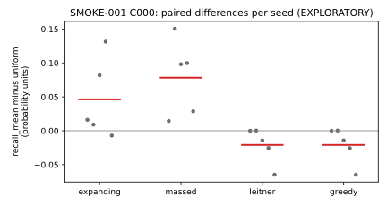

<!-- SPDX-License-Identifier: LicenseRef-MEMORY-NC-Research-1.0 -->
# SMOKE-001 exploratory report (generated)

**EXPLORATORY: not a confirmatory result; protocol not frozen; never to be presented as a finding.**

Generated by `memory_research.report` from `results.json` (SHA-256 `66cb8a9dadb7e4c0412ca20a25835b8865662455d1e3ef1fa856f64f4af4cd88`). Every number below is computed from that file; none is typed by hand. Simulated learners only; no claim about human learning.

## Provenance

- experiment: SMOKE-001
- kind: exploratory
- created (UTC): 2026-11-24T16:05:41Z
- matrix config SHA-256: `cda83ad8da4f35c2f8c19856f53ca2f125400d8074c66e0f1c47ac4bac676e9f`
- protocol: None (frozen: False)
- code revision of the run: `bad36ee04f8598005a7070f99d0ee26eda6b6d33` (dirty: False)
- report generator: memory_research.report 0.1.0 at `13bb3d9fab7a312eb6edbb7678298f038aefe05d` (dirty: False)
- python / numpy: 3.12.1 / 2.5.4
- OS: Darwin 24.3.0 (macOS-15.3.1-arm64-arm-64bit)
- CPU: Apple M1 Pro

## Runs

| runs | ok | excluded | failed |
|---|---|---|---|
| 25 | 25 | 0 | 0 |

## Runtime

| quantity | value |
|---|---|
| mean runtime per run (s) | 0.0011 |
| median runtime per run (s) | 0.0007 |
| max runtime per run (s) | 0.0108 |
| wall clock, whole matrix (s) | 0.0356 |
| process peak RSS (MiB) | 38.0781 |
| mean runtime per run, uniform (s) | 0.0027 |
| mean runtime per run, expanding (s) | 0.0003 |
| mean runtime per run, massed (s) | 0.0002 |
| mean runtime per run, leitner (s) | 0.0009 |
| mean runtime per run, greedy (s) | 0.0012 |

## Cells

| cell | factors | config SHA-256 (first 12) |
|---|---|---|
| C000 | {} | 023ac9ac1822 |

## Primary metric `recall_mean` per arm

| cell | arm | n | mean | SD | median | min | max |
|---|---|---|---|---|---|---|---|
| C000 | uniform | 5 | 0.0213 | 0.0275 | 0.0143 | 0.0000 | 0.0666 |
| C000 | expanding | 5 | 0.0676 | 0.0612 | 0.0596 | 0.0091 | 0.1572 |
| C000 | massed | 5 | 0.0996 | 0.0517 | 0.1124 | 0.0144 | 0.1505 |
| C000 | leitner | 5 | 0.0005 | 0.0008 | 0.0002 | 0.0000 | 0.0018 |
| C000 | greedy | 5 | 0.0005 | 0.0008 | 0.0001 | 0.0000 | 0.0018 |

## Paired differences versus `uniform`

Mean difference over seeds, SD of the paired differences (`s`), 95% percentile bootstrap interval (10,000 resamples, seed 20261124), paired t interval, Holm-adjusted p within the cell, standardized effect `d_z`, and the projected 95% half-width with 50 seeds (`t(0.975, 49) s / sqrt(50)`). The protocol (section 6) treats 50 seeds as adequate when `s < 0.07`.

| cell | arm | pairs | mean diff | s | d_z | p (Holm) | half-width, 50 seeds |
|---|---|---|---|---|---|---|---|
| C000 | expanding | 5 | 0.0463 | 0.0585 | 0.7921 | 0.4536 | 0.0166 |
| C000 | massed | 5 | 0.0783 | 0.0561 | 1.3943 | 0.1424 | 0.0160 |
| C000 | leitner | 5 | -0.0208 | 0.0268 | -0.7765 | 0.4536 | 0.0076 |
| C000 | greedy | 5 | -0.0209 | 0.0268 | -0.7776 | 0.4536 | 0.0076 |

| cell | arm | bootstrap 95% CI | paired t 95% CI | section 4 rule |
|---|---|---|---|---|
| C000 | expanding | [0.0040, 0.0939] | [-0.0263, 0.1189] | above zero |
| C000 | massed | [0.0343, 0.1197] | [0.0086, 0.1480] | above zero |
| C000 | leitner | [-0.0440, -0.0027] | [-0.0542, 0.0125] | below zero |
| C000 | greedy | [-0.0440, -0.0027] | [-0.0542, 0.0125] | below zero |

The `rule` column applies the protocol's section 4 decision rule mechanically. In an exploratory run it is a planning diagnostic only and is not a test of any hypothesis.

## Degenerate-case flags

- C000 uniform: near floor (mean recall 0.0213 < 0.10)
- C000 expanding: near floor (mean recall 0.0676 < 0.10)
- C000 massed: near floor (mean recall 0.0996 < 0.10)
- C000 leitner: floor (every seed has mean recall < 0.05)
- C000 greedy: floor (every seed has mean recall < 0.05)
- C000 leitner: items never reviewed in 5/5 runs (mean 6.8 of 10 items)
- C000 greedy: items never reviewed in 5/5 runs (mean 5.6 of 10 items)

## Figures

*Figure 1.* Paired difference in recall_mean (arm minus uniform) for each seed, cell C000; dots are seeds (n = 5 baseline runs), red bars are means. Exploratory; not a finding.

## Tables

`summary.csv` (per cell and arm) and `contrasts.csv` (paired contrasts) are written next to this report.
