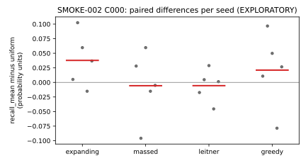

<!-- SPDX-License-Identifier: LicenseRef-MEMORY-NC-Research-1.0 -->
# SMOKE-002 exploratory report (generated)

**EXPLORATORY: not a confirmatory result; protocol not frozen; never to be presented as a finding.**

Generated by `memory_research.report` from `results.json` (SHA-256 `c444227a801339355784a11a0129415a55864706b8cf0086b416212bc3c0944a`). Every number below is computed from that file; none is typed by hand. Simulated learners only; no claim about human learning.

## Provenance

- experiment: SMOKE-002
- kind: exploratory
- created (UTC): 2026-11-24T23:34:50Z
- matrix config SHA-256: `96ffb49f226ae3f24f0081d5257f1f7bc692a9a06a97533c51c6859e3d3c30d2`
- protocol: None (frozen: False)
- code revision of the run: `6bde8efc2560ed999d532c6f4552fec8b30cdc97` (dirty: False)
- report generator: memory_research.report 0.2.0 at `6bde8efc2560ed999d532c6f4552fec8b30cdc97` (dirty: False)
- python / numpy: 3.12.1 / 2.5.4
- OS: Darwin 24.3.0 (macOS-15.3.1-arm64-arm-64bit)
- CPU: Apple M1 Pro

## Runs

| runs | ok | excluded | failed |
|---|---|---|---|
| 25 | 25 | 0 | 0 |

## Runtime

| quantity | value |
|---|---|
| mean runtime per run (s) | 0.0012 |
| median runtime per run (s) | 0.0007 |
| max runtime per run (s) | 0.0098 |
| wall clock, whole matrix (s) | 0.0369 |
| process peak RSS (MiB) | 38.4688 |
| mean runtime per run, uniform (s) | 0.0015 |
| mean runtime per run, expanding (s) | 0.0003 |
| mean runtime per run, massed (s) | 0.0002 |
| mean runtime per run, leitner (s) | 0.0027 |
| mean runtime per run, greedy (s) | 0.0013 |

## Cells

| cell | factors | config SHA-256 (first 12) |
|---|---|---|
| C000 | {} | dca6240f6edd |

## Primary metric `recall_mean` per arm

| cell | arm | n | mean | SD | median | min | max |
|---|---|---|---|---|---|---|---|
| C000 | uniform | 5 | 0.5579 | 0.0672 | 0.5548 | 0.4790 | 0.6293 |
| C000 | expanding | 5 | 0.5957 | 0.0754 | 0.5814 | 0.5107 | 0.6806 |
| C000 | massed | 5 | 0.5523 | 0.1126 | 0.5397 | 0.3831 | 0.6806 |
| C000 | leitner | 5 | 0.5523 | 0.0811 | 0.5094 | 0.4836 | 0.6498 |
| C000 | greedy | 5 | 0.5790 | 0.0849 | 0.5757 | 0.4763 | 0.6708 |

## Paired differences versus `uniform`

Mean difference over seeds, SD of the paired differences (`s`), 95% percentile bootstrap interval (10,000 resamples, seed 20261124), paired t interval, Holm-adjusted p within the cell, standardized effect `d_z`, and the projected 95% half-width with 50 seeds (`t(0.975, 49) s / sqrt(50)`). The protocol (section 6) treats 50 seeds as adequate when `s < 0.07`.

| cell | arm | pairs | mean diff | s | d_z | p (Holm) | half-width, 50 seeds |
|---|---|---|---|---|---|---|---|
| C000 | expanding | 5 | 0.0378 | 0.0462 | 0.8178 | 0.5657 | 0.0131 |
| C000 | massed | 5 | -0.0057 | 0.0584 | -0.0975 | 1.0000 | 0.0166 |
| C000 | leitner | 5 | -0.0056 | 0.0277 | -0.2027 | 1.0000 | 0.0079 |
| C000 | greedy | 5 | 0.0211 | 0.0645 | 0.3270 | 1.0000 | 0.0183 |

| cell | arm | bootstrap 95% CI | paired t 95% CI | section 4 rule |
|---|---|---|---|---|
| C000 | expanding | [0.0033, 0.0744] | [-0.0196, 0.0951] | above zero |
| C000 | massed | [-0.0529, 0.0384] | [-0.0781, 0.0668] | inconclusive |
| C000 | leitner | [-0.0268, 0.0148] | [-0.0400, 0.0288] | inconclusive |
| C000 | greedy | [-0.0350, 0.0686] | [-0.0590, 0.1011] | inconclusive |

The `rule` column applies the protocol's section 4 decision rule mechanically. In an exploratory run it is a planning diagnostic only and is not a test of any hypothesis.

## Degenerate-case flags

None detected by the automatic checks.

## Figures

*Figure 1.* Paired difference in recall_mean (arm minus uniform) for each seed, cell C000; dots are seeds (n = 5 baseline runs), red bars are means. Exploratory; not a finding.

## Tables

`summary.csv` (per cell and arm) and `contrasts.csv` (paired contrasts) are written next to this report.
